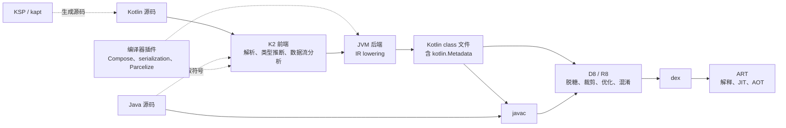

# 01-1 Kotlin 语言与编译模型

Kotlin 的大部分保证在编译期给出：类型检查、空安全、穷尽性、可见性和智能转换。编译完成后，这些语义以 JVM 字节码的形式交给 Java 调用方、反射、代码生成工具和 R8，再以 dex 的形式在 ART 上执行。字节码表达不了的部分，由编译器插入运行时检查，或写进 `kotlin.Metadata`；剩下的部分在边界处失去保证。

面试中的追问通常沿三层展开：某个写法在语言层面是什么语义；编译器把它变成了什么形态；这个形态在 Java 互操作、反射、R8 和运行时面前会产生什么后果。本篇按这三层解释 Kotlin 在 Android 上的类型、空安全、类与对象、函数与 lambda、泛型、委托、集合与异常，并说明每项保证的成立条件和失效场景。

本篇以 Kotlin 2.4（K2 编译器，JVM 目标）为基准。ART 的类加载、执行方式与 GC 在 01-2 展开；线程模型、挂起与 Flow 在 01-3 展开；Gradle、AGP、R8 与打包签名的完整产物链在 07 展开；Compose 编译器对函数的改写在 03-2 展开。文中描述的 Kotlin 编译产物、D8 产物和小样例的运行结果，除注明来源者外，都在本机用最小样例核对过；R8 的优化效果和设备上的行为没有验证。版本与验证细节集中在文末「版本与依据」。

## 1. 编译模型：从源码到 dex

### 1.1 编译链路

Kotlin 编译器分为前端和后端。K2 前端（FIR）负责解析、名称解析、类型推断和数据流分析，类型错误、可空性错误、穷尽性缺失和智能转换失败都在这里报告。前端结果转换为 IR 之后，JVM 后端执行一系列 lowering：展开内联函数，决定 lambda 的生成方式，为默认参数生成桥接方法，把 `suspend` 函数改写为带 `Continuation` 参数的状态机，为 `when` 生成分派表，最后输出 class 文件。

同一模块中 Kotlin 与 Java 混编时，Kotlin 编译器先运行。它读取 Java 源码只为解析符号，并不编译 Java；Kotlin 的 class 文件生成后，javac 再把它们放进 classpath 编译 Java 源码。因此两种语言可以在同一模块内互相引用，但 Java 代码面对的始终是 Kotlin 的字节码形态，而不是 Kotlin 源码中的语义。

Android 上 class 文件并不直接运行。D8 把 class 转换为 dex，同时完成脱糖；release 构建通常改用 R8，把裁剪、优化、混淆和 dex 转换合并为一步。dex 进入 APK 或 AAB，安装后由 ART 以解释、JIT 和 AOT 编译相结合的方式执行。

图中每一环都会消费前一环的产物，也都可能丢失前一环的语义：javac 只认字节码签名，R8 可能删除反射需要的信息，ART 执行的是 D8 改写后的代码。后面各节讨论的失效场景，大多发生在这些交接处。

### 1.2 kotlin.Metadata：字节码之外的 Kotlin 语义

JVM 的类型系统中没有可空类型、扩展接收者、属性、参数默认值、`internal`、`sealed`、`data`、`value` 这些概念。Kotlin 编译器把这些信息用 protobuf 序列化，写进每个 class 文件上的 `@kotlin.Metadata` 注解：`d1` 存放序列化数据，`d2` 存放字符串表，`k` 区分普通类、文件门面类（顶层声明所在的 `XxxKt`）、合成类和多文件门面，`mv` 记录元数据版本。

元数据有三类读者：

- Kotlin 编译器。依赖以 jar 或 aar 形式出现时，Kotlin 调用方依然能看到参数默认值、可空性、扩展函数和 `internal` 限制，依据就是元数据。Java 调用方读不到这些信息，只能看到字节码签名。
- kotlin-reflect 和基于它的库。`KClass` 的属性列表、主构造器和参数默认值都来自元数据，Moshi 的反射适配器 `KotlinJsonAdapterFactory`、Jackson 的 Kotlin 模块都依赖这一点。
- R8。混淆会改写类名和成员名，元数据中的名字也需要同步改写。元数据被移除，或者 R8 不认识当前的元数据版本，在 debug 构建中正常的反射代码就会在 release 构建中失败。

由此产生一条工程约束：R8 必须能读懂所用 Kotlin 版本的元数据。Android 官方兼容表列出了每个 Kotlin 版本所需的最低 R8 版本，Kotlin 2.4 对应 R8 9.1.29。AGP 自带 D8 和 R8，只有单独调用它们或覆盖其版本时才需要另行对照。本机用 build-tools 36.1.0 中的 d8（版本 9.0.3-dev）处理 Kotlin 2.4.0 的产物时，d8 提示元数据版本 2.4.0 超出了它支持的 2.2.0，dex 照常生成。构建成功不代表元数据被正确处理，依赖元数据的反射代码需要在 release 产物上验证。

### 1.3 编译器插件、KSP 与 kapt

三者都在构建期影响产物，能力边界各不相同。

编译器插件运行在编译过程内部，可以扩展前端检查，也可以改写 IR。Compose 编译器给每个可组合函数增加 `Composer` 参数和表示参数变化的 `$changed` 位掩码，并插入分组与跳过逻辑（03-2）；kotlinx.serialization 插件在编译期为类生成序列化器，运行时不需要反射；Parcelize 为类生成 `Parcelable` 实现。插件依赖编译器的内部 API，因此与编译器版本紧密绑定。Kotlin 2.0 起，Compose 编译器并入 Kotlin 仓库，通过 `org.jetbrains.kotlin.plugin.compose` Gradle 插件使用，版本与 Kotlin 一致，过去需要逐一对照 Compose 编译器与 Kotlin 版本的问题随之消失。

KSP 通过符号 API 读取 Kotlin 声明，只能生成新的源文件，不能修改已有代码。Room、Dagger/Hilt、Moshi、Glide 等常用库都已支持 KSP。kapt 的做法是先根据 Kotlin 源码生成 Java 存根，再让 javac 的注解处理器读取这些存根。生成存根的代价很高，Android 官方迁移指南已将 kapt 标为维护模式，建议迁移到 KSP。迁移有两个细节：模块中只要还剩一个 kapt 处理器，就仍然要生成存根，收益要等 kapt 全部移除后才能完全体现；Data Binding 没有 KSP 支持计划，使用它的模块离不开 kapt。迁移后也可能出现新的编译错误，因为 KSP 读到的 Kotlin 类型信息（例如可空性）比存根更准确。

这条边界可以回答一个常见追问：Compose 为什么只能做成编译器插件？因为它需要改写已有函数的签名和函数体，而 KSP 只能新增文件。

### 1.4 D8 脱糖与 lambda 的实例身份

D8 生成 dex 时，会把 Java 8 及更高版本的语言特性改写成 ART 能执行的形式。常见的形态包括：

- `invokedynamic` 形式的 lambda 被改写为合成类 `$$ExternalSyntheticLambdaN`，捕获的值成为它的实例字段。
- minSdk 低于 24 时，接口的默认方法和静态方法被移到 D8 生成的 `$-CC` 辅助类中。
- `invokedynamic` 形式的字符串拼接（`makeConcatWithConstants`）被改写为 `StringBuilder` 调用链，min-api 35 下同样如此。
- 部分较新的 Java 库方法被替换为 `$$ExternalSyntheticBackportN` 中的等价实现。

`java.time` 这类 Java 库 API 的脱糖需要另外开启 core library desugaring，属于 07 的内容。

Kotlin 2.0 改变了 lambda 的编译策略，Android 上 lambda 的实例身份因此与 JVM 不同。Kotlin 1.x 默认把每个 lambda 编译成继承 `kotlin.jvm.internal.Lambda` 的匿名类；2.0 起默认通过 `invokedynamic` 调用 `LambdaMetafactory`，在运行时生成实现类。新方式生成的 lambda 不可序列化，也不支持 `reflect()`；需要旧行为时，可以使用编译选项 `-Xlambdas=class`，或在单个 lambda 上标注 `@JvmSerializableLambda`。对一个不捕获任何变量的 lambda 重复求值，本机观察到三种结果：

| 编译方式 | 产物形态 | 重复求值得到的实例 |
| --- | --- | --- |
| `-Xlambdas=class`（1.x 的默认行为） | 匿名类，带静态 `INSTANCE` 字段 | 同一实例 |
| 2.x 默认，在 JVM 上运行 | `LambdaMetafactory` 在运行时生成的类 | 同一实例 |
| 2.x 默认，经 D8 转换为 dex（min-api 24，debug 与 release 模式） | `$$ExternalSyntheticLambda0`，没有静态字段 | 每次 `new-instance` 一个新对象 |

R8 能否把它优化回单例，本文没有验证。可以确定的结论是：Android 上的代码不能依赖 lambda 的实例身份。写在 `onDraw`、触摸事件或每帧回调里的 lambda 会产生持续的分配，必要时可以提到字段中复用。捕获变量的 lambda 在任何平台上都是每次求值产生新实例，所以 Compose 编译器在强跳过模式下会自动记住可组合函数中的 lambda，否则接收 lambda 参数的可组合函数无法通过参数比较判断为"未变化"（03-2）。

## 2. 类型系统：编译期保证与运行时表示

### 2.1 类型层级与基本类型

`Any` 对应 `java.lang.Object`，但只暴露 `equals`、`hashCode` 和 `toString`，`wait`、`notify` 必须先转换为 `java.lang.Object` 才能调用。`Unit` 是一个单例对象，返回 `Unit` 的函数编译为 `void` 方法；`Unit` 出现在泛型位置时，例如函数类型 `() -> Unit` 对应的 `Function0<Unit>`，`invoke` 实际返回 `Unit.INSTANCE`，所以 Java 代码实现 Kotlin 函数类型时必须显式返回它。`Nothing` 没有任何实例，是所有类型的子类型。`throw`、`error()`、`TODO()` 的类型都是 `Nothing`，编译器据此知道其后的代码不可达；`return` 也是 `Nothing` 类型的表达式，所以能写在 elvis 运算符的右侧。标准库的 `EmptyList` 实现的是 `List<Nothing>`，借助 `List` 的协变，可以充当任意元素类型的空列表。

数值类型在非空、非泛型的位置编译为 JVM 原始类型，`Int` 对应 `int`；一旦成为可空类型、泛型实参或 `Any`，就以 `java.lang.Integer` 等包装对象存在。装箱有两个后果。第一是分配成本，`List<Int>`、`(Int) -> Int` 这样的泛型路径会反复装箱。第二是身份比较不可靠：`==` 比较 `equals`，`===` 比较引用，而两个包装对象的引用是否相同取决于 `Integer.valueOf` 的缓存，默认只缓存 -128 到 127，所以两个装箱的 100 引用相同，两个装箱的 1000 引用不同。此外，Kotlin 不做隐式的数值拓宽，`Int` 不能直接赋给 `Long`，不同数值类型之间也不能直接用 `==` 比较。

浮点数的相等性随静态类型变化。静态类型为 `Double` 时，比较遵循 IEEE 754：`0.0 == -0.0` 为真，`NaN == NaN` 为假。同样的值以 `Any` 或泛型参数的形式比较时，改用 `equals` 语义，结果正好相反。行情数据如果用 `NaN` 表示缺失的价格，直接比较与放进集合、作为 `Map` 的键、参与列表差异计算时，会得到不同的结论。

无符号类型 `UInt`、`ULong` 是基于有符号原始类型的 value class，Java 看到的是有符号数和改名后的方法（3.7）。

### 2.2 空安全：编译期检查与运行时断言

编译期，`T` 与 `T?` 是两个不同的类型。非空位置不接受可空值，`?.`、`?:`、`!!` 和智能转换在两者之间转换。这套检查只覆盖 Kotlin 编译器看得到的代码，为了让 null 在进入 Kotlin 的地方尽早失败，编译器还会插入运行时检查。检查方法实现在标准库的 `kotlin.jvm.internal.Intrinsics` 中：

| 位置 | 插入的检查 | 失败时抛出 |
| --- | --- | --- |
| public、protected、internal 函数的非空引用参数 | `checkNotNullParameter` | `NullPointerException`，信息为 "Parameter specified as non-null is null: method …, parameter …" |
| 平台类型的表达式赋给显式声明的非空类型 | `checkNotNullExpressionValue` | `NullPointerException`，信息为 "getXxx(...) must not be null" |
| `!!` | `checkNotNull` | `NullPointerException` |
| 读取尚未初始化的 `lateinit` 属性 | `throwUninitializedPropertyAccessException` | `UninitializedPropertyAccessException` |

private 函数不插入参数检查，因为它的调用方只可能是同一文件或同一类中、已经过编译期检查的 Kotlin 代码。这些检查让 null 在入口处立即失败，而不是在远处变成难以定位的崩溃。编译器选项 `-Xno-param-assertions`、`-Xno-call-assertions` 可以关闭它们，也有项目在 R8 规则中把 `Intrinsics` 的检查方法声明为无副作用，以此删除检查、减小体积。代价是 null 会继续传播，崩溃点离 null 的来源越来越远。

平台类型。没有可空性注解的 Java 声明在 Kotlin 中呈现为平台类型，IDE 中记作 `String!`。编译器允许把它当作可空或非空使用，不报编译错误，失败推迟到运行时，位置取决于写法：

- 赋给显式声明的非空变量：在赋值处立即抛出 NPE，信息为 "getXxx(...) must not be null"。
- 保持推断出的平台类型并直接调用其方法：在解引用处抛出普通的 JVM NPE。
- 传给 Kotlin 函数的非空参数：在被调函数入口的参数检查处失败。

稳妥的做法是在 Java 边界处立即写明可空性，或者为 Java 一侧补充注解。

可空性注解。带注解的 Java 声明不再是平台类型。Kotlin 识别多种注解，各自的报告级别由编译器源码中的配置决定：

- `androidx.annotation`、`android.annotation`、`android.support.annotation` 和 JetBrains 的注解按严格级别处理，不匹配就是编译错误。
- `androidx.annotation.RecentlyNullable` 与 `RecentlyNonNull` 只产生警告。Android SDK 用它们标注新补充了可空性的 API，开发者升级 compileSdk 时不会立即编译失败。本机 API 36 的 `android.jar` 中，`Activity` 同时引用了 `android.annotation.NonNull`、`android.annotation.Nullable` 和 `androidx.annotation.RecentlyNonNull`。
- JSpecify 自 Kotlin 2.1 起默认严格；JSR-305 默认只报警告，但其中内置的 `@Nonnull`、`@Nullable`、`@CheckForNull` 总是影响类型。

由此推出两个工程后果：升级 compileSdk，或者某个 Java 库补充了注解，原本能编译的 Kotlin 代码可能报错；`Recently*` 产生的警告应当按未来的错误处理。

重写 Java 方法。重写参数为平台类型的 Java 方法时，Kotlin 允许开发者自行决定参数是否可空。框架回调如果没有注解，开发者又把参数声明为非空，那么系统一旦传入 null，崩溃就发生在重写方法入口的参数检查处。这时堆栈顶部是应用自己的 Kotlin 方法，信息为 "Parameter specified as non-null is null"，看起来像应用的 bug，根源却是对框架契约的错误假设。

Kotlin 代码仍然出现 NPE 的路径可以归为几类：

1. 平台类型与框架回调，见上文。
2. `!!` 和 `lateinit` 压制了编译器，而它们断言的前提并不成立，例如 Fragment 的视图已经销毁后，仍然访问 `lateinit` 的视图绑定对象。
3. 初始化顺序：父类构造期间调用了子类重写的方法，子类的属性此时尚未初始化（3.1）。
4. 绕过构造器创建对象。Gson 在类没有无参构造器时，会通过 `UnsafeAllocator` 绕过构造器直接分配对象（Gson 源码 `ConstructorConstructor`），Kotlin 构造器中的默认值、非空检查和 `init` 校验都不会执行，JSON 中缺失的非空字段保持为 null。只有主构造器的参数全部带默认值时，Kotlin 才会额外生成一个无参构造器，此时 Gson 会使用它，默认值得以保留；但 JSON 中显式写出的 null 仍然会被反射写进非空字段。kotlinx.serialization 在编译期生成序列化器，Moshi 的代码生成方案通过 Kotlin 构造器创建对象，两者都能遵守默认值和可空性。
5. 泛型擦除与未检查转换，让错误类型的值或 null 进入集合，直到读取时才失败（5.2）。
6. 并发：一个线程检查了可空属性，另一个线程随后把它改成了 null。K2 拒绝对可变属性做智能转换，正是为了防止这种情况（2.3）。
7. JNI 返回 null 等跨语言边界（06-2）。

### 2.3 智能转换的成立条件

智能转换要求编译器能证明：从检查到使用之间，值不会改变。满足条件的有三种：局部 `val`；final、没有自定义 getter、并且在同一模块中声明的 `val` 属性；在检查和使用之间没有被修改、也没有被可能修改它的 lambda 捕获的局部 `var`。

K2 拒绝智能转换时会说明原因，常见的有四种（括号内是编译器信息的要点）：

- 可变属性（"could be mutated concurrently"）：其他线程可能在检查之后修改它。
- 属性是 open 的或带自定义 getter（"has an open or custom getter"）：每次读取可能得到不同的值。
- 局部变量被捕获它的闭包修改（"mutated in a capturing closure"）：lambda 可能在任意时刻执行。
- 在其他模块中声明的公开属性（"public API property declared in different module"）：那个模块以后可以把它改为自定义 getter 或 `var`，本模块不重新编译就无从察觉，所以编译器不能依赖它当前的实现。这条原因容易被忽略，它本质上是二进制兼容性约束。

常见的处理方式是先把值读入局部 `val`，或者使用 `?.let`。这样做改变了语义：后续代码基于一个快照工作，不再观察最新的值。在 UI 渲染中这往往正是需要的，例如同一次渲染中只读取一次 `StateFlow.value`，可以避免同一帧前后读到不同的状态。

K2（Kotlin 2.0）扩展了数据流分析：把类型检查的结果存入局部 `val` 后，仍然可以据此智能转换；`||` 连接的类型检查会合并为公共父类型；在内联函数的 lambda 中可以保留智能转换；`try`、`catch`、`finally` 的数据流更加精确。Kotlin 2.3 稳定了基于数据流的 `when` 穷尽性检查，已经被提前 return 排除的分支不再需要写 `else`。

契约（contracts）让编译器把函数调用纳入数据流分析。标准库的 `require`、`check`、`requireNotNull`、`isNullOrEmpty` 声明了"正常返回即说明条件成立"，调用之后可以直接智能转换；`run`、`let` 等声明了 lambda 在原地恰好执行一次，所以可以在 lambda 中初始化外部的 `val`。自定义契约目前仍需 `@OptIn(ExperimentalContracts::class)`。编译器不会验证契约的真假，契约写错会让智能转换失去可靠性。

## 3. 类与对象：声明如何映射到 JVM

### 3.1 默认 final 与初始化顺序

Kotlin 的类和成员默认是 final 的，需要被继承或重写时必须显式标注 `open`。这样可以避免"脆弱基类"问题：子类依赖父类的内部调用关系，父类修改实现后子类悄然失效。代价落在需要在运行时生成子类的工具上，例如测试替身框架必须能处理 final 类，Mockito 5 起默认改用可以修改 final 类字节码的 inline mock maker（09）。

调用 `Derived()` 时，初始化按以下顺序进行：

1. 分配对象，所有字段都是零值，即 null、0 或 false。
2. 执行父类构造器，父类的属性初始化器和 `init` 块按声明顺序执行。
3. 父类构造器返回后，子类的属性初始化器和 `init` 块按声明顺序执行。

如果父类在第 2 步调用了被子类重写的 open 方法，重写方法会在子类属性初始化之前运行，即使属性声明为非空类型，此时也仍然是 null。例如父类的 `init` 调用子类重写的方法，而重写方法向子类的列表属性中添加元素，就会因为列表仍是 null 而抛出 NPE。

Android 框架类经常在构造期间调用可重写的方法。API 36 的源码中，`TextView` 的构造器会调用 `setFilters` 和 `setText(CharSequence, BufferType)`，两者都是可以重写的 public 方法。继承 `EditText` 的 Kotlin 类如果重写了 `setText`，并在其中使用自己的属性，那么第一次调用发生时这些属性还没有初始化，非空类型因此失效。处理方式是在重写方法中先判断初始化状态，或者让重写方法不依赖子类的属性。

在构造期间泄漏 `this` 属于同一类问题，例如在 `init` 中把自己注册为监听器。另一个线程可能在构造完成之前拿到这个引用，并看到尚未初始化的字段。Kotlin 的 `val` 编译为 final 字段，而 Java 内存模型对 final 字段可见性的保证，只在构造期间 `this` 没有逃逸时成立（内存模型在 01-3 展开）。

### 3.2 属性、幕后字段与可见性

Kotlin 的属性由访问器和可选的幕后字段组成，Java 看到的是 `getX()` 和 `setX()`，以 `is` 开头的属性对应 `isX()`。`val` 只表示没有 setter，并不代表不可变：自定义 getter 每次都可能返回不同的值，引用的对象本身也可能是可变的。

几种修饰会改变属性的 JVM 形态：

- `const val` 只能用于基本类型和 `String`，并且位于顶层或 `object`、companion 中。它的值在编译期内联到每个使用处，库修改常量后，已经编译的调用方需要重新编译才能看到新值，这一点与 Java 的 `static final` 常量相同。
- `@JvmField` 直接把字段公开为 public，不生成 getter。
- `lateinit` 只能用于非原始类型的 `var`。它的幕后字段与 setter 的可见性相同，public 属性对应的就是 public 字段，所以 Dagger/Hilt 的字段注入 `@Inject lateinit var` 可以直接写入。`::x.isInitialized` 只能在能访问幕后字段的位置使用；初始化之前读取会抛出带属性名的 `UninitializedPropertyAccessException`。

显式幕后字段在 Kotlin 2.4 稳定。过去 ViewModel 通常要写一对属性：私有的 `_state` 类型为 `MutableStateFlow`，公开的 `state` 类型为 `StateFlow`。现在可以只声明一个公开类型为 `StateFlow` 的属性，再用 `field` 声明它的幕后字段类型为 `MutableStateFlow`；在类的内部访问这个属性时，编译器自动把它智能转换为字段的类型。字节码中是一个类型为 `MutableStateFlow` 的私有 final 字段，getter 通过 `checkcast` 返回 `StateFlow`。这种封装只存在于类型层面：外部拿到的是同一个对象，强制转换回 `MutableStateFlow` 后仍然可以修改它。如果需要在运行时阻止这种转换，可以暴露 `asStateFlow()` 返回的只读包装对象，代价是多一个对象。

可见性的 JVM 映射：

- `private` 顶层声明只在文件内可见，编译为文件门面类的私有静态成员。
- `protected` 只对子类可见。与 Java 不同，同一个包中的代码不能访问。
- `internal` 表示同一模块内可见。模块是一次编译的单元，在 Gradle 中对应一个源码集；测试源码集被视为主源码集的友元，可以访问其中的 `internal` 声明。`internal` 在字节码中是 public 的：类成员的名字会加上模块名后缀（例如模块 `app` 中的 `internalMember$app`），顶层的 `internal` 函数则保持原名。所以 Java 代码可以直接调用 `internal` 声明，它是 Kotlin 编译期的规则，不是运行时的边界。
- `@PublishedApi internal` 允许 public 内联函数引用该声明，这个声明随之成为事实上的公开 ABI（4.3）。

跨类访问 private 成员时，编译器会生成合成访问器，例如外部类访问 companion 中的私有属性时出现的 `access$…$cp`。它们会出现在 debug 构建的堆栈中；release 构建中 R8 可能把这类只做转发的方法内联掉。

### 3.3 嵌套类、内部类与匿名对象

Kotlin 的嵌套类默认不持有外部实例，需要持有时要显式标注 `inner`，内部类带有一个指向外部实例的 `this$0` 字段。匿名对象只在实际使用了外部实例的成员时才持有 `this$0`（不访问外部成员的匿名 `Runnable` 没有这个字段）。lambda 同理，只要引用了外部类的属性或方法，就会捕获 `this`。

这决定了 Android 上常见的内存泄漏引用链。一个延迟执行的 `Runnable` 通过 `Handler.postDelayed` 投递到主线程后，引用链为主线程 `Looper` → `MessageQueue` → `Message` → `Runnable` → `Activity`。即使 Activity 已经销毁，在这条消息执行或被移除之前，它都无法被回收（Looper 见 01-3，GC 根见 01-2）。Kotlin 的嵌套类默认不持有外部引用，降低了意外持有的概率；但 lambda 隐式捕获 `this` 更难察觉，风险转移到了 lambda 上。

### 3.4 object 与 companion object

`object` 声明编译为一个带私有构造器和静态 `INSTANCE` 字段的类，实例在类的初始化方法 `<clinit>` 中创建。JVM 保证类初始化只执行一次，并且是线程安全的：多个线程同时首次访问时，只有一个线程执行初始化，其余线程等待。初始化发生在首次主动使用时，所以它也是惰性的。

初始化失败的后果常被忽略。`<clinit>` 抛出异常时，首次访问得到 `ExceptionInInitializerError`，这个类随即被标记为错误状态，此后同一进程中的每次访问都得到 `NoClassDefFoundError`，单例在进程剩余的生命周期中都不可用。一个在初始化时读取配置文件或依赖全局状态的 `object`，可能因为一次偶发的失败而在整个进程内失效。初始化逻辑应当保持简单，可能失败的工作放到显式的、可以重试的初始化步骤中。

companion object 编译为嵌套类 `Outer$Companion`，外部类上有一个静态字段 `Companion` 指向它的实例。companion 中属性的幕后字段作为静态字段放在外部类上；`const` 成员编译为外部类的 `public static final` 字段；`@JvmStatic` 在外部类上生成一个委托给 companion 的静态方法。因为状态存放在外部类上，companion 随外部类一起初始化。

`object` 和 companion 中的状态属于整个进程。它们持有 Activity 会造成泄漏，需要 Context 时应当持有 `applicationContext`。更隐蔽的问题发生在进程被回收之后：系统按任务栈恢复 Activity，而 `object` 中的内存状态已经重置，恢复出来的页面去单例中读取会话或缓存时得到的是空值。这是 02-2 要处理的状态存续问题。

### 3.5 data class

编译器只根据主构造器中声明的属性生成 `equals`、`hashCode`、`toString`、`componentN` 和 `copy`，类体中声明的属性不参与比较。几个容易出错的地方：

- `copy` 是浅拷贝，新旧对象共享内部的可变集合。UI 状态中的集合应当使用只读类型，修改时整体替换。
- 数组属性按引用比较，内容相同的两个对象并不相等。需要按内容比较时，改用 `List` 或手动重写 `equals` 和 `hashCode`。
- 含 `var` 属性的 data class 作为 `HashMap` 的键或放进 `HashSet` 之后，修改属性会改变 `hashCode`，条目从此再也找不到。
- 主构造器是 private 而 `copy` 仍是 public 时，`copy` 成为绕过工厂函数校验的创建路径。Kotlin 2.4.0 对这种写法给出警告，并提示从语言版本 2.5 起它将成为错误；`@ConsistentCopyVisibility` 可以提前让 `copy` 与构造器的可见性一致，`@ExposedCopyVisibility` 则保留旧行为。
- 解构按 `componentN` 的位置进行。调整属性的声明顺序后，类型相同的解构会悄悄换成另一个值，编译器不会报错。

Kotlin 官方的库作者兼容性指南建议公开 API 中避免使用 data class：增加属性会改变构造器和 `copy` 的签名，已经编译的调用方会遇到 `NoSuchMethodError`；调整属性顺序则会改变解构的含义。应用内的模块一起编译，通常不受影响，但这对独立发布的 SDK 模块是实际的约束。

`data object`（Kotlin 1.9 稳定）的 `toString` 返回对象名，`equals` 按类型判断，即使反序列化产生了第二个实例，两者也相等。它适合作为 sealed 层级中不携带数据的叶子，例如 `Loading`。data class 与 Compose 稳定性推断的关系在 03-2 展开。

### 3.6 enum、sealed 与 when

enum 的每个常量都是该类的一个实例。`values()` 每次调用都会复制一个新数组，Kotlin 1.9 起推荐使用 `entries`，它返回一个缓存的只读列表。

`when` 的编译形态取决于判断的对象：

- 判断 enum 时，编译器生成一个 `$WhenMappings` 类，用其中的 `$EnumSwitchMapping$0` 数组把常量的 ordinal 映射为分支序号，再执行 `tableswitch`。多出的这一层映射，保证另一个模块重新排列 enum 常量之后，已经编译的分支仍然正确。
- 判断 sealed 类型时，生成一串 `instanceof` 检查。
- 判断字符串时，先比较 `hashCode`，再执行 `lookupswitch` 和 `equals`。
- 作为表达式且没有写 `else` 的穷尽 `when`，末尾会插入抛出 `NoWhenBranchMatchedException` 的代码。正常情况下这段代码不可达；依赖模块新增了 enum 常量或 sealed 子类、而调用方没有重新编译时，它就会被执行。

sealed class 和 sealed interface 的直接子类必须位于同一模块、同一个包中，编译器因此知道全部子类型，可以检查 `when` 是否穷尽。sealed class 编译为抽象类，带一个私有构造器，以及一个带 `DefaultConstructorMarker` 参数、供子类调用的合成构造器。

两者的选择取决于数据的形态：enum 表示一组固定的值，各常量的结构相同；sealed 表示一组固定的类型，每种类型可以携带不同的数据，例如 `Loading`、`Content(data)`、`Failure(error)`。sealed interface 允许一个类同时属于多个层级，enum 也可以实现 sealed interface。对 UI 状态做 `when` 时不写 `else` 是一个有意的选择：新增状态后，所有没有处理它的位置都会编译失败；写了 `else`，新状态就会被默默归入默认分支。Kotlin 2.2 稳定的守卫条件允许在 `is` 分支上附加额外条件；带守卫的分支不算覆盖了该类型，穷尽性检查仍然要求其余情况有对应的分支。

### 3.7 value class

`@JvmInline value class` 只包含一个属性，编译器尽可能直接用底层类型表示它。以包装 `Long` 的 `UserId` 和包装 `String` 的 `Symbol` 为例：

| 使用位置 | JVM 签名中的形态 |
| --- | --- |
| 非空参数 `UserId` | `long`，函数名带哈希后缀，例如 `loadUser-7kdkdd4` |
| 可空参数 `UserId?` | 装箱为 `UserId` 对象，函数名同样带后缀 |
| 可空参数 `Symbol?` | 可空的 `String`，不装箱 |
| `List<UserId>` | 元素是装箱的 `UserId` |
| `Any` 参数 | 装箱为 `UserId` 对象 |

改写函数名有两个作用：区分 `f(id: UserId)` 和 `f(raw: Long)` 这类擦除后签名相同的重载，以及防止 Java 绕过类型直接传入任意的 `long`。Java 要调用这些函数，需要用 `@JvmName` 指定一个固定的名字；Kotlin 2.2 起还可以用实验性的 `@JvmExposeBoxed` 暴露装箱版本。底层是原始类型时，可空位置会装箱；泛型、接口和 `Any` 位置无论底层类型如何都会装箱，每次装箱都是一次分配。value class 禁止使用 `===`，相等性按底层值判断。`typealias` 与它不同：类型别名在编译后不存在，把 `String` 起名为 `SymbolId` 并不能阻止它与普通字符串混用。

Compose 大量使用 value class 承载布局和绘制中的高频数值：`Dp` 包装 `Float`，`Color` 包装 `ULong`，`Offset` 把两个 `Float` 打包进一个 `Long`。以非空的具体类型传递时，它们不产生对象分配；放进 `List<Offset>`、声明为 `Offset?` 或作为泛型参数使用时会装箱。Compose 用 `Offset.Unspecified`、`Dp.Unspecified` 这类哨兵值表示"未指定"，效果上避开了可空类型带来的装箱。

业务建模中，`SymbolId`、`OrderId` 这类 value class 可以在编译期阻止不同 ID 的混用，大多数路径上没有额外成本。引入之前需要确认序列化、数据库映射、反射和测试替身框架对 value class 的支持。

### 3.8 接口默认方法、类委托与 SAM 转换

Kotlin 2.2 起，接口中带实现的方法默认编译为 JVM 默认方法，同时保留一个 `DefaultImpls` 静态桥接类，用来兼容按旧方式编译的代码。这由编译选项 `-jvm-default` 控制：默认值 `enable` 同时生成两者，`no-compatibility` 不再生成桥接类，`disable` 恢复 2.2 之前只生成桥接类的行为。minSdk 低于 24 时，D8 还会把默认方法移到 `$-CC` 辅助类中（1.4）。

类委托用 `by` 把接口的实现委托给一个对象，编译器为接口的每个成员生成转发方法，转发目标是构造时传入的那个对象。重写其中一个方法，只改变经过包装对象的调用，不影响委托对象内部的自调用。例如包装类重写 `add` 来计数，再调用 `addAll` 添加两个元素，计数仍然是 1，因为委托对象的 `addAll` 直接调用的是它自己的 `add`。继承的情况正好相反：继承 `HashSet` 并重写 `add`，父类的 `addAll` 可能回调被重写的 `add`，导致重复计数。委托避免了对父类内部自调用的依赖，代价是包装类无法拦截委托对象的内部路径。

SAM 转换与监听器的身份。Kotlin 的 `fun interface` 和 Java 的单抽象方法接口都可以用 lambda 实现，每次转换都会得到一个新对象；1.4 已经说明，在 Android 上即使不捕获变量也是如此。所以，用 lambda 字面量调用 `removeOnGlobalLayoutListener` 这类注销方法时，传进去的是一个从未注册过的新对象，原来的监听器不会被移除，常见后果是重复回调和内存泄漏。需要注销的监听器必须保存引用。

## 4. 函数、lambda 与内联

### 4.1 顶层函数、扩展函数与默认参数

顶层函数编译为文件门面类 `XxxKt` 的静态方法，可以用 `@file:JvmName` 改名。扩展函数编译为静态方法，接收者作为第一个参数传入。因此扩展函数按接收者的静态类型解析，而不是运行时类型：变量声明为 `Shape`，即使运行时是 `Circle`，调用的也是 `Shape` 的扩展。成员函数与扩展函数签名相同时，总是成员优先。扩展函数无法访问接收者的私有成员。Dart 的扩展方法同样按静态类型解析，这一点两者一致。

默认参数编译为一个合成的静态方法 `name$default`，它在原有参数之外增加一个 `int` 位掩码和一个占位参数。调用方省略某些参数时，计算出对应的掩码并调用 `$default`，后者按掩码求出默认值，再调用原方法。构造器的默认参数对应一个带 `DefaultConstructorMarker` 参数的合成构造器。默认值表达式在被调方求值，可以引用排在前面的参数。

默认参数与二进制兼容。给公开函数新增一个带默认值的参数，源码层面兼容，二进制层面不兼容：JVM 签名变了，按旧签名编译的调用方在运行时遇到 `NoSuchMethodError`。在应用中，这种情况出现在单独升级一个以二进制形式发布的 SDK、而依赖它的另一个二进制模块没有重新编译时。保持兼容有几种方式：手动保留旧签名的重载，并标记为隐藏的弃用声明；使用 Kotlin 2.4 实验性的 `@IntroducedAt`，按版本自动生成隐藏重载。`@JvmOverloads` 只解决 Java 调用方的问题，Kotlin 官方指南明确指出它不能为 Kotlin 调用方保持二进制兼容：省略了参数的 Kotlin 调用方调用的是 `$default`，而它的签名同样变了。

`@JvmOverloads` 与自定义 View。`@JvmOverloads` 从末尾逐个去掉默认参数来生成重载，所有重载都调用参数最全的那个构造器。用在自定义 View 的构造器上时，`(Context, AttributeSet)` 这个版本以 `defStyleAttr = 0` 调用父类的三参数构造器，跳过了父类自己的两参数构造器，而框架控件的两参数构造器恰好负责传入主题中的默认样式属性。API 36 的源码中：

- `Button(Context, AttributeSet)` 传入 `getButtonDefaultStyleAttr(context)` 的结果，通常是 `com.android.internal.R.attr.buttonStyle`；在 Wear 的 Material3 环境下改为 0，并配合默认样式资源 `Widget_Material3_Button`。
- `TextView(Context, AttributeSet)` 传入 `textViewStyle`。
- `EditText(Context, AttributeSet)` 传入 `editTextStyle`。

所以，用 `@JvmOverloads` 继承 `Button` 之后，从 XML 创建的控件会失去主题赋予的按钮样式，背景、最小高度和文字外观都会改变。正确的做法是写出与父类一一对应的次构造器并逐个委托，或者显式传入正确的默认样式属性。

命名参数只对 Kotlin 调用方可用，参数名记录在元数据中。修改参数名不影响二进制兼容，但会破坏使用了命名参数的源码。

### 4.2 函数类型与 lambda 的编译形态

函数类型 `(A) -> R` 在运行时是 `kotlin.jvm.functions.Function1<A, R>`。因为 `invoke` 是泛型方法，原始类型的参数和返回值都要装箱，`(Int) -> Int` 的每次调用都可能装箱两次，除非调用被内联。带接收者的函数类型 `A.() -> R` 在运行时同样是 `Function1`，接收者就是第一个参数，所以两种函数类型可以互相赋值。

lambda 的捕获规则：

- 捕获 `val` 时，值被复制进 lambda 对象的字段。
- 捕获 `var` 时，变量被包进堆上的 `kotlin.jvm.internal.Ref.IntRef`、`ObjectRef` 等对象，外部作用域和 lambda 共享同一个 `Ref`。dex 中，计数器 lambda 的合成类持有一个类型为 `Ref$IntRef` 的字段 `f$0`。`Ref` 中的字段是普通字段，没有任何同步，lambda 一旦在其他线程执行，就存在可见性问题和数据竞争（01-3）。
- 引用外部类的成员时，捕获 `this`。lambda 的寿命一旦超过外部对象就会造成泄漏，例如把它注册给单例、在生命周期之外收集 Flow、通过 `Handler` 延迟执行。

### 4.3 inline、noinline、crossinline 与 reified

`inline` 把函数体和作为参数传入的 lambda 体一起复制到调用处。收益是不创建函数对象、不经过 `invoke` 装箱，并且让非局部返回和 `reified` 成为可能。代价有三个：

- 每个调用处都复制一份函数体，dex 体积随之增加，函数体过大还会给单个方法的大小带来压力。
- 函数体成为调用方二进制的一部分。库修改了 public 内联函数的实现，已经编译的调用方仍然执行旧的函数体，直到重新编译。为此，public 内联函数只能引用公开 API，需要引用内部实现时要标注 `@PublishedApi internal`，被标注的声明从此成为事实上的公开 ABI。
- 堆栈中看不到内联函数自己的帧，行号通过 `SourceDebugExtension`（SMAP）映射回源码，调试和阅读崩溃堆栈时需要考虑这一点。

非局部返回。内联 lambda 中的 `return` 直接从外层函数返回；`return@forEach` 只结束当前这一次 lambda 调用，效果相当于进入下一次循环。Kotlin 2.2 起，内联 lambda 中也可以使用非局部的 `break` 和 `continue`。

`noinline` 让某个 lambda 参数保持为对象，以便保存它或传给非内联函数。`crossinline` 用于 lambda 虽然被内联、却在另一个执行上下文中调用的情况，例如被放进一个 `Runnable` 投递出去。等到它真正执行时，外层函数的栈帧可能早已结束，因此编译器禁止其中出现非局部返回。

`reified` 只能用于内联函数。库的字节码中，类型参数的位置留有 `reifiedOperationMarker` 占位，每个调用处内联时把它替换为具体类型，于是 `is T`、`T::class.java`、`typeOf<T>()` 都能使用。`by viewModels<VM>()`、`getSystemService<T>()` 这类辅助函数都依赖它。它的限制是调用处必须知道具体类型；在非 reified 的泛型函数中调用时，类型信息早已擦除，编译器会要求把 `reified` 一路传递上去。

`tailrec` 函数被编译为循环。

### 4.4 作用域函数

`let`、`run`、`with`、`apply`、`also` 都是内联函数，区别只有两点：上下文对象以 `this` 还是 `it` 出现，返回的是 lambda 的结果还是上下文对象本身。一个常见的错误发生在"用 `?.let` 处理非空、再用 `?: run` 处理空值"的组合中：如果 `let` 块最后一个表达式的值为 null，`run` 块也会执行。嵌套的 `apply` 中，`this` 指向最内层的接收者，容易调用到错误对象上的同名方法；`@DslMarker` 可以在 DSL 中限制隐式接收者，但对普通的作用域函数不起作用。

### 4.5 suspend 函数的编译形态

一个参数为 `id`、返回 `User` 的挂起函数，在 JVM 上的签名是在参数末尾多一个 `Continuation`，返回类型变为 `Object`。返回值要么是结果，要么是表示"已挂起"的标记 `COROUTINE_SUSPENDED`。函数体被改写为状态机：跨越挂起点仍然存活的局部变量保存在续体对象的字段中，`label` 字段记录下一次从哪里恢复。

这个形态带来两个直接后果。第一，Java 无法自然地调用挂起函数，需要提供回调或 `Future` 形式的包装。第二，库可以通过反射识别挂起函数：Retrofit 检查接口方法的最后一个参数是否为 `Continuation`，并从它的泛型签名中读出响应类型。调度、取消和异常传播在 01-3 展开。

## 5. 泛型：型变、擦除与签名

### 5.1 声明处型变

Java 在使用处用通配符表达型变，Kotlin 主要在声明处表达：`List<out E>` 是协变的只读接口，`MutableList<E>` 是不变的，`Comparable<in T>` 是逆变的。`out` 修饰的类型参数只能出现在返回值等输出位置，`in` 修饰的只能出现在参数等输入位置，编译器据此保证类型安全。需要临时限制时，可以使用使用处投影，例如 `Array<out T>`。星投影 `MutableList<*>` 表示"某个未知类型的列表"，读出的元素是 `Any?`，不能写入任何值。Kotlin 的数组是不变的，而 Java 的数组是协变的，向协变数组写入错误类型的值会在运行时抛出 `ArrayStoreException`。

Dart 的泛型类默认协变，这在类型上并不严格可靠，由运行时检查兜底；Kotlin 的声明处型变由编译器静态检查。

### 5.2 擦除与延迟失败

JVM 在运行时擦除类型实参。因此 `is List<String>` 无法编译，只能写 `is List<*>`；转换为 `List<String>` 或 `T` 是未检查转换，编译器只给出警告，运行时并不检查元素类型。错误类型的值由此进入集合，这称为堆污染。失败推迟到读取元素时编译器插入的 `checkcast` 处：错误类型的元素可以一直留在列表中，直到被读取时才抛出 `ClassCastException`。

Android 上的典型来源是 Gson：用原始的 `List` 类型反序列化一个列表，得到的元素是 Gson 为 JSON 对象创建的 `Map`（较早的版本是 `LinkedTreeMap`，当前主干代码是 `LinkedHashMap`），而不是期望的数据类。错误在后续访问元素字段时才暴露，离反序列化的位置很远。正确的做法是通过 `TypeToken` 提供完整的泛型类型，或者使用在编译期生成序列化器的方案。`reified` 只能在内联的调用处缓解这个问题。

### 5.3 Signature 属性、反射与 R8

擦除针对的是运行时的值，声明上的泛型信息仍然保存在 class 文件的 `Signature` 属性中，包括父类的类型实参、字段类型、方法的参数类型和返回类型。反射可以通过 `getGenericSuperclass`、`getGenericReturnType` 读到它们。Gson 的 `TypeToken` 正是利用这一点：创建一个 `TypeToken<List<Item>>` 的匿名子类，再从它的泛型父类中读出 `List<Item>`。Retrofit 同样从方法的返回类型，或者 `Continuation` 参数的泛型签名中读取响应类型。

R8 会删除它认为不需要的属性和类。保留泛型信息需要 `-keepattributes Signature`，并保留相关的类。R8 的 FAQ 指出，即使在兼容模式下，类合并、参数删除等优化也可能移除泛型签名；AGP 8.0 起默认启用的 full mode 更进一步：即使写了 `-keepattributes`，`Signature` 等属性也只为被 keep 规则匹配的类和成员保留，`InnerClasses`、`EnclosingMethod` 这类描述两个类之间关系的属性还要求两端都被保留。对 Retrofit 的挂起函数，full mode 下除了接口类本身，还需要保留 `kotlin.coroutines.Continuation`。这类问题表现为只在 release 构建中出现的运行时错误，例如 Gson 报告 `TypeToken` 缺少类型参数，或者 `Class` 无法转换为 `ParameterizedType`。较新版本的 Gson 和 Retrofit 在库中附带了对应的 consumer 规则，具体以所用版本为准。

反射带来的问题不只在签名上。只通过反射创建的类，例如只由 Gson 反序列化得到的数据类，在 R8 看来从未被实例化，R8 可能据此认定这种类型的值始终为 null 并做相应优化，表现为反序列化后的字段总是 null。参与序列化的字段因此也需要 keep 规则保留。

Kotlin 根据型变在 Java 签名中生成通配符：

| Kotlin 声明 | Java 看到的签名 |
| --- | --- |
| 参数 `List<String>` | `List<String>`，`String` 是 final 类，不生成通配符 |
| 参数 `List<Number>` | `List<? extends Number>` |
| 返回值 `List<Number>` | `List<Number>`，返回值不生成通配符 |
| 参数 `MutableList<Number>` | `List<Number>`，不变的类型不生成通配符 |
| 类型参数 `T : Comparable<T>` | `T extends Comparable<? super T>` |
| 参数 `List<@JvmSuppressWildcards Number>` | `List<Number>` |

这张表解释了 Dagger/Hilt 的一个常见错误：多重绑定提供的是 `Set<Plugin>`，Kotlin 注入点在 Java 签名中却成了 `Set<? extends Plugin>`。Dagger 按 Java 签名匹配，于是报告找不到绑定。在注入点标注 `@JvmSuppressWildcards` 就能解决。

### 5.4 泛型与可空性

类型参数 `T` 的默认上界是 `Any?`，所以以 `T` 为参数类型的函数可以接收 null；要排除 null，需要声明上界 `T : Any`。重写带非空注解的 Java 泛型方法时，可以使用确定非空类型 `T & Any`。来自 Java 的泛型同样带着平台类型，例如 `List<String!>!`，集合本身和其中元素的可空性都不确定。

## 6. 委托属性与 lazy

### 6.1 委托的编译形态

委托属性编译为一个隐藏字段 `x$delegate` 和一个访问器，访问器调用委托对象的 `getValue(thisRef, property)`。委托需要用到 `KProperty` 参数时，编译器在类上生成一个静态数组 `$$delegatedProperties` 来保存这些反射对象。字节码中，`observable` 和 `notNull` 委托的访问器会读取这个数组；`lazy` 的访问器直接调用 `Lazy.getValue()`，因为 `Lazy` 的 `getValue` 运算符是一个忽略 `property` 参数的内联扩展，内联之后就不需要读取反射对象了。

### 6.2 lazy 的三种模式

| 模式 | 实现类 | 机制 | 适用条件与风险 |
| --- | --- | --- | --- |
| `SYNCHRONIZED`（默认） | `SynchronizedLazyImpl` | `@Volatile` 字段加双重检查锁，默认以 Lazy 对象自身为锁 | 适合多线程共享；初始化期间持有锁，存在死锁风险 |
| `PUBLICATION` | `SafePublicationLazyImpl` | 不加锁，用 CAS 发布第一个完成的值 | 初始化器可能并发执行多次，必须没有副作用 |
| `NONE` | `UnsafeLazyImpl` | 不做同步 | 只能在单线程中使用，例如只在主线程访问的 UI 对象 |

标准库源码（`LazyJVM.kt`）中还有三个细节：初始化成功后，`initializer` 被置为 null，释放 lambda 捕获的引用；初始化器抛出异常时不缓存任何结果，下一次访问会重新执行初始化；文档提醒不要在外部对返回的 Lazy 对象加锁，否则可能死锁。

死锁的典型形态有两种。一种是两个 `lazy` 互相依赖，分别由两个线程首次访问，各自持有一把锁并等待另一把。另一种是主线程等待某个 `lazy` 的锁，而持锁的后台线程在初始化器中又同步等待主线程完成某项工作，在 Android 上表现为 ANR。另外，一个从未被访问的 `lazy` 会一直持有初始化器捕获的引用。

### 6.3 Android 中的生命周期陷阱

`lateinit` 与 `lazy` 解决的问题不同。`lateinit` 用于稍后由外部赋值的 `var`，例如由依赖注入或生命周期回调赋值，它本身不包含初始化逻辑，也不提供线程安全；`lazy` 用于在首次访问时自行计算的 `val`，默认带同步。

Fragment 实例的寿命比它的视图长。Fragment 进入返回栈时，视图被销毁，实例保留，回到前台时再创建新的视图。如果在 Fragment 中用 `lazy` 缓存视图、绑定对象或依赖视图的适配器，缓存的就是第一次创建的视图，之后的更新都会写到已经脱离窗口的旧视图上，旧的视图层级也无法回收。依赖视图的对象应当绑定到视图的生命周期，例如使用 `viewLifecycleOwner`，或者使用在 `onDestroyView` 中清空的可空绑定字段（02-2）。

`by viewModels()` 返回的也是一个 `Lazy`，首次访问时才去 `ViewModelStore` 获取实例。在 Fragment 尚未附着时访问它，会因为拿不到 `ViewModelStore` 而抛出 `IllegalStateException`，所以不能在构造器或会被立即求值的属性初始化器中访问它。

`Delegates.notNull()` 与 `lateinit` 的区别在于：前者可以用于原始类型，代价是多一个委托对象，并且没有 `isInitialized`；后者是一个带检查的普通字段。Compose 中通过 `by` 委托给 `remember` 的 `mutableStateOf`，使用的是 `State` 上的 `getValue`、`setValue` 运算符扩展，每次经由委托的读取都是一次快照状态读取，会被记录为依赖（03-2）。

## 7. 集合与数组

### 7.1 只读不等于不可变

`List` 与 `MutableList` 的区别只存在于编译期，运行时两者都是 `java.util.List`。运行时的实现类如下：

| 创建方式 | 运行时类 |
| --- | --- |
| `listOf` 传入多个元素 | `java.util.Arrays$ArrayList` |
| `listOf` 传入一个元素 | `java.util.Collections$SingletonList` |
| `emptyList()` | `kotlin.collections.EmptyList` |
| `mutableListOf` | `java.util.ArrayList` |
| `mapOf` 传入一个键值对 | `java.util.Collections$SingletonMap` |
| `mapOf` 传入多个键值对 | `java.util.LinkedHashMap` |
| `setOf` 传入多个元素 | `java.util.LinkedHashSet` |

`mapOf`、`setOf` 保持插入顺序，这是文档承诺的行为，与直接使用 `HashMap` 不同。`listOf` 返回的 `Arrays$ArrayList` 被强制转换为 `MutableList` 之后可以 `set`，但 `add` 会抛出 `UnsupportedOperationException`。

这意味着：

- 把 Kotlin 的只读列表交给 Java 代码，对方可以尝试修改它，结果取决于底层实现。
- 拿到一个 `List` 引用，并不代表它不会变化。持有 `MutableList` 引用的另一方仍然可以修改它，遍历时可能遇到 `ConcurrentModificationException`，跨线程时还存在数据竞争。
- 需要稳定的快照时，用 `toList()` 复制一份。需要真正不可变、并且修改时共享结构的集合，可以使用 `kotlinx.collections.immutable`，Compose 编译器也把这些类型视为稳定（03-2）。

数组方面，`Array<Int>` 对应 `Integer[]`，`IntArray` 对应 `int[]`；`vararg` 参数在函数内部是数组，展开运算符 `*` 会复制一份数组。

### 7.2 Iterable 与 Sequence

`Iterable` 上的 `map`、`filter` 等操作是内联函数，不创建 lambda 对象，但每一步都会立即创建一个完整的中间列表。`Sequence` 上的操作不内联，每个操作创建一个 lambda 对象和一层迭代器包装，元素逐个流过整条操作链，不产生中间列表，还可以在 `first`、`take` 处提前结束。字节码中，前者被展开为循环，每一步创建一个 `ArrayList`；后者为每个操作生成一个 lambda，再调用 `SequencesKt` 中对应的函数。

选择取决于数据规模、操作链长度以及是否需要提前结束。小集合配短操作链时，`Iterable` 通常更直接；大集合、长操作链或只需要前几个结果时，`Sequence` 更合适。两者的实际差异需要在目标设备上测量，不宜套用固定的结论。

## 8. 异常与错误表达

### 8.1 没有受检异常

Kotlin 的异常都不受检查，函数签名中也不声明会抛出什么。Java 编译器只允许捕获被调方声明过的受检异常，所以 Kotlin 函数可能抛出 `IOException` 时，需要标注 `@Throws(IOException::class)`，Java 调用方才能显式捕获它。

动态代理是另一个边界。通过 `java.lang.reflect.Proxy` 实现的接口方法，如果抛出了方法签名中没有声明的受检异常，代理会把它包装成 `UndeclaredThrowableException`。Retrofit 为 Kotlin 挂起函数做了专门处理：在抛出异常之前先强制挂起一次，让异常通过续体传递，从而避开这种包装（Retrofit 源码 `KotlinExtensions.kt` 中的 `suspendAndThrow`）。

### 8.2 runCatching 与 Result

`runCatching` 捕获的是 `Throwable`（标准库源码），范围包括：

- `CancellationException`。在协程中，这会把取消当成一次普通失败来处理，协程在被取消之后继续执行后续逻辑，破坏了结构化取消（01-3）。
- `OutOfMemoryError`、`StackOverflowError` 等 `Error`。

在协程代码中使用它时，需要重新抛出 `CancellationException`，或者只包裹不含挂起调用的代码。

`require`、`check`、`error()` 分别抛出 `IllegalArgumentException`、`IllegalStateException`、`IllegalStateException`，适合表达编程错误和被破坏的不变量。网络不可用、余额不足这类可以预期的业务失败，更适合用 sealed 结果类型表达，让调用方在编译期处理每一种情况。两者的分工是：异常表示调用方通常无法就地处理的意外，类型化的结果表示业务流程中的正常分支。

### 8.3 资源关闭

`use` 在块结束时关闭 `Closeable`。块内和关闭时都抛出异常时，关闭时的异常作为 suppressed 附加到主异常上，不会覆盖它。`Cursor`、各种流和 `ParcelFileDescriptor` 都适用。`try` 是表达式；内联 lambda 中的非局部返回穿过 `finally` 时，`finally` 照常执行。

## 9. Java 互操作速查

| Kotlin 声明 | Java 看到的形态 | 调整方式 |
| --- | --- | --- |
| 属性 `name`、`isActive` | `getName()`/`setName()`、`isActive()`/`setActive()` | `@JvmName`、`@get:JvmName`、`@JvmField` |
| `Quote.kt` 中的顶层函数 | `QuoteKt` 的静态方法 | `@file:JvmName` |
| `object` 的成员 | 通过 `INSTANCE` 调用 | `@JvmStatic` |
| companion 的成员 | 通过 `Companion` 调用 | `@JvmStatic`、`@JvmField`、`const` |
| 带默认值的参数 | 只有完整参数列表的方法 | `@JvmOverloads`，注意自定义 View 的构造器 |
| `internal` 类成员 | public，名字带模块后缀 | 不构成访问控制边界 |
| value class 参数 | 名字带哈希后缀，参数为底层类型 | `@JvmName`；实验性的 `@JvmExposeBoxed` |
| `suspend` 函数 | 多一个 `Continuation` 参数，返回 `Object` | 另外提供回调或 `Future` 包装 |
| 函数类型参数 | `Function1` 等接口，返回 `Unit` 时需返回 `Unit.INSTANCE` | 改用 `fun interface` |
| 可能抛出受检异常的函数 | 签名中没有 `throws` | `@Throws` |
| 带型变的类型参数 | 生成 `? extends`、`? super` | `@JvmSuppressWildcards`、`@JvmWildcard` |
| 可空性 | 签名上带 `org.jetbrains.annotations` 的 `@NotNull`、`@Nullable` | 运行时另有 `Intrinsics` 检查 |
| 主构造器属性上的注解 | 落在构造参数、字段或 getter 上，Java 看不到 Kotlin 的 property 目标 | `@param:`、`@field:`、`@get:`；Kotlin 2.4 稳定的 `@all:` |

最后一行常常是 Room、Gson、Dagger 的注解"写了却不生效"的原因。一个注解可以作用于多个 JVM 元素时，Kotlin 按 use-site 规则选择落点。Kotlin 2.4 稳定的新默认规则是：构造参数可用时作用于构造参数；property 可用时同时作用于 property，不可用时改为作用于字段。旧规则只选第一个可用的目标，可以用编译选项 `-Xannotation-default-target=first-only` 恢复。Java 的反射和注解处理器只能看到字段、方法和参数，看不到 Kotlin 的 property 目标，框架需要在特定元素上读取注解时，应当显式写出 use-site 目标。

## 10. 版本演进与工程约束

Kotlin 的语言版本（2.x.0）大约每半年发布一次，工具版本（2.x.20）位于两次语言版本之间，修复版本为 2.x.yz。截至 2026-11-06，最新版本为 2.4.21（2026-10-08）；2.4.0 于 2026-06 发布，2.5.0 计划在 2026-12 发布。与本篇相关的变化如下：

| 版本 | 与 Android 开发相关的变化 |
| --- | --- |
| 2.0 | K2 成为默认且稳定的编译器，智能转换增强；lambda 默认通过 invokedynamic 生成；Compose 编译器并入 Kotlin 仓库，版本与 Kotlin 一致 |
| 2.1 | JSpecify 可空性注解默认按严格级别报告 |
| 2.2 | 守卫条件、非局部 break/continue、多美元符号字符串插值稳定；接口方法默认编译为 JVM 默认方法；context parameters 预览；`@JvmExposeBoxed` 实验 |
| 2.3 | 嵌套类型别名、基于数据流的穷尽性检查稳定；未使用返回值检查器实验 |
| 2.4 | context parameters（显式上下文实参与可调用引用除外）、显式幕后字段、`@all` 元目标与新的注解默认规则稳定；集合字面量、编译期常量增强、显式上下文实参、`@IntroducedAt` 实验；元数据默认包含注解；Kotlin Gradle 插件要求的最低 AGP 版本升至 8.5.2；不再支持语言版本 1.9 |

context parameters 让函数声明它所需要的上下文，例如日志器、时钟或事务作用域，由调用方所处的上下文隐式提供。它在 JVM 上就是排在最前面的普通参数，所以 Java 调用方需要显式传入。未使用返回值检查器可以发现一类真实的错误：调用 `copy()`、`plus()` 或 Flow 操作符之后忽略了返回的新对象，误以为原对象被修改了。

升级 Kotlin 时需要一并核对的约束：

- Kotlin Gradle 插件支持的 AGP 版本范围。
- AGP 自带的 R8 能否处理新版本的元数据（1.2）。
- KSP 与各个编译器插件的兼容版本。
- 依赖库编译时使用的语言版本与 API 版本。JVM 上，调用方的编译器版本最多可以比库的语言版本低一个版本；运行时标准库的版本不能低于库的 API 版本。

## 11. 与 Dart 同名或相近概念的差异

| 概念 | Dart | Kotlin/JVM | 差异的后果 |
| --- | --- | --- | --- |
| 空安全 | 健全的空安全，非空保证在运行时同样成立 | 编译期检查加边界断言，平台类型、反射和未检查转换都是缺口 | Kotlin 代码需要在 Java、反射与序列化的边界上重新确认可空性 |
| 泛型 | 运行时保留类型实参，`is List<String>` 有效；类默认协变，由运行时检查兜底 | 运行时擦除；声明处型变，静态检查 | Kotlin 需要 `reified`、`TypeToken` 或 `Signature` 属性获取类型信息，并承担 R8 删除签名的风险 |
| 默认开放性 | 类默认可以被继承和实现，Dart 3 用 `final`、`base`、`interface`、`sealed` 修饰符收紧 | 默认 final，需要显式 `open` | Kotlin 的测试替身和代理工具需要额外机制 |
| 延迟初始化 | `late` 可以带初始化器，实现惰性求值；isolate 内单线程，不需要同步 | `lateinit` 只延迟赋值，惰性求值用 `lazy`，默认加锁 | 共享内存的线程使 Kotlin 的惰性初始化必须考虑同步与死锁 |
| sealed | 子类型限定在同一个库中 | 子类型限定在同一模块、同一个包中 | 都支持穷尽检查，限定范围的单位不同 |
| record 与 data class | record 是匿名的结构化类型，按结构比较 | data class 是具名类型，生成 `copy` 和 `componentN` | Kotlin 没有通用元组，`Pair`、`Triple` 之外需要具名类型 |
| 代码复用 | mixin 线性化进父类链，可以带状态 | 接口默认方法（不带状态）加类委托 | Kotlin 的委托不会拦截委托对象内部的自调用 |
| 扩展方法 | 按静态类型解析 | 按静态类型解析 | 机制一致；Dart 中 `dynamic` 类型的接收者不能使用扩展 |
| 常量 | `const` 可以创建规范化的编译期常量对象 | `const val` 只支持基本类型和 `String` | Kotlin 没有常量对象，共享的不可变实例依赖 `object` 或顶层 `val` |
| 并发模型 | isolate 之间不共享内存 | 线程共享内存 | lambda 捕获的 `Ref`、`lazy`、可变属性都要考虑可见性与竞争（01-3） |
| 异步函数 | 调用 `async` 函数会立即开始执行，直到第一个 `await` | 挂起函数本身不启动任何东西，必须在协程中调用 | 任务的启动、作用域和取消由协程构建器决定（01-3） |

## 自检追问

下面的问题按面试中常见的追问方式组织，答案都在括号所示的小节中。读完后可以先尝试口头回答，再回到正文核对。

1. Kotlin 中声明为非空的参数为什么还会收到 null？这时崩溃堆栈的顶部是谁的方法？（2.2）
2. 平台类型的值在三种不同的写法下，分别会在哪里失败？（2.2）
3. 升级 compileSdk 之后，原本能编译的 Kotlin 代码为什么可能报出可空性错误？`RecentlyNonNull` 起什么作用？（2.2）
4. 为什么不能对另一个模块中声明的公开 `val` 属性做智能转换？（2.3）
5. 父类构造器调用了子类重写的方法时，子类的非空属性是什么值？`TextView` 的子类会在哪里遇到这个问题？（3.1）
6. `internal` 能阻止 Java 代码调用吗？它在字节码中是什么样子？（3.2）
7. 一个 `object` 的初始化抛出了异常，之后再访问它会发生什么？（3.4）
8. 为什么官方建议在库的公开 API 中避免使用 data class？（3.5）
9. 对 enum 做 `when` 时为什么会生成 `$WhenMappings`？什么情况下会抛出 `NoWhenBranchMatchedException`？（3.6）
10. value class 在哪些位置会装箱？为什么 Java 调用它的函数需要 `@JvmName`？（3.7）
11. 用 `@JvmOverloads` 继承 `Button` 会出现什么问题？根源在哪里？（4.1）
12. 给一个已发布的公开函数新增带默认值的参数，为什么会导致 `NoSuchMethodError`？`@JvmOverloads` 能解决吗？（4.1）
13. Android 上同一个不捕获变量的 lambda 求值两次，得到的是同一个对象吗？这会给监听器的注销带来什么问题？（1.4、3.8）
14. 捕获了 `var` 的 lambda 在其他线程执行时有什么问题？（4.2）
15. `crossinline` 为什么禁止非局部返回？库修改了 public 内联函数的实现之后，调用方什么时候才能生效？（4.3）
16. Gson 的 `TypeToken` 为什么可能在 R8 full mode 下失效？（5.3）
17. Dagger 多重绑定提供的 `Set<Plugin>`，为什么在 Kotlin 注入点找不到绑定？（5.3）
18. `lazy` 的三种模式分别如何实现？初始化器抛出异常后会怎样？什么情况下会死锁？（6.2）
19. 在 Fragment 中用 `lazy` 缓存视图有什么问题？（6.3）
20. 在协程中使用 `runCatching` 有什么风险？（8.2）

## 版本与依据

- 语言基准为 Kotlin 2.4。截至 2026-11-06，Kotlin 官方发布页显示的最新版本为 2.4.21。
- 本机验证（2026-11-06）：使用 Android Studio 内置的 kotlinc 2.4.0 编译最小样例（JVM 目标 17），用 JBR 25 的 `javap` 查看字节码，并在 JVM 上运行；再用 build-tools 36.1.0 的 d8（版本 9.0.3-dev；min-api 21、24、35；debug 与 release 模式）生成 dex，用 `dexdump` 查看。样例只用于核对本文的结论，没有保留在仓库中。
- 本机源码：Android SDK Sources for API 36 中的 `Button.java`、`TextView.java`、`EditText.java`；API 36 的 `android.jar`；kotlinc 2.4.0 附带的标准库源码 `LazyJVM.kt`、`Result.kt`、`Intrinsics.java`。
- 在线源码（2026-11-06 核对）：Kotlin 编译器的 `JavaNullabilityAnnotationSettings.kt`（master 分支）；Retrofit 的 `KotlinExtensions.kt`、`RequestFactory.java`（trunk 分支）；Gson 的 `ConstructorConstructor.java`、`ObjectTypeAdapter.java`（main 分支）；AndroidX 的 `Fragment.java` 与 Compose 的 `Dp.kt`、`Offset.kt`、`Color.kt`（androidx-main 分支）；kotlinx.coroutines 的 `Share.kt`（master 分支）。
- 在线文档（2026-11-06 核对）：R8 兼容性 FAQ（main 分支），用于 full mode 的属性保留规则和反射类被优化为 null 的问题；AGP 8.0.0 发布说明，用于 full mode 默认启用；Mockito 5.0.0 发布说明，用于默认 mock maker 的变化。
- 验证边界：本机核对停留在字节码、dex 和 JVM 运行结果层面，没有在设备上运行。R8 没有实际运行：属性保留规则和反射类被优化为 null 的说法来自 R8 FAQ，能否把 lambda 优化回单例、是否内联合成访问器都没有结论。文中不包含性能数值，涉及成本的部分只解释机制。

## 参考资料

Kotlin 官方文档：

- [What's new in Kotlin 2.4.0](https://kotlinlang.org/docs/whatsnew24.html)
- [What's new in Kotlin 2.3.0](https://kotlinlang.org/docs/whatsnew23.html)
- [What's new in Kotlin 2.2.0](https://kotlinlang.org/docs/whatsnew22.html)
- [What's new in Kotlin 2.0.0](https://kotlinlang.org/docs/whatsnew20.html)
- [Kotlin releases](https://kotlinlang.org/docs/releases.html)
- [Calling Java from Kotlin](https://kotlinlang.org/docs/java-interop.html)
- [Calling Kotlin from Java](https://kotlinlang.org/docs/java-to-kotlin-interop.html)
- [Inline functions](https://kotlinlang.org/docs/inline-functions.html)
- [Inline value classes](https://kotlinlang.org/docs/inline-classes.html)
- [Delegated properties](https://kotlinlang.org/docs/delegated-properties.html)
- [Generics: in, out, where](https://kotlinlang.org/docs/generics.html)
- [Backward compatibility guidelines for library authors](https://kotlinlang.org/docs/api-guidelines-backward-compatibility.html)
- [kapt compiler plugin](https://kotlinlang.org/docs/kapt.html)

Android 官方文档：

- [Java 8+ language features and APIs](https://developer.android.com/studio/write/java8-support)
- [AGP, D8, and R8 versions required for Kotlin versions](https://developer.android.com/build/kotlin-support)
- [Migrate from kapt to KSP](https://developer.android.com/build/migrate-to-ksp)
- [Android Gradle Plugin 8.0.0 release notes](https://developer.android.com/build/releases/past-releases/agp-8-0-0-release-notes)

R8 与第三方库：

- [R8 FAQ（compatibility-faq.md）](https://r8.googlesource.com/r8/+/refs/heads/main/compatibility-faq.md)
- [Mockito 5.0.0 release notes](https://github.com/mockito/mockito/releases/tag/v5.0.0)

源码：

- [Kotlin 编译器：JavaNullabilityAnnotationSettings.kt](https://github.com/JetBrains/kotlin/blob/master/core/compiler.common.jvm/src/org/jetbrains/kotlin/load/java/JavaNullabilityAnnotationSettings.kt)
- [Retrofit：KotlinExtensions.kt](https://github.com/square/retrofit/blob/trunk/retrofit/src/main/java/retrofit2/KotlinExtensions.kt)
- [Gson：ConstructorConstructor.java](https://github.com/google/gson/blob/main/gson/src/main/java/com/google/gson/internal/ConstructorConstructor.java)
- [Gson：ObjectTypeAdapter.java](https://github.com/google/gson/blob/main/gson/src/main/java/com/google/gson/internal/bind/ObjectTypeAdapter.java)
- Kotlin 标准库源码：随 Kotlin 编译器发布的 `kotlin-stdlib-sources.jar`
- Android 框架源码：Android SDK Sources for API 36
