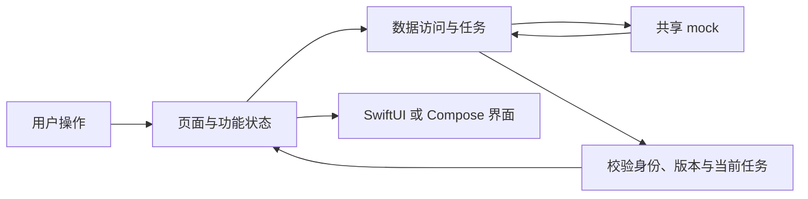

# 双端股票 App 架构方案

本文件维护后续 SwiftUI 与 Compose 股票 App 的共同设计。当前产品、原型和接口方案仍待学习者评估；这些内容是建设建议，尚未在原生端实现。业务行为以[产品草案](product.md)为归属，HTTP、WebSocket 和字段定义见[接口方案](../shared/services/docs/api.md)，避免在此复制完整契约。

## 工程与共享边界

后续由 `swift-app/` 和 `kotlin-app/` 分别承载独立原生 App，`shared/services/` 提供统一业务数据和模拟服务。两个原生客户端接入该服务，不在本机另建业务假数据或撮合账本。

| 共用约定 | 各端独立实现 |
| --- | --- |
| 证券身份、字段和金额语义 | Swift/Kotlin 数据类型与解码 |
| 登录、交易、自选规则 | 平台会话存储、状态和交互反馈 |
| HTTP、WebSocket、版本与错误含义 | 网络调用、任务取消、连接和订阅管理 |
| 用户流程与关键验收行为 | SwiftUI/Compose 页面、导航和生命周期协作 |

不引入跨语言业务运行时或共享 UI 框架。两端可以围绕同一功能先后推进，但不要求目录、类名和框架 API 一一对应。

## 功能职责与数据流

应用围绕身份、自选、行情、交易和账户组织。先保持单应用工程，通过代码职责划分 UI、状态及数据访问；出现实际复用或独立构建需求后再拆模块，不为每个功能预建多层空接口。

页面表达状态并接收操作，功能状态组织请求与反馈，数据访问负责传输和协议解码。金额、业务错误和订单状态不由视图根据展示文字反推。具体采用哪些状态类型、仓库接口或平台容器，在实现时按复杂度确定。

## 状态、任务和资源的建议归属

| 作用域 | 负责内容 | 结束或切换时 |
| --- | --- | --- |
| 应用 | 配置、依赖、公共行情连接协调 | 应用生命周期变化时按实际平台条件处理 |
| 用户会话 | 访问凭据、私有订阅、用户缓存 | 退出或换账号时停止私有任务并清理隔离数据 |
| 功能或页面 | 查询条件、行情详情、图表视口、输入草稿 | 取消失效请求，结束不再需要的消费关系 |
| 一次交易提交 | 预览、clientOrderId、待确认结果 | 收到明确结果后结束；结果不明时保留恢复所需信息 |
| 服务 | 自选、订单、成交、现金和持仓账本 | 以服务返回结果为准，客户端不自行裁决成交 |

页面是否仍在导航中、是否可见、应用是否活跃是不同条件。行情订阅按实际消费者共享与释放，避免每个行视图独立创建连接；具体连接数量、暂停策略和重连实现留到原生开发验证。

## 请求、行情与恢复

初次读取通过 HTTP 获得证券资料和业务快照，长连接按契约接收更新。搜索和证券切换需要检查结果归属；取消底层工作之外，旧结果仍不能覆盖新页面或新账号的状态。

行情使用稳定证券 ID，报价与图表柱按各自身份更新。最新报价不应强制重置用户正在浏览的历史视口，也不能覆盖正在输入的委托价格。页面选择与草稿属于客户端状态，自选与交易账本由服务维护。

当前 mock 的 epoch 标识服务运行批次，sequence 只在单连接、单 topic 内比较，业务 version 按对应数据定义使用。重连或发现缺口后重新取得快照；当前服务不提供历史事件重放。原生端实现必须遵守这些边界，协议调整时同步服务及接口文档。

前台恢复与网络断开需要明确加载、旧数据提示和重试反馈，不将连接对象存在视为数据仍然有效。后台常驻连接或系统调度不在本轮设计范围。

## 交易一致性

现有 mock 采用服务端预览再提交，预览含有效期，提交使用 previewId 和 clientOrderId。确认页面显示服务确认内容；过期时重新获取预览，不在最终提交阶段偷偷修改价格或数量。

发送前保存本次提交的恢复标识。超时只能说明尚未得到结果，应查单或重试同一提交，不能自动生成新标识再下一笔。防重复点击与服务端幂等共同处理重复提交，客户端按钮禁用不能替代幂等。

订单、成交、冻结现金和可用持仓以服务结果为准。撤单与成交可能竞争，部分成交不能因点击撤单被回滚；跨主题更新也不自动构成一次原子的界面更新。具体对齐策略根据契约及实现复杂度选择。

金额与价格使用十进制字符串传输，数量使用整数；原生实现选择十进制或整数最小单位处理业务金额，展示格式化与计算分开。模拟佣金、每手数量和撮合规则由产品及接口文档维护，不冒充真实交易所规则。

## 平台差异与工具

SwiftUI 与 Compose 分别使用适当的状态、任务和导航能力，不机械映射 Flutter、Task、协程或页面生命周期。登录凭据使用各平台合适的存储方式，凭据的具体存储方式在各端实现时确定。

服务默认监听本机回环地址。未来 iOS Simulator、Android Emulator 和真机需要分别确定可达地址、网络配置及本地 HTTP 的开发范围，需要分别验证请求和连接行为。

Xcode 基础操作和两端 Codex 环境说明保留为工具文档；Android Studio 使用教程后续补充。工程建立时再按实际环境选择构建版本与依赖。

## 验证与后续调整

mock 测试用于检查模拟业务和协议行为，原生构建、运行和设备观察分别验收。当前原生实现状态及工具入口由根 README 和各 App README 维护。

原生实现形成后，逐步把建议替换为有源码和实际验证支持的设计。正文随后从真实问题归纳，九个能力域用于发现知识缺口，不强制增加第一版功能。
