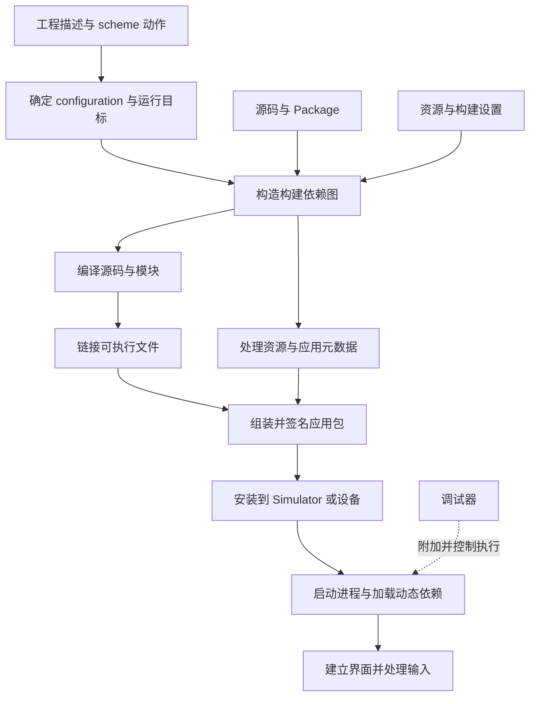

# iOS 01｜工程基础与工具链

已有 Flutter 客户端经验时，通常已经知道如何切换环境、运行应用和查看构建失败。但直接打开原生工程，仍容易混淆几件事：左侧目录里的文件是否都会进入应用；target、scheme 与 Debug 分别决定什么；更新 Xcode 后为什么旧模拟器不能运行；代码能编译为什么还可能缺少资源或启动失败。

本篇从一个最小 SwiftUI 应用出发，建立源码、依赖、资源和配置如何形成应用，以及应用如何被安装、启动和调试的运行模型。目标是能根据失败所在环节选择证据，并预测修改输入会影响什么。实现、操作、截图和真实观察见 [EngineeringLab 工程实验](../../ios/docs/engineering-foundations.md)。

本篇于 2026-10-29 核对 Apple、Swift 官方资料；工程使用 Xcode 27.1、Apple Swift 6.4 与 iOS Simulator SDK 27.1。具体 language mode、最低部署版本与实际运行系统由工程说明记录。版本名相同或不同都不能替代兼容性检查。

## 从一次 Run 建立整体关系

假设应用显示学习进度：用户点击按钮，应用调用本地库中的函数，把 `3` 和 `6` 转成摘要，再显示结果。同时页面显示构建分支、业务环境和资源文件中的文字。预期是代码与依赖匹配、资源在包内、配置符合当前目的，最终能从按钮进入断点检查参数。

这个过程包含两类工作。构建阶段先根据工程描述和当前选择，确定需要哪些输入、依赖和工具任务，产生应用包；运行阶段把包安装到目标环境，启动进程，由系统与 SwiftUI 建立界面，等待输入。修改函数源文件会影响构建；只点击已经运行的按钮不会重新编译。



图示表达依赖关系，不表示 Xcode 严格逐项串行执行。独立任务可以并行，未受影响的输出可能被复用；某些资源处理也可能产生供编译使用的代码。Run 需要可执行环境，通用的 Any iOS Simulator Device 可以作为构建目标，却不是一台能接收点击的模拟器。

Flutter 的 `flutter run` 会把多项操作组合起来，也可能调用 iOS 原生工具链。这些经验有助于辨认阶段，但 Dart package、Flutter 构建模式与 Xcode 工程对象不能按名称直接一一对应。

## 工程里谁决定构建什么

同一份仓库可以包含应用、库、测试和扩展。如果把“目录里有这个文件”当作“这个文件必然参与当前构建”，就可能误判找不到类型或缺少资源的原因。需要先区分文件组织、产品定义与动作选择。

### Project、workspace、target 与 module

`project` 是 Xcode 的工程描述，通常以 `.xcodeproj` 目录保存。它记录 targets、配置、文件组织和依赖引用；`project.pbxproj` 是其中的重要配置文件。`workspace` 用于组织一个或多个工程及相关内容，打开入口通常是 `.xcworkspace`。单个 project 内也可以带有内部 workspace；看到这个目录不意味着必须另外建立一个多工程架构。

`target` 定义要生成的产品，以及生成它所需的源码、资源、构建设置和阶段。例如应用 target 产生 `.app`，测试 target 产生测试产品。一个 project 可以有多个 target；当前应用只有一个，不需要为学习概念提前增加扩展和框架。

Swift `module` 是代码导入与访问控制的边界。`import BuildLessonKit` 让编译器查找对应模块的声明，跨模块调用还需要 API 可见。模块如何产生，由所属 target 和构建配置决定；工程、磁盘目录、Swift module 并非同一种对象。

例如包中默认访问级别的函数可在同一模块使用，但应用模块不能因此直接调用。将示例 API 声明为 `public` 表达对外契约；把所有实现都改成 public 会扩大需要维护的接口，应只公开实际需要的部分。

### Scheme、configuration 与 destination

当工程有多种用途时，还需要决定“这次执行什么动作”。`scheme` 定义 Build、Run、Test、Profile、Archive 等动作使用的 targets 和相关选项。每个动作可以选择不同的 build configuration；Run 还涉及可执行文件、启动参数和调试行为。

`configuration` 是一套命名的构建设置组合，常见名称是 Debug 和 Release。名称本身没有魔法；预处理条件、优化、调试信息等实际设置决定行为。`destination` 则确定产品面向的平台、设备或模拟器以及架构等条件。一次构建需要同时确定动作、configuration 和 destination。

| 变化 | 主要改变什么 | 不能据此推断什么 |
| --- | --- | --- |
| 切换 scheme | 当前动作使用的 targets、配置和启动选项 | 一定更换业务环境 |
| Debug 改为 Release | 该配置下的编译、优化、符号等设置 | 一定连接生产服务，或一定关闭调试器 |
| Simulator 改为真机 | 目标平台、SDK、架构及签名安装条件 | arm64 代码一定可在二者之间互装 |
| 改 bundle identifier | 应用的包身份 | 只改变图标下面的名称 |

共享 scheme 放在工程的 `xcshareddata/xcschemes` 中，可随仓库保存。个人 scheme 与窗口状态可能只在用户目录存在。在自己的 Xcode 中能 Run，不足以证明另一台机器有相同的动作入口。

### 文件出现在哪，与参与什么任务

传统 group 可以引用磁盘上不同位置的文件；较新的文件系统同步 group 会根据目录内容自动识别文件，并允许配置例外。因此不能只凭 Build Phases 中是否逐个列出所有文件判断成员关系，还应检查 group、target membership、例外规则与实际构建日志。

源码参与编译，资源按类型处理或复制。资源被加入工程但未进入应用时，Swift 编译可能完全成功，运行时按名称查找仍会失败。反过来，把说明、临时数据或脚本随意放进同步的应用源码目录，也可能使它们被当作资源纳入产品。文档和实验脚本应放在应用 target 的输入目录之外。

## 版本如何限制能否运行

新建工程默认使用较新的部署要求，而本机可能只安装了旧 Simulator runtime。此时 Xcode 可以显示设备，但标记系统低于 deployment target。需要核对不同版本各自约束的对象。

| 名称 | 约束的对象 | 本例中的含义 |
| --- | --- | --- |
| Xcode 版本 | IDE 与随附开发工具 | 工程模板和可用工具由当前安装提供 |
| Swift compiler 版本 | 实际执行编译的工具 | 由 `swift --version` 检查 |
| Swift language mode | 当前模块采用的语言兼容语义 | 应用 target 选择 Swift 6；不等于安装了 6.0 编译器 |
| SDK | 编译时可见的 API、模块和平台定义 | 使用 iOS Simulator SDK 27.1 编译 |
| Deployment target | 产品支持的最低系统版本 | 应用最低 iOS 18.0 |
| Simulator runtime | 模拟器实际运行的系统 | 与 SDK 分别安装和选择 |
| Destination | 本次具体运行或构建环境 | 例如指定系统版本的一台 iPhone 模拟器 |

使用新 SDK 并降低 deployment target，不会让旧系统自动拥有新 API。调用晚于最低系统版本提供的 API，需要满足 availability 条件，并给旧系统提供合理路径。只检查编译器版本也无法证明某个 API 能在目标设备上使用。

Simulator 与真机即使都使用 arm64，也具有不同的平台 ABI 和运行环境。链接器与安装过程还要考虑平台信息、SDK 和签名要求。本轮采用模拟器建立工具链理解；真机安装需要再核对设备支持、开发者设置、团队、证书和 provisioning 等条件。

## 编译、链接与应用包分别产生什么

如果所有问题都归结为“构建失败”，就容易在找不到函数时清缓存，或在资源丢失时修改编译选项。应先沿输入到输出的关系定位。

### 编译器接受源码与模块接口

Swift 编译器读取源码、当前模块的语言与条件设置，以及所需的依赖模块信息，进行解析、类型检查和后续代码生成。未知类型、参数不匹配、访问级别不够，通常会在这里形成诊断。成功后得到目标代码、模块信息及相关调试信息，供后续构建任务使用。

`import` 使声明可供编译器分析，不会单独完成库产品的集成。缺少模块时先检查依赖是否声明、包是否能解析、产品是否关联到使用它的 target，再检查导入名。反复修改搜索路径可能掩盖真正的依赖缺失。

### 链接器连接定义与引用

源码可以引用在其他文件或库中实现的符号。链接器接收目标代码与相关库，解析这些引用并形成可执行文件或其他链接产物。声明可见但没有提供实现时，编译阶段可能通过，而链接阶段报告 undefined symbol。重复提供同一外部符号则可能出现 duplicate symbol。

静态链接会把需要的代码纳入最终链接产物；动态链接则保留对动态库的依赖，并在运行时由加载器处理。依赖是静态库还是动态库，会影响应用包应包含什么、启动时需要找到什么。Swift Package 的 library product 可以由消费方决定链接形式，因此不能假设每个 package 都会对应一个嵌入的 `.framework`。

### 资源、Info.plist 与签名

应用包是有约定结构的目录，包含可执行文件、`Info.plist`、处理后的资源及按需嵌入的内容。Asset Catalog 会经过工具处理，并非原样复制整个 `.xcassets` 目录。普通文本资源则可以进入包内，再通过 `Bundle` 查找。

`Info.plist` 表达系统或应用读取的元数据。有些内容由源 plist 提供，有些来自构建设置或构建工具生成；应检查最终包中的文件。改源配置但运行旧包，或读取了另一个 bundle，都会造成“配置没生效”的表象。

构建设置通常不会自动成为运行时变量。要在运行中读取一个构建输入，需要明确传递途径，例如生成 Info.plist、生成源文件或复制受控资源。最终包中的普通配置可被检查，不适合保存真实凭据。

签名将产品内容与其身份、权限等验证信息关联。模拟器的签名流程与真机开发签名有不同要求；模拟器 CodeSign 成功不能证明真机证书和 provisioning 已准备好。归档、分发与交付保障由第 09 能力域继续展开。

### 从安装到第一次交互

安装把应用登记到目标系统并建立运行所需条件；启动创建进程并加载可执行文件和动态依赖。加载阶段失败时，构建产物可能已存在，但应用还没有到业务函数。随后框架接管应用入口，SwiftUI 根据 `App` 的 Scene 描述建立窗口与内容。

最小入口如下：

```swift
@main
struct EngineeringLabApp: App {
    var body: some Scene {
        WindowGroup {
            ContentView()
        }
    }
}
```

这里先理解 `@main` 声明应用入口、`WindowGroup` 声明一类窗口内容、`ContentView` 描述界面即可。它们的值、身份和生命周期需要在后续主题中分别展开；`body` 不能当作只执行一次的普通初始化函数。

## 依赖为什么需要解析、关联与锁定

把几行逻辑提取到本地 package，可以观察依赖边界，同时保持输入完全可控。包以 `Package.swift` 描述 products、targets 和依赖；消费方选择 product，编译时导入相应 target 形成的 module。包名、product 名和 module 名可以相同，也可以不同。

本例的最小声明为：

```swift
// swift-tools-version: 6.0
import PackageDescription

let package = Package(
    name: "BuildLessonKit",
    products: [.library(name: "BuildLessonKit", targets: ["BuildLessonKit"])],
    targets: [.target(name: "BuildLessonKit")]
)
```

第一行选择 manifest API 和最低工具要求，并影响默认语言模式；它不安装 Swift，也不设置 iOS 最低版本。应用工程的配置也不会自动替代包自身的 manifest 设置。

本地依赖按路径读取工作副本，修改后直接参与构建。本例没有远程版本需要锁定，不能用它证明远程依赖恢复已经验证。远程源码依赖还需要获取仓库，并在直接依赖和传递依赖的约束之间找到相容版本；约束冲突会在业务源码编译之前失败。

例如允许 `1.2.3..<2.0.0` 表达可接受范围；解析结果则是具体版本与提交。`Package.resolved` 保存解析结果，应用应将相关锁文件纳入版本管理；它不能取代 manifest 的约束、工具链记录和源码可获取性，也不覆盖本地工作副本的未提交改动。

如果选择二进制依赖，还需核对目标平台、架构切片、模块兼容性和资源。XCFramework 可以组织多个平台或架构变体，但不是任意二进制兼容的保证。缺少 Simulator 切片时，应检查依赖产物支持范围，而不是把真机库强行当作模拟器库使用。本轮只实现本地源码依赖，远程与二进制部分保留机制说明。

## 配置怎样进入程序，构建怎样复用结果

开发、测试与生产表达业务环境；Debug、Release 通常表达编译和诊断策略。二者可以组合。若把 `#if DEBUG` 直接当作唯一环境判断，Release 下的测试包就容易错误访问生产服务。

本例用两个独立输入观察区别：编译条件决定保留哪段源码；Info.plist 的 `LabEnvironment` 决定运行时读取的示例环境。没有网络接口，配置不承担连接真实后端的职责。

```swift
#if DEBUG
static let compilation = "Debug 条件分支"
#else
static let compilation = "非 Debug 条件分支"
#endif
```

这里判断的是名为 `DEBUG` 的编译条件是否定义，不是字符串形式的 configuration 名称。模板通常在 Debug 中定义它；若修改构建设置，名称和分支可以不再对应。Swift 编译条件与 C/Objective-C 的预处理宏也需要分别检查。

工程增大后，可用 `.xcconfig` 文本文件组织配置，并通过 configuration 的 Base Configuration 关联。仅创建文件不会使设置生效；多层设置、条件限定和 `$(inherited)` 都会影响最终值。应查看 Xcode Build Settings 的层级和求值结果，再检查编译命令或最终 Info.plist。当前最小工程直接保留 target 设置和源 plist，避免为一个值增加多层配置。

增量构建根据任务的输入、输出和依赖关系决定是否重新执行。修改 Swift 源码可能触发当前模块及受影响的依赖消费方编译；修改普通文本资源可能只需要更新包内资源；修改编译条件则可能使原有编译结果失效。实际范围还受优化策略、编译驱动与工程结构影响，必须查日志确认。

DerivedData 保存中间产物、索引和缓存等本机数据。清理它会迫使更多工作重新执行，但不会修复错误源码、未声明依赖或最低版本冲突。遇到可疑旧产物时先记录输入与当前输出，再用受控清理排查，避免把每次 clean 后成功都解释为同一原因。

自定义代码生成必须声明足够准确的输入、输出和执行条件。遗漏输入会留下旧代码，遗漏输出或每次都运行则可能扩大构建成本。本轮仅观察 Xcode 已有的资源符号等生成任务，尚未实现自定义生成插件，也不作构建速度收益结论。

## 调试如何把运行现象连接到源码

应用能启动后，仍需确认按钮实际调用了预期实现。断点让附加的调试器在特定代码位置暂停，局部变量显示当前栈帧的数据，调用栈说明怎样进入这里。它们共同提供比“打印了成功”更具体的执行证据。

在 `LessonSummary.make` 的参数检查处暂停，应先看到 `completed = 3`、`total = 6`。执行计算后再检查 `remaining`，预期为 `3`；若停在赋值之前，不能把尚未初始化的局部变量当作有效结果。

Step Over 执行当前调用而不进入其内部，Step Into 尝试进入被调用函数，Step Out 执行到返回调用方，Continue 恢复运行直到下一次停止。源码行与机器指令不是严格一一对应，Release 优化也可能让变量不可用、函数内联或停点位置变化。优先用 Debug 理解执行过程，再单独研究优化产物。

调用栈描述当前线程上的调用关系，不代表所有异步任务的完整时间历史。调试器暂停还会改变时间条件，因此断点通过不能证明实时性或竞争问题已解决。并发、UI 更新和状态所有权在后续能力域展开。

## 根据失败阶段选择证据

面对错误，先记录当前动作、configuration、destination、工具版本与第一个相关诊断。多个后续错误可能来自同一原因。

| 现象 | 先核对的环节 | 关键证据与下一步 |
| --- | --- | --- |
| 包不能解析、路径不存在 | 依赖输入 | package 路径、manifest、约束、获取日志 |
| 找不到类型、访问级别错误 | 编译 | 首个源码诊断、target 归属、import 与 API 可见性 |
| Undefined／duplicate symbol | 链接 | 具体缺失或重复符号、链接输入、库产品与平台切片 |
| 设备显示不可用 | 运行条件 | deployment target、runtime、支持的平台和 Xcode 目的地提示 |
| 包存在但不能安装 | 安装 | 安装错误、平台与包身份、设备与签名条件 |
| 安装后立即退出 | 加载或执行 | 启动日志、缺失动态库、崩溃或停止原因 |
| 页面出现资源缺失文字 | 运行时资源查找 | 最终应用包、资源名称与 bundle；构建成功不排除该错误 |
| 按钮结果不符 | 业务执行 | 断点输入、实际调用、计算结果及显示路径 |

练习时一次只改变一个可解释的输入，保留可恢复的正常基线。编译错误修复后重新构建，资源故障修复后重新安装并观察，运行错误修复后重复相同输入。每类证据只能支持其覆盖范围，不能把其他阶段自动视为通过。

## 如何使用本篇继续学习

先阅读到版本关系，再打开 [工程实验](../../ios/docs/engineering-foundations.md)完成首次运行；随后对照依赖与配置章节做变更预测，最后用断点和故障实验检验理解。工程文档区分预期与真实观察。

可以通过下面的问题检查当前理解，答案应联系实际工程：

- 为什么 package 目录存在、源码中也写了 import，仍可能无法调用函数？
- SDK 是 27.1，最低部署版本是 18.0，实际设备系统为 18.6，各自意味着什么？
- 切到 Release 后业务环境仍显示 local，是否说明构建失败？
- 资源文字改变后，为什么可能不需要重新编译业务 Swift 文件？
- 应用成功构建后，安装、启动和按钮行为分别还需要哪些证据？

能阅读说明、工程能运行、学习者能独立解释和修改实验，是不同的完成依据。当前进度与正文入口见 [iOS 入口](README.md)。

## 官方参考

- [Apple：Configuring a new target in your project](https://developer.apple.com/documentation/xcode/configuring-a-new-target-in-your-project)
- [Apple：Running your app on simulated or physical devices](https://developer.apple.com/documentation/xcode/running-your-app-on-simulated-or-physical-devices)
- [Apple：Build settings reference](https://developer.apple.com/documentation/xcode/build-settings-reference)
- [Apple：Adding package dependencies to your app](https://developer.apple.com/documentation/xcode/adding-package-dependencies-to-your-app)
- [Swift：PackageDescription](https://docs.swift.org/package-manager/PackageDescription/PackageDescription.html)
- [Swift：Version Compatibility](https://docs.swift.org/swift-book/documentation/the-swift-programming-language/compatibility/)
- [Apple：Adding a build configuration file to your project](https://developer.apple.com/documentation/xcode/adding-a-build-configuration-file-to-your-project)
- [Apple：Improving the speed of incremental builds](https://developer.apple.com/documentation/xcode/improving-the-speed-of-incremental-builds)
- [Apple：Setting breakpoints to pause your running app](https://developer.apple.com/documentation/xcode/setting-breakpoints-to-pause-your-running-app)
- [Apple：Stepping through code and inspecting variables to isolate bugs](https://developer.apple.com/documentation/xcode/stepping-through-code-and-inspecting-variables-to-isolate-bugs)
