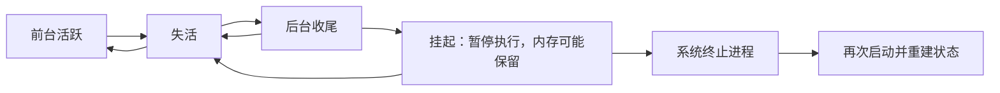
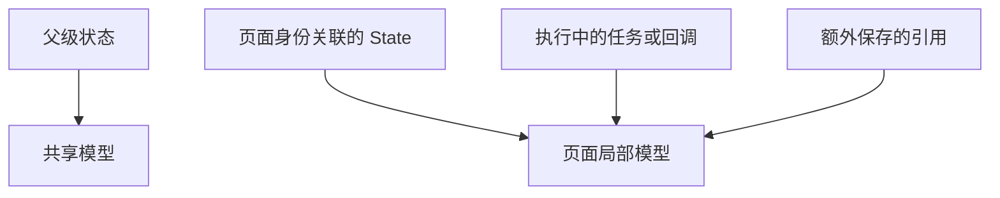

# iOS 02｜SwiftUI 页面、应用运行与生命周期

SwiftUI 描述界面，iOS 决定应用的运行条件。开发者需要把两者连接起来：页面由什么声明，更新时保留什么状态，页面离开后哪些对象还在，应用进入后台后能否继续执行，以及进程结束后怎样重新建立内容。

本篇围绕应用结构、页面生命周期、状态存续、前后台机制和内存管理展开。这里的“页面”指承担一份完整界面职责的视图组合；SwiftUI 用 View 描述它，用视图身份关联它的状态，并通过系统宿主管理呈现。

## 应用与页面怎样声明

### App、Scene 与系统宿主

Swift 是语言，SwiftUI 是 Apple 的声明式 UI 框架，提供界面组合、状态更新和应用结构。UIKit 以窗口、视图控制器和视图等对象组织 iOS 界面；SwiftUI 应用仍运行在 iOS 的应用与窗口体系中。Foundation 则提供文件、URL、日期等基础服务。Xcode 用于开发与调试，实际运行由 iOS 或 Simulator 承载。

SwiftUI 应用通常以遵循 App 协议的类型作为入口，`@main` 标记这个入口。App 的 `body` 声明 Scene，Scene 的内容建立视图层级。系统启动进程并完成框架初始化后，依据这些声明连接界面场景、建立窗口内容，随后处理输入与系统事件。

Scene 是系统管理一份应用 UI 的单位，拥有独立的连接、活跃与后台状态。WindowGroup 是一种 Scene 声明，用相同的根内容描述一组窗口。在支持并启用多窗口的平台上，系统可以据此建立多份窗口内容；每份内容可以拥有独立的页面状态，应用级对象则可以由它们共享。

窗口是系统呈现内容的容器，View 描述窗口内的内容。导航到另一页，通常仍在同一个窗口和 Scene 内。应用进程、Scene、窗口和业务页面因此具有不同的生命周期：一页退出不会直接结束进程，一份 Scene 也不能代表所有窗口的运行状态。

UIKit 中，UIApplication 承担应用级协调，UIScene 表达场景，UIWindow 承载显示内容。使用 SwiftUI 的 App 声明时，这些宿主关系由框架协调；需要接入已有 UIKit 界面时，UIHostingController 可以承载一棵 SwiftUI 视图层级。一个 SwiftUI View 可以是一整页，也可以是一段文字，它与 UIViewController 没有逐一对应关系。

### View、body 与界面组合

自定义页面通常声明为遵循 View 协议的结构体，输入通过属性传入，`body` 返回由其他 View 组合出的内容。`some View` 保留具体类型关系而隐藏组合类型名称；结果构建器让多个内容、条件和循环形成界面描述。这些都是第一章 Swift 语言能力在框架中的应用。

页面可以把一部分内容拆成子 View，再由父 View 传递数据和操作。父子关系共同组成视图层级。modifier 则在已有内容外组合行为、环境或显示特征，修饰的位置决定这些特征作用于哪一层。声明一个页面，实际是在描述这棵层级及其依赖。

SwiftUI 根据当前输入计算内容，并协调实际的布局和显示。View 值本身是短暂的描述；框架可以为同一份界面多次创建描述值。`body` 也可能反复求值，因此其中适合表达当前内容。请求、文件写入和资源启动有各自的触发入口，否则界面更新会重复执行这些工作。

Button 的 action 由交互触发，`onAppear` 在对应内容出现时参与，`.task` 为对应视图关联异步工作。阅读页面声明时，应沿这些入口区分内容计算和事件执行。具体的页面声明、组合与运行见[页面声明与状态身份实验](../../ios/docs/swiftui-pages-and-state.md)。

## SwiftUI 怎样管理页面生命周期

### View 值与视图身份

SwiftUI 需要知道一次更新中的内容与之前哪一份内容对应，这个对应关系称为视图身份。它将不断产生的 View 值连接成一段持续的界面生命周期，并关联状态存储、任务等信息。

身份既可以来自视图结构，也可以由数据显式指定。结构身份与内容的类型及其在组合结构中的位置有关；条件分支可以形成不同身份。ForEach 使用数据标识区分元素，`.id` 可以显式关联身份；标识改变时，对应内容会按新的身份建立状态。

父级传来新的标题或数值，通常只是同一身份下的一次输入更新。SwiftUI 可以用新 View 值重新计算内容，同时沿用已有状态。若一个条件分支被移除，或显式 ID 改变，则可能结束原身份并建立新的身份。两种变化都能产生新画面，但状态存续结果不同。

因此，类型声明说明“这类内容怎样表达”，身份说明“现在是哪一份内容”。一份页面可以先后由许多 View 值描述；两个类型相同的页面，也可以拥有不同的身份和状态。

### 创建、更新、出现与移除

页面需要区分四种过程。创建 View 值时，Swift 执行初始化并接收输入；内容需要更新时，SwiftUI 读取 `body`；内容参与呈现时，框架协调出现与消失；身份结束时，原来的状态关联结束。

这几种过程没有统一的一对一次数关系。父级更新可以多次创建子 View 值，而子内容一直保持出现；导航覆盖或容器滚动可以改变可见性，而原来的导航和模型仍然保留。理解生命周期时，应先确定当前观察的是哪一层内容。

`onAppear` 的 action 在对应内容出现前执行，`onDisappear` 在内容消失后执行，具体时机与所修饰的 View 和容器有关。它们适合表达与出现条件相关的响应。初始化次数用于观察描述值创建，appear/disappear 用于观察出现关系，对象的 `deinit` 则用于观察引用释放，三种证据分别回答不同问题。

NavigationStack 中的返回、sheet 的关闭，以及条件分支的移除，可以作为观察页面离开的场景。容器也可能让一行内容离开可见区域时触发消失；此时整页仍在。页面生命周期应根据实际身份、层级和容器判断，不能仅依据界面是否被遮挡。

### 页面关联的异步工作

`.task` 把异步工作关联到被修饰的视图，在内容出现前启动。内容消失后，SwiftUI 可以自动取消尚未完成的任务；移除内容或重建身份也会结束原来的任务关联。`.task(id:)` 进一步观察输入身份，输入改变后取消旧任务并启动新任务。

取消采用第一章的合作机制：挂起调用响应取消，工作检查资格，退出时清理资源。旧任务收尾与新任务开始可能交错，所以持续更新共享结果的工作还需要识别当前轮次。框架管理任务关联，业务逻辑管理结果有效性和资源结束。

按钮中自行创建的 Task 有独立寿命，需要由页面或模型明确管理句柄和取消规则。决定一项工作应持续多久时，可以区分视图存在、页面可见、Scene 活跃和业务流程未结束这几种条件，再选择对应控制入口。

例如页面仍保留在导航层级中，但 Scene 已进入后台，关联任务不一定收到取消。如果工作只在界面活跃时有意义，就应结合 `scenePhase` 管理。任务与场景事件的运行对照见[生命周期与任务实验](../../ios/docs/lifecycle-and-tasks.md)。

## 状态怎样随页面存续

### State 的存储与重置

`@State` 将局部数据交给 SwiftUI 管理。框架把存储关联到对应视图身份，后续创建的 View 值重新连接这份存储。因此，输入更新和 `body` 求值可以继续使用已有计数、选中项或模型引用。

State 的初始值用于建立状态。一个已有身份收到新输入时，初始值不会自动成为覆盖当前编辑的指令。输入与局部状态需要同步时，应明确决定是沿用编辑、响应输入变化，还是建立一份新的身份；这分别对应不同的使用语义。

身份结束或显式重建后，相关局部状态重新初始化。把可变化的标题作为 ID，就可能让一次改名变成状态重建；给每次更新生成新 ID，也会破坏状态连续性。稳定身份的意义就在于让内容变化与身份变化分别发生。

State 存在于父级还是子级，还决定其作用域。数据只服务一份内容时可以由该内容拥有；多份页面需要共享时，可以把拥有者放到它们共同的上层。对象放在哪个文件中，对其作用域没有影响。

### 模型的拥有、观察与访问

引用类型模型可以由 State 保留，再传给子页面。父级保存同一对象，子级读取它，便建立了共享关系。若对象使用 `@Observable`，SwiftUI 会追踪内容计算中读取的可观察属性，并在依赖变化时更新相应内容。

这里有三种责任：State 管理引用的存储，ARC 根据强引用决定对象寿命，Observation 提供属性变化追踪。给类型添加 Observable 不会改变它的业务作用域；一个普通 class 被 State 持有后，引用能够延续，但其内部字段也不会因此全部获得可观察能力。

Binding 提供访问已有数据源的读写连接，Bindable 则为可观察对象的属性提供这种连接。它们让子控件参与修改，无需另外复制一份状态。Environment 沿层级提供环境值或对象，解决依赖怎样传入；实际寿命仍由注入位置和所有强引用共同决定。绑定或闭包也可能间接持有数据源，访问方式需要与实际引用链一起分析。

已有项目还可能使用 ObservableObject、StateObject 和 ObservedObject。StateObject 为 ObservableObject 提供与身份关联的稳定存储，ObservedObject 用于观察传入的对象。本章以 Observation 与 State 为主线；阅读旧代码时，仍应分别识别谁建立和持有对象、谁观察变化。

### 页面状态、场景状态与持久数据

应用级、窗口级和页面级状态，是把存储关联到不同拥有者的结果。App 层建立的对象可以跨 Scene 共享；窗口内容建立的对象可以服务该窗口的多个页面；页面局部 State 则随对应身份存续。作用域决定了其他页面结束后谁还保留数据。

这些首先都是进程内关系。SceneStorage 提供按场景保存轻量 UI 状态的机制，系统决定保存和恢复时机；AppStorage 连接 UserDefaults，适合简单偏好。需要可靠保留的业务数据则使用明确的持久化策略，在下一次运行时读取并重建模型。

恢复后的内容来自新的状态和对象。即使画面与离开时一致，也可能已经换了进程；恢复需要保存可重建的信息，而不是内存地址和旧任务。场景恢复、偏好与文件的具体对照保留在[对象内存与进程恢复实验](../../ios/docs/state-restoration.md)。

## iOS 怎样管理前后台运行

### Scene 状态与事件入口

iOS 根据界面是否在前台、能否交互及系统中断等条件改变 Scene 状态。SwiftUI 通过环境中的 `scenePhase` 提供 active、inactive、background 三个阶段，应用使用 `onChange` 响应变化。

| 阶段 | 系统条件与应用处理 |
| --- | --- |
| active | 场景在前台并可交互；恢复需要活跃界面的工作，检查内容是否需要刷新 |
| inactive | 场景暂时不活跃，可能处于切换或系统中断；暂停依赖持续交互的活动 |
| background | 场景在后台；收敛非必要工作，处理有限收尾并准备后续恢复 |

从 View 环境读取阶段，反映的是所属 Scene；在 App 层读取则汇总各 Scene 的状态。多窗口应用可能同时具有活跃和非活跃场景，因此应将窗口自身活动与全应用共享资源分开管理。

UIKit 通过 UIApplicationDelegate 处理应用级事件，通过 UISceneDelegate 处理支持 Scene 的界面事件；SwiftUI 的 App 和 scenePhase 提供声明式接入。纯 SwiftUI 页面通常先使用这些入口，需要特定系统回调时再接入 delegate。一个页面的 appear/disappear 则属于视图层，与上述系统事件处于不同层次。

### 后台、挂起与终止

切到桌面的常见路径是场景失活、进入后台，应用完成允许的收尾后被挂起。挂起意味着进程暂时不获得执行机会，已有内存仍可能保留。返回前台时，系统可以恢复同一进程，页面继续使用之前的内存状态。

系统也可以终止后台或挂起的进程以回收资源。下一次进入就需要重新启动、重新创建对象。Scene 被断开连接、窗口被关闭和进程被终止也是不同事件：系统可以结束一份场景的连接，而应用其他部分继续存在。

图示是常见运行路径。挂起是进程执行条件，SwiftUI 没有相应的第四个 ScenePhase；系统也可以直接在后台启动应用处理获准事件。应用切换器中的画面是系统保存的 UI 快照，实际进程状态需要另行判断。

前后台变化影响资源使用规则。失活时可以暂停动画、计时和交互相关更新；进入后台时释放可重建的大型缓存，并按对应框架要求结束摄像头等资源使用。关键数据应在业务提交或适当自动保存时点写入，后台回调可以补充收尾，进程终止不能作为唯一保存机会。

### 系统允许的后台工作

后台执行资格由 iOS 管理。普通应用进入后台后只有有限的收尾机会；需要延长正在进行的重要操作时，可使用 UIKit 的后台执行申请，及时结束，并在到期时停止工作。系统调度的刷新或处理任务则由 BGTaskScheduler 等机制安排，执行机会取决于系统条件。

持续音频、定位、后台传输等能力各有用途、声明和运行约束，应使用对应框架。一个常驻 Task、定时器或普通网络连接，本身不会获得这些资格；任务挂起多久、系统何时调度都需要与平台能力一起判断。

线程调度与应用前后台是两个维度。把计算放到工作线程，可以减少主线程阻塞；当整个进程被挂起时，这些线程同样不能继续计算。MainActor 管理 UI 状态访问，后台执行机制管理进程何时获准运行，二者解决不同的问题。

返回 active 后，应依据当前状态重建必要工作、检查数据时效。系统后台任务还应能够中断和重试，以已保存的进度重新开始。本章建立运行关系，具体后台能力接入由后续系统能力主题展开。

## 对象与内存怎样释放

### 从 State 存储追踪强引用

第一章的 ARC 在 SwiftUI 中仍然成立：对象能否释放取决于强引用是否结束。视图状态保存一个 class 引用时，这份状态就参与对象的持有；父级模型、环境、闭包和任务也可能各自保留它。

视图身份结束后，SwiftUI 会结束相关状态的关联，并在清理过程中释放它持有的值。对象如果还有其他强引用，就会继续存活。转场和框架清理也可能延后实际释放时机，所以“收到 disappear”与“该对象已经执行 deinit”需要分别观察。

图中的箭头表示强持有。移除页面只会结束其中一条来源；任务或额外引用仍在时，局部模型可以继续存在。分析内存时，需要找到仍然有效的持有路径，而不是只看页面是否可见。

常见的 struct View 是值类型，也可以包含对象引用。值复制不会让引用指向的模型自动变成另一份对象，新的持有方反而可能延长同一对象的寿命。SwiftUI 保存的状态、应用自己的缓存以及闭包捕获，都应纳入引用链。

### 任务、闭包与资源结束

模型保存 Task 句柄，任务闭包又捕获模型时，执行期间会形成相互持有。有限工作完成后，任务释放执行上下文，模型清除句柄，这段关系可以解除；持续等待的流或未移除的回调，需要明确取消或注销才能结束。

弱捕获影响的是引用关系。若任务先把弱引用提升为强引用，再跨越长时间 await 使用，模型仍会在那段工作中被保留。资源应该在什么条件下结束，需要由页面、场景或业务拥有者发出明确动作，再由异步代码响应取消并完成清理。

`deinit` 可以观察普通对象最终释放，也可以承担适合析构的同步收尾。涉及 await、系统资源协议或及时停止的工作，应提供明确的关闭路径。否则可能出现页面已经离开，任务仍持有模型，而模型又等待析构才取消任务的情况。

因此，对象释放与资源停止可以有不同时间点：对象仍被共享时，其摄像头会话可以已经停止；页面消失后，一项合法的保存操作也可以短暂继续。先定义资源何时有资格使用，再安排拥有与结束关系。

### 应用内存与系统回收

ARC 管理对象引用，iOS 管理整个进程能够占用的内存与执行资源。一个页面退出后，仍有引用的数据会留在内存；图片解码、缓冲区和框架缓存也会影响占用。对象执行 deinit 只证明该对象释放，不能直接等同于进程内存读数按相同大小立即下降。

发生内存压力时，系统可能清理可回收资源、终止挂起应用，并向仍在运行的应用发送内存警告。应用应尽快丢弃可重建的图片、缓存和临时数据，限制高内存并发操作。UIApplication 的内存警告通知可以作为响应入口，释放对象仍需要应用移除相应强引用。

若压力持续，或进程达到系统施加的内存限制，iOS 可以通过 jetsam 终止进程。此时由操作系统回收整个进程的资源，业务不能依赖每个对象先执行 deinit 或收到完整退出回调。重要数据的持久化和进程重建因此必须提前设计。

挂起本身暂停执行，不会把所有内存对象清空；进程被终止后，原来的对象、状态存储和任务都结束。再次启动只能用磁盘数据、场景恢复信息或其他可信输入重新建立它们。具体内存占用诊断由性能章节展开，本章先把页面身份、对象引用与进程回收这三个层次连接起来。

配套[对象内存与进程恢复实验](../../ios/docs/state-restoration.md)对比同一身份下更新、身份重建、额外强引用与 deinit，再用进程重启观察内存状态和保存数据的区别。

## 资料与适用条件

本篇于 2026-10-31 核对 Apple 官方文档与 WWDC《Demystify SwiftUI》。身份与状态存储采用框架公开的行为模型，不依赖私有视图树或底层控件的固定对应关系。

配套使用 Xcode 27.1、Apple Swift 6.4、Swift 6 language mode 和 iOS Simulator SDK 27.1，最低 iOS 18.0。应用默认 MainActor 隔离并启用 Approachable Concurrency。当前 SDK 的 `@State` 已采用宏实现，旧教程常按属性包装器展开；本篇主要讨论状态存储与生命周期，两种写法背景下都需要理解这些关系。Observation 主线适用于 iOS 17 及更新系统。

正文不含代码和操作命令，具体声明与观察放在三篇工程文档。模拟器可以观察页面与进程重启，真实后台调度、设备内存压力和多窗口行为有各自的验证条件；实际覆盖由实验记录说明。

## 官方参考

- [SwiftUI：App](https://developer.apple.com/documentation/swiftui/app)、[Scene](https://developer.apple.com/documentation/swiftui/scene)、[View](https://developer.apple.com/documentation/swiftui/view)、[UIHostingController](https://developer.apple.com/documentation/swiftui/uihostingcontroller)
- [WWDC21：Demystify SwiftUI](https://developer.apple.com/videos/play/wwdc2021/10022/)、[View.id](https://developer.apple.com/documentation/swiftui/view/id(_:))
- [State](https://developer.apple.com/documentation/swiftui/state)、[Managing model data in your app](https://developer.apple.com/documentation/swiftui/managing-model-data-in-your-app)、[StateObject](https://developer.apple.com/documentation/swiftui/stateobject)
- [ScenePhase](https://developer.apple.com/documentation/swiftui/scenephase)、[task](https://developer.apple.com/documentation/swiftui/view/task(name:priority:file:line:_:))、[带输入身份的 task](https://developer.apple.com/documentation/swiftui/view/task(id:name:priority:file:line:_:))
- [UIKit：Managing your app’s life cycle](https://developer.apple.com/documentation/uikit/managing-your-app-s-life-cycle)、[Preparing your UI to run in the background](https://developer.apple.com/documentation/uikit/preparing-your-ui-to-run-in-the-background)、[Extending your app’s background execution time](https://developer.apple.com/documentation/uikit/extending-your-app-s-background-execution-time)
- [UIKit：Responding to memory warnings](https://developer.apple.com/documentation/uikit/responding-to-memory-warnings)、[Xcode：Identifying high-memory use with jetsam event reports](https://developer.apple.com/documentation/xcode/identifying-high-memory-use-with-jetsam-event-reports)
- [SceneStorage](https://developer.apple.com/documentation/swiftui/scenestorage)、[AppStorage](https://developer.apple.com/documentation/swiftui/appstorage)
