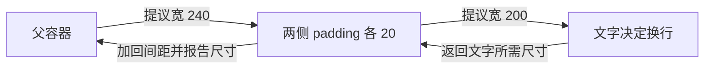
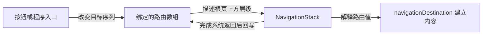

# iOS 03｜SwiftUI 更新、布局、渲染与交互

在 SwiftUI 中实现一页界面，开发者需要决定内容怎样组合、状态怎样接入、空间怎样分配，以及操作怎样改变当前内容。框架依据这些声明协调更新、布局、绘制和系统呈现。理解这套关系后，才能解释为什么同一份数据改变，有时只更新一段文字，有时让列表状态错位，有时又重建整段导航。

本章以 SwiftUI 为主线，按更新与布局、列表、输入、动画、导航、模态和自适应展开。第二章已经说明 View 值、身份和状态存储的关系；这里继续解释这些内容怎样参与具体界面。正文使用公开行为模型，具体 Swift 写法和可操作对照放在各节附近的工程教程中。

## 状态怎样经过布局成为画面

### 从界面声明到一次更新

一个计数区域可以由父 View 保存计数，子 View 显示数字，Button 接收增加操作。建立内容时，SwiftUI 计算相关 body，得到文字、按钮、容器和修饰器组成的描述。用户点击后，Button 的 action 修改状态存储；依赖这份状态的内容需要重新计算。新描述与旧内容通过身份连接，原本仍有效的局部状态继续使用，变化的输入交给后续布局和显示处理。

这几个角色需要分别认识：View 值描述当前输入下的内容；状态存储保存跨更新延续的数据；依赖关系告诉框架哪些内容受变化影响；身份负责连接前后两次描述。给父级传入新标题不必重建子级的编辑状态，改变子级身份则可能结束旧状态。更新机制是在这些关系上工作，不能只从“又创建了一个结构体”推断屏幕发生了什么。

| 数据怎样进入界面 | 谁保存、谁读取 | 修改后怎样参与更新 |
| --- | --- | --- |
| 普通属性输入 | 父级构造子 View 时提供当前值 | 父级重新提供输入，框架判断子内容是否需要更新 |
| State | SwiftUI 将存储关联到视图身份，内容读取它 | 对依赖内容发出更新需要，后续描述仍连接原存储 |
| Observable 模型 | 拥有者保存对象，各内容读取对象属性 | Observation 跟踪的属性变化影响对应读取者 |
| Binding | 子控件获得已有数据源的读写连接 | 写入回到源存储，再由源存储的更新机制影响界面 |
| Environment | 祖先向后代提供环境值或对象 | 消费环境的内容接收相应变化；注入位置决定可见范围 |

例如 Stepper 通过 Binding 编辑父级的计数，父级文字与 Stepper 都读取同一数据源，所以两处显示一起变化。Binding 自身没有再复制一份计数。若子级改为建立自己的 State，两份存储就需要额外定义同步规则；名字相同不会使它们自动同步。

### 属性读取怎样建立依赖

Observable 模型有 score 与 message 两个属性。若 UIScoreView 在 body 中读取 score，UIMessageView 读取 message，修改 score 会让分数内容因该依赖而需要更新。仅把同一对象引用传到两处，并不会让每处都订阅对象的全部属性。对象引用本身被替换、其他输入或环境变化，仍然可以成为额外更新原因。

再把读取位置移到父级：父级读取 score，将得到的整数传给一个子 View。此时父级建立了 score 的可观察依赖，分数改变会使父级重新计算并提供新的整数输入。子级依靠这个输入描述文字。这与子级自己读取模型得到相同画面，却有不同的依赖边界。

依赖取决于实际执行的读取。一个区域用开关选择显示 score 或 message，显示分数时会读取开关和 score；切到说明后，新的内容计算改为读取开关和 message。之后 score 变化不再因为这段内容的当前可观察读取而要求更新。某个计算属性内部又读取了哪些可观察属性，也会参与同样的追踪；为集合查询换一个计算属性名称并不会缩小实际访问范围。

独立 View 类型为框架提供独立内容边界。父级计算属性和辅助函数仍在父级内容计算中执行，把读取移到其中通常只是整理源码。另一方面，也无需为每个字段建立一个对象或子 View：同一内容确实需要多个属性时，共同读取就是合理依赖。先沿数据源和实际读取位置分析，再决定拆分。

依赖失效、body 求值和用户看见变化是不同观察对象。框架可以合并更新，也可能发现新结果没有需要显示的差异。调试时可以观察更新原因，不能用一行日志对应一次完整绘制。具体写法和读取位置对照见[更新与列表教程](../../ios/docs/swiftui-updates-and-lists.md#从局部状态到绑定)。

### 父子布局怎样协商尺寸

SwiftUI 常用 HStack、VStack、ZStack 组织横向、纵向和重叠内容；Grid 让多行多列共同决定排列；ScrollView 在一个方向提供滚动空间。这些容器接收父级给出的尺寸提议，再依据自身规则测量和放置子内容。布局的基本方向是：提议向下，尺寸响应向上，容器据结果向下安排位置。

尺寸提议表达“在这个条件下你希望多大”。一个维度可以是有限数值，也可以未指定；未指定让内容报告该方向的理想尺寸。零和无限值还可用于询问最小或最大响应。子内容并非必须完全接受提议：文字根据宽度决定换行，固定尺寸内容有自己的要求，可伸展内容则可能接受更多空间。容器可以用不同提议测量同一子内容多次。

以父级提供 240 pt 宽度、文字外有两侧各 20 pt padding 为例：padding 向文字提出扣除两侧间距后的宽度；文字据此换行，报告所需尺寸；padding 将间距加回，向父级报告自己的尺寸。父级随后给这一组合安排位置。若文字字号增大，文字返回的高度可以增大，padding 和父级排列也随之变化。

图中只追踪这一轮有限宽度提议；实际容器还可以用其他提议继续测量。位置安排发生在尺寸关系确定之后。

frame 又增加了一层协商。固定宽度 frame 可向内部提供确定宽度，并向外报告该层宽度；内容是否填满、是否溢出还取决于内部响应和对齐。最大宽度为无限的可伸展 frame，通常用于在父级允许的有限范围内扩展。fixedSize 则让内容在选定方向采用理想尺寸，例如允许文字按给定宽度换行，同时保留其所需高度。它们改变的是具体层次的测量关系，不能把所有后代直接变成相同尺寸。

### 修饰顺序、空间竞争与测量工具

modifier 在内容外逐层组合，读声明时可以从外到内追踪提议，再从内到外追踪响应。文字先 padding 后 background，背景接收到包含间距的主要内容范围；先 background 后 padding，背景位于内部，外层间距留在背景之外。两者都可以成立，取决于背景应当代表文字本身还是整个内容块。

HStack 需要在水平方向安排多个子项。子项可压缩和可伸展的程度、间距与 layoutPriority 共同影响空间分配，alignment 再决定交叉轴上如何对齐。给长标题提高优先级，表达它在空间竞争中的相对重要性；父级总空间没有增加，另一段文字可能因而更窄。需要两段都完整显示时，改为纵向排列可能比继续调整优先级更合适。

滚动容器进一步改变提议条件。垂直滚动区域通常不在滚动方向给出与可见高度相同的有限约束，内容需要决定自己的高度。把依赖“占满剩余高度”的内容直接放进去，就可能与预期不同。因此，应先确认当前内容接到怎样的提议，再考虑给它补 frame。

GeometryReader 用几何代理提供所在容器的尺寸、坐标和安全区域等信息，同时它本身也是一个参与布局的容器。Preference 让后代把测量或语义信息交给祖先。Layout 则让自定义容器直接询问子项尺寸并放置子项：sizeThatFits 回答容器希望多大，placeSubviews 在最终 bounds 中安排它们。要实现两列等宽，可以扣除间距、给两项相同宽度提议，再用较大的响应高度决定容器高度，不必测量后写回 State 再等待下一次更新。

测量结果写入状态、状态又改变被测尺寸时，会建立反馈关系；只有收敛条件清楚时才容易控制。普通容器能表达的排列优先用普通容器，需要共同测量的特殊规则再用 Layout。完整的尺寸传递和可观测日志见[布局教程](../../ios/docs/swiftui-layout-and-drawing.md#从宽度提议到文字换行)。

### 从布局几何到绘制内容

布局确定内容的尺寸和位置，绘制决定这些区域里如何表现文字、颜色和图形。offset 在布局完成的关系上改变显示位置，周围内容仍按原占位排列；改变 frame 或容器间距，则会影响布局响应和相邻内容的位置。截图上相似的移动可以来自不同过程。

绘制区域、可见区域和交互区域也各有职责。较大的图形可以超出外层布局范围，clipped 或 clipShape 决定哪些部分可见；contentShape 可指定交互形状；allowsHitTesting 决定内容是否参与命中。裁掉像素本身不足以表达全部输入规则。后面的输入部分会把触摸接收与这些区域连接起来。

自绘内容从局部坐标开始。Shape 在给定矩形内生成 Path，填充或描边把几何路径表现出来，因此同一个形状可以响应不同容器尺寸和样式。Canvas 则把 GraphicsContext 和可用 size 交给绘制闭包，适合在同一绘制区域内组合多个图元，例如把一组采样值映射成趋势线。改变输入采样值后，绘制描述根据新数据产生线段。

Canvas 内的每个点没有各自的 View 身份、焦点和操作。需要逐点探索时，必须另行建立命中和可访问性语义；只需表达整体趋势时，可以给整块图形提供摘要。选择控件、Shape 或 Canvas，需要同时考虑内容结构、交互粒度与可访问性，不能只依据像素外观。

### 应用怎样把变化交给系统呈现

一次点击后，应用先处理事件并修改状态。SwiftUI 根据变化更新所需内容、完成必要的布局与绘制准备；iOS 界面通过 Core Animation 的提交与系统渲染管线参与呈现。render server 和 GPU 继续处理绘制、合成等工作，最终由显示系统呈现可显示图像。这里是阶段关系，框架可以合并工作并在多个帧之间流水处理。

因此，修改一份没有被当前内容读取的状态，可以不产生当前画面的变化；重新计算 body 后，结果也可能沿用已有几何和显示内容；动画又可以通过可插值数据持续改变画面，而业务状态早已到达目标。不能把状态赋值、body 求值、布局、绘制和屏幕刷新当成固定的一对一调用链。

区分阶段也有助于定位问题。body 中的大量计算增加应用侧更新成本；复杂布局增加测量与放置工作；模糊、阴影、透明与复杂合成可能增加绘制或呈现工作。具体瓶颈需要工具和固定条件确认，本章先建立工作归属，不从求值次数推断帧率。Shape、Canvas 和几何变化的实现见[绘制实验](../../ios/docs/swiftui-layout-and-drawing.md#shape怎样生成-pathcanvas怎样绘制采样点)。

## 列表怎样连接数据、行与滚动位置

### 先认识容器与数据展开的分工

List 提供系统列表，包括选择、编辑、行操作、系统样式和基础可访问性协作。ScrollView 提供可滚动区域，内部排列仍由 Stack、Lazy Stack 或其他布局决定。ForEach 接收集合并按标识产生内容，本身不负责提供滚动或系统列表行为。在 List 中使用 ForEach，是把数据展开与列表容器组合起来。

若需要系统行交互，List 通常是直接入口；若需要自由组合卡片、图表和不同布局，可以在 ScrollView 内安排内容。普通 Stack 会为全部子内容建立布局描述，Lazy Stack 按需准备靠近可见区域的内容。后者可以有预取、估算和保留，其行为也会影响尺寸与滚动观察。

### 稳定身份怎样把状态连接到一行

假设列表依次显示条目 A、B、C，A 行有一次局部按钮计数。头部插入 X 后，A 移到第二个位置。如果 ForEach 使用业务 ID，框架仍能将新列表中的 A 与旧 A 对应，继续关联原来的局部状态；若使用位置 0、1、2 作 ID，旧位置 0 现在描述 X，原状态就可能显示在 X 的标题下面。

ID 的职责是表达“更新前后是否仍是这份内容”。标题改变通常仍是同一条目，所以可变标题不适合作身份；每次求值生成的新 UUID 则把每次更新表达为新内容。使用整个值作为身份时，还要确认值的变化是否真的意味着身份变化。若同一列表允许同一业务对象出现两次，应给两次出现建立各自标识。

稳定 ID 连接内容，也不提供永久状态仓库。筛选把 A 从 ForEach 输入中移除后，容器内部内容与状态的结束时机还受实现和保留策略影响；一次短暂移除后仍看到计数，不足以承诺长期保留。若身份已经结束，重新建立就会初始化行内 State。需要明确保留编辑或计数时，应放到列表拥有者或其他适当模型中，按业务 ID 保存，再用 Binding 交给行；需要明确重置时，则可以主动改变身份。实验分别观察重排、短暂移除与显式重建。

### 按需内容怎样参与更新

Lazy 容器的“按需”针对内容准备与布局，不表示整个输入集合都可以不处理。框架仍需要数据标识及内容结构信息。先筛选输入集合，再为每个元素产生结构可预测的一行，有助于容器识别行；把筛选隐藏在逐项内容构造中，会让元素与实际行数的关系更复杂。

UIKit 的 cell 复用协议让开发者接收并配置可复用单元；SwiftUI 的 List 和 Lazy Stack 由框架管理内容身份和生命周期。不能根据一行消失就认定对象已经释放，也不能把 onAppear 次数当作创建数量。普通与按需实验分别记录内容求值和出现事件，用来比较本次输入下的准备行为，不据此估算内存或性能收益。

### 滚动状态怎样表达用户的位置

滚动像素偏移回答内容移动了多远，目标 ID 回答与哪个元素关联，业务阅读状态还可能包含“是否跟随最新”。聊天列表头插新数据时，保留像素偏移和保留原条目在视口里的位置可能得到不同画面，因此需要先选择要保持的关系。

ScrollViewReader 提供代理，应用可请求滚到具有相应 ID 的目标；基于目标 ID 的 scrollPosition 把程序请求与用户滚动后的位置反馈连接到状态；scrollTargetLayout 标记容器内用于定位的目标布局。目标身份是定位依据，实际位置仍由内容几何、锚点、容器和系统行为共同决定。

例如当前目标是 20，头部插入一个新 ID，20 仍然是同一条目；若把 21 过滤掉，原先指向 21 的目标已不在输入中，就没有保持那一行位置的基础。文字变高也会改变它的几何位置。阅读历史时应由明确动作恢复跟随最新，避免每次数据到达都强制滚动。目标失效的实际反馈和行状态对照见[列表与滚动实验](../../ios/docs/swiftui-updates-and-lists.md#行身份为什么会影响局部状态)。

## 输入、焦点与手势怎样推动状态

### 控件怎样把操作接到数据源

Button 的 action 接收已经识别的按钮操作；TextField 的文本 Binding 让编辑内容回写数据源；Toggle 和 Stepper 分别表达开关与步进操作。SwiftUI 再依据这些数据源更新相关内容。系统控件同时带有禁用、键盘、焦点和可访问性语义，因此实现一个按钮时，应先使用 Button，再按需要调整样式。

用普通图形加点击手势，可以识别触摸，却还需要自己提供对应的可访问性操作等语义。图表中的拖动、缩放等连续输入适合使用 Gesture；普通业务按钮则已经有更完整的控件入口。选择由需要接收的交互决定。

### 命中测试怎样找到接收者

触摸发生在窗口坐标中，系统与框架根据当前层级、区域和参与资格寻找接收者。前方覆盖层可能成为接收内容，即使其颜色透明也不意味着自动穿透。装饰层使用 allowsHitTesting 退出命中后，底层按钮才可以继续接收相应触摸。

交互形状可以通过 contentShape 明确指定。例如一个圆形画面外还有矩形布局范围，应用可以选择按圆形还是按矩形参与命中；裁剪只处理可见内容，不能替代这项选择。视觉遮罩如果用于阻挡操作，还需要处理底层可访问性，避免读屏用户仍可访问视觉上已不可操作的内容。

### 手势怎样识别、竞争和结束

DragGesture 从连续触摸中识别拖动，达到相应识别条件后提供位置与 translation。TapGesture 识别点击，组合手势还可以表达同时、顺序或排他关系。highPriorityGesture 改变优先关系，simultaneousGesture 允许与其他手势同时识别；外层 ScrollView 和系统返回也有自己的识别行为。

卡片位于滚动区域里时，一次纵向移动可能既像拖卡片又像滚列表。应用需要决定这两种意图如何区分，再选择关系；同时识别可能让两者一起改变，高优先级拖动又可能夺走滚动。判断必须联系实际层级、方向和系统，单看某个修饰器名称不足以保证交互结果。

拖动状态可以分为“已经确认的位置”和“本次临时位移”。GestureState 保存识别期间的位移，updating 接收新值；显示位置由确认值与临时值相加。正常结束时，onEnded 将本次位移计入确认值；识别结束或取消后，GestureState 自动回到初始值。这样取消只撤销未确认部分，不依赖某个结束回调一定执行。教程会分别显示两份值，便于观察这个过程。

### 焦点、键盘与编辑状态怎样协作

FocusState 把焦点目标连接到状态。每个字段注册自己的焦点值，用户点字段会更新绑定，程序修改绑定可以请求相应字段获得焦点。表单可以用枚举区分名称与数量，Next 将焦点移到下一字段，校验失败再把焦点定位到出错字段。

焦点是输入接收关系，键盘是系统提供的一种输入界面。有硬件键盘或不同控件时，获得焦点不必表现为相同的软件键盘。键盘出现又会影响安全区域与可用空间；表单需要能滚动到当前字段，键盘工具栏可以提供明确的完成入口。把整个界面忽略键盘安全区域，会改变避让关系，应依据内容目的决定。

TextField 编辑中的字符串可以是空值、负号或尚未完整的小数。中文输入还包含未确认的组合文本与候选选择。若每次输入都把字符串解析成数值后重新格式化，可能把这些合法的编辑中间状态抹掉，打断光标或组合过程。常见表单可以保存原始文本，到提交时按明确地区格式解析并校验，再显示结果；实时约束则需要进一步处理输入法行为。

这些机制在[输入与动画教程](../../ios/docs/swiftui-input-and-animation.md#文本绑定焦点与提交)中分别实现，先学习单项输入，再观察手势与滚动的组合。

## 动画怎样连接目标与过程

### 状态目标与中间画面

展开按钮把 expanded 从收起改为展开后，业务状态立即表示展开，新的声明给出目标高度和圆角。动画让可动画属性在时间中经过中间值，形成逐渐展开的画面。框架处理这些中间数据，应用无需每帧修改 expanded，也不应把每帧绘制当作新的业务提交。

CGFloat、位置、颜色等可动画表达可以参与相应插值；布尔状态本身负责选择目标，不会先变成“半个 true”。新的声明只给出目标参数，具体 Shape 或修饰器通过可动画数据描述中间形态。自定义 Shape 也需要让插值数据实际参与路径生成；若路径始终只看另一个固定值，就看不到期望过程。

### 动画上下文怎样到达变化的位置

withAnimation 为闭包中的状态修改设置动画上下文。变化被 SwiftUI 处理时，Transaction 携带这次更新的动画等信息，相关视图与修饰器据此处理可动画变化。它的作用可以涉及这次更新中受影响的多处内容，动画代码的位置与界面层级都影响最终范围。

animation(value:) 将动画配置附着在局部内容上，并以指定值的变化作为触发条件。触发值改变时，该局部子树在这次更新中的其他可动画变化也可能接收到同一上下文。比如同一个按钮同时改变高度和透明度，即使修饰器监测的是高度状态，两处仍可能一起动画。把修饰器缩到实际需要的图形附近，或在另一子树调整 Transaction，可以表达更小范围。

因此，可以先选择目标状态，再确定动画应覆盖哪些内容，最后配置曲线、时长或弹簧。实验会对比同一次更新中两个图形的表现，并用局部 Transaction 让其中一处直接到达目标，展示上下文传播的边界。

### 属性动画与内容转场

同一身份下改变高度，框架保留内容并插值它的可动画属性。条件分支由无到有时，则需要处理内容插入；transition 描述插入和移除期间采用的表示，例如移动与透明度。transition 还需要相应更新具有动画条件，单独声明它不会让所有插入自动播放动画。

身份在这里决定前后内容怎样连接。随意换一个 ID 可以使属性更新变成旧内容退出、新内容进入，同时结束局部状态。要改变展开效果，应先选择属性动画或插入移除，而不是为获得动画不断重建身份。布局高度动画会持续影响周围内容安排，offset 等显示变换则可以保留原占位，二者产生不同的空间效果。

### 新目标怎样打断原过程

动画进行中再次点击，业务状态变为另一个目标，框架依据当前过程及动画规则重新趋向目标。弹簧等动画可以表现连续运动，具体衔接由动画系统负责。应用要保证最后一个目标正确，避免等待“上一段走完”后才承认新的操作。

动画完成回调适合安排动画相关工作，不能代替保存成功、系统模态关闭或业务事务完成的契约。Reduce Motion 则要求重新选择合适表达：保留最终状态与结果反馈，减少大幅位移或直接更新。自定义动画是否遵守这一选择，由应用实现负责。

目标值、局部动画范围、转场与自定义插值见[动画实验](../../ios/docs/swiftui-input-and-animation.md#属性动画转场与中途改变目标)。

## 导航栈与路由怎样组织页面

### iOS 工程中用什么做导航

SwiftUI 的主线是 NavigationStack、NavigationLink 和 navigationDestination，应用可以直接用系统能力组织页面导航。UIKit 工程常用 UINavigationController 管理 UIViewController 栈，通过 push、pop 和设置控制器数组改变层级。独立模态流程则分别由 SwiftUI 的呈现修饰器或 UIKit 的 present/dismiss 建立。

已有 Flutter 经验可以帮助区分“页面栈管理”和“路由组织”。Navigator 提供页面导航基础，go_router、GetX 的路由管理等方案还组织目标、入口或应用流程。SwiftUI 中常见的 Router、Coordinator 通常是应用在系统能力之上的封装角色，也存在第三方方案；建立一个 NavigationStack 并不要求先选择一个路由库。NavigationStack 自身也没有自动完成 URL 解析、鉴权重定向和全应用路由配置。

本章先学习系统导航，再用类型化路径组织目标，最后增加局部协调。一个 SwiftUI 路由值描述目标，框架协调对应宿主；它与 UIKit 中开发者持有的控制器实例没有逐一替换关系。

### 从简单链接到值驱动目标

最简单的入口是在 NavigationStack 根内容中放一个直接构造 destination 的 NavigationLink。点击后，框架在根内容上方显示目标，并提供系统返回。目标中的 dismiss 可以根据该目标的环境请求返回。应用无需显式保存路径，适合局部、简单的深入浏览。

当程序也要控制目标、检查当前层级或一次进入多级页面时，可以采用值驱动方式。NavigationLink 提供一个 Hashable 路由值，栈内稳定注册的 navigationDestination 说明这种值怎样生成页面。链接负责表达目标，注册负责将目标解释为内容，NavigationStack 负责组织导航关系。

例如路由类型有“文章详情，携带文章 ID”和“相关内容，携带文章 ID”。用户点击文章 A，链接交出详情 A；目标注册匹配路由并建立详情视图；详情再按 A 查找当前数据。路由不必携带整份文章快照，后续文章内容改变时也能读取新数据。代价是 A 可能已不存在，页面必须表达目标失效或由入口拒绝进入。

目标注册应位于栈能稳定发现的位置，例如 List 外层；若放在尚未准备的懒行内部，栈可能在需要时找不到它。正文所说的“声明路由”因此至少涉及目标值、容器和注册三部分，三者连接好才形成可用导航。

### 路径怎样表达当前页面和返回关系

NavigationStack 可以绑定一个路由数组。根页不在数组中，每个元素表达根页上方的一层。数组为空时显示根内容；只有详情 A 时处在详情；详情 A 后面再有相关内容 A 时，返回一级应回到详情 A。

| 操作 | 路径怎样变化 | 页面关系 |
| --- | --- | --- |
| 从根页进入详情 A | 空路径增加详情 A | 根页之上显示详情 |
| 从详情深入相关内容 | 保留详情 A，末尾增加相关内容 A | 新页返回后仍是原详情 |
| 返回一级 | 移除末尾目标 | 回到前一层；剩空时回到根页 |
| 返回已有祖先 | 保留目标祖先，移除其后元素 | 结束祖先之后的深入路径 |
| 返回根页 | 清空路径 | 保留根内容 |
| 进入一条新路径 | 校验后整体替换目标序列 | 以新序列描述当前浏览层级 |

绑定使这套关系具有两个方向。应用修改数组，框架协调栈；用户完成系统返回，框架又更新绑定路径。因此，程序返回和系统返回需要观察同一份状态。交互式返回在过程中可以取消，不能把手势开始当作已经完成离开，也不能仅凭页面一时被遮挡就清空业务状态。

路由数组由谁保存，决定导航状态能跨什么变化延续。只服务一份页面组合时，可以用局部 State；多个入口共同控制同一流程时，可以提升到共同拥有者。页面重建后仍有路径数据，能重新描述浏览层级，但不意味着已经保留旧视图全部局部状态和像素滚动位置。

### 类型化路径、NavigationPath 与 Router

关联值枚举可以把不同目标统一为一个路由类型，数组仍有明确元素类型，程序可以遍历、查找祖先和裁剪路径。新加一个路由分支时，目标映射中的穷尽检查有助于发现遗漏。共同类型也需要了解流程内的目标，规模扩大后应按流程组织，而不是把所有模块内部细节堆到一个枚举里。

NavigationPath 使用类型擦除保存异构 Hashable 值，各类型分别注册目标。它适合组合不同类型的导航，但不提供具体数组那样任意按元素类型遍历和修改的接口；可编码表示还要求全部元素支持编码。恢复路径需要继续验证数据、账号和版本，可编码不等于旧路径现在仍然有效。

若详情可以从列表、搜索和通知入口进入，入口可以共同调用一个 Router。Router 先检查目标，选择当前流程，再修改路径；需要登录时还可以保存待处理意图，完成准备后重新校验。这里的 Router 是应用代码，系统实际导航仍由 NavigationStack 完成。简单链接没有这些协调需求时，直接绑定与操作闭包已经足够。

例如“当前栈顶已是 A 时不再追加 A”是 Router 的一种入口策略，直接 NavigationLink 不会自动执行这份代码；其他流程也可能允许再次进入 A。教程将基础路径与这种应用策略分开，避免把示例去重理解成框架保证。

### 多流程、分栏与内层导航

多个 Tab 常代表并列流程。每个流程保存自己的路径，切换 Tab 只改变当前选择，就可以回到先前的浏览位置。若共用同一个数组，切换后会继续描述另一流程留下的目标。路径拥有者应跨切换存续，多个 Scene 则按各自窗口任务建立作用域。

sheet 内也可以有 NavigationStack：编辑器深入“编辑规则”后，内层返回回到编辑器；关闭 sheet 则结束整个编辑流程。dismiss 的接收对象取决于读取它的环境，把外层取得的动作交给内层，不会自动变成针对新呈现的关闭动作。应在实际目标内容里读取需要的上下文，或显式传入相应操作。

NavigationSplitView 则用选择关联侧栏、内容与详情，窄环境再折叠为栈。选择对象、列可见性、紧凑环境优先列与详情中的继续深入路径各有职责，后面的适配部分会说明空间变化时如何保持它们的关系。

[导航教程](../../ios/docs/swiftui-navigation-and-presentation.md#先用系统链接建立最小导航)先提供简单链接和完整类型化路径，再介绍现有两流程 Router 与独立编辑器。读者可以先搭建导航，再学习组合封装。

## 模态与覆盖层怎样形成可协调的流程

### 用呈现关系表达任务关系

浏览详情通常继续当前栈，编辑或新建则可能是一段能够完成或取消的独立任务。sheet 将独立内容呈现在当前上下文上方，fullScreenCover 使用全屏呈现；popover 与锚点保持上下文关联，inspector 补充当前内容的检查或编辑。alert 与 confirmationDialog 处理简短决定。它们由系统管理相应的呈现行为，实际形式还受平台与可用空间影响。

overlay 和 ZStack 则在当前视图层级里叠放内容。它们适合徽标、局部提示或定制面板，默认不会建立系统模态的关闭、焦点与无障碍管理。先判断任务是否独立以及需要系统提供哪些交互，再选择呈现方式，样式是之后的选择。

### 布尔条件与带身份目标怎样驱动呈现

一份固定帮助可以由布尔状态表达：按钮把状态设为显示，sheet 修饰器根据绑定建立内容；用户下滑关闭后，框架把绑定更新为不显示。呈现内容里读取环境 dismiss 请求关闭，也会参与这一呈现关系。状态与系统呈现通过绑定连接，应用无需自己持有系统弹层实例。

编辑选中对象时，item 形式让“有目标”和“要显示”由同一可选值表达。点击条目建立一个编辑目标，非空时呈现编辑器；关闭后目标回到缺失。这样不会出现布尔已开、目标尚未赋值的组合。item 身份又决定前后呈现关联哪份内容，所以同一业务条目的新编辑会话可以有独立的会话 ID。

呈现修饰器的挂载位置决定上下文。列表公用编辑器适合由稳定列表容器保存目标并挂载 sheet；挂在会被筛掉的行上，会让流程依赖短暂内容。真正的父子呈现应从稳定的父呈现内容建立，父流程结束时也要定义子流程怎样终结。

### 输入草稿怎样变成完成或取消

把共享模型的 Binding 直接交给表单，每次输入都会写回源数据，其他消费者可以立即看到。如果“取消”要求放弃本次编辑，就需要一份独立草稿：打开时从目标初始化，输入仅修改草稿，完成时校验并交给源数据拥有者，取消时直接丢弃。

例如父级保存原文“原始文字”，编辑器初始化为同样文字。输入“新文字”后，父级仍读到原文；点击完成，编辑器通过保存操作把新文字交给父级，再请求关闭。onDismiss 只说明呈现结束，不能仅凭它推断用户完成了保存，因为取消和交互关闭也会经过关闭出口。

组合场景还可能需要提交时检查源目标与版本。旧会话不能覆盖更新后的内容时，保存失败应保留草稿并反馈原因。版本检查属于应用数据规则，基础模态不需要先引入它。interactiveDismissDisabled 可以在有未确认修改时限制交互式关闭，显式取消按钮则可以询问是否放弃；程序关闭仍需遵守应用自己的规则。

### 互斥呈现与关闭后动作怎样协调

若帮助、编辑和预览平级互斥，一个可选枚举可以只表达当前一种呈现，避免多个布尔值同时为真的无效组合。若它们本来具有父子关系，则应分别表达层级。状态模型应反映真实流程，不能把“只用一个枚举”推广成任何时候只允许一层呈现。

保存后还要进入详情时，有两个过程：先结束编辑呈现，再改变底层导航。可以在确认写入后保存待处理目标、清除展示条件；在对应 onDismiss 出口消费目标并修改路径。固定延时无法证明转场完成，而绑定变为空也不表示屏幕关闭过程已经结束。协调器还应定义关闭期间的新呈现请求如何处理，并防止目标被重复消费。

[呈现实验](../../ios/docs/swiftui-navigation-and-presentation.md#布尔-sheetitem-编辑器与结果交付)先演示绑定和独立草稿，再用组合示例落实互斥与关闭后导航，清楚区分系统契约与示例策略。

### 局部覆盖怎样影响布局和输入

overlay 先依据主要内容建立布局，再将附加内容安排在它的范围内，主要内容主导对外尺寸。ZStack 的多个子内容则共同参与容器布局。例如在按钮上覆盖一个徽标，通常希望按钮尺寸继续决定布局；多个内容本来需要共同占据空间时，ZStack 更符合关系。

装饰提示应退出命中，重要的阻挡层则要明确阻挡范围与可访问性。zIndex 调整所在层级中的前后关系，不能让普通 overlay 跨越系统 sheet 的呈现层级。自绘模态面板还需要自行承担焦点、关闭、键盘、旋转与访问方式变化的协调。

底部操作条如果直接 overlay 在滚动内容上，滚动容器可能仍把被遮住的区域当成可用空间。safeAreaInset 可以在相应边缘放入操作区，同时把剩余区域传给后续内容，适合让末尾项目能够滚到操作条上方。其高度可以随文字与环境变化，避免用估计 padding 维持遮挡关系。

## 界面怎样适应窗口、语言与 iPhone Duo

### 根据当前容器选择布局

SwiftUI 界面参与的是当前容器布局。屏幕尺寸、设备名称和方向都不足以确定详情面板有多宽：同一窗口可以分屏，同一分栏中侧栏显示与隐藏也会改变详情空间。Environment 的 size class 表达较粗的环境类别，GeometryReader 的局部 size 则给出当前容器的几何输入。

适配可以先从内容出发。两个操作横排放得下就横排，放不下再纵排时，ViewThatFits 会按声明顺序比较候选在受约束轴上的理想尺寸，选择第一个能够容纳的候选。候选可以是完整文字版与紧凑版，也可以是横排与纵排；选择候选意味着相应的内容结构可能变化。

若希望同一组子内容只改变排列规则，AnyLayout 可以在 HStackLayout 与 VStackLayout 等布局之间切换，保持子内容的结构关联。子 View 自己的计数可以继续存续；用条件分支分别创建两棵 H/V 结构时，分支变化会影响身份。上层草稿无论哪种写法都可能延续，所以仅观察父级草稿不能证明子树状态保留。

断点应说明内容需求。详情达到一定宽度时与辅助说明并列，大字时仍纵排，是一种可解释规则；把某个实验断点当成所有手机和平板的分界则缺少依据。布局改变可以与业务选择、草稿、滚动目标分别变化，存储应放在需要跨这种变化延续的位置。

### 分栏与操作入口怎样随空间变化

NavigationSplitView 根据选择关系协调侧栏和详情。用户选择条目，selection 更新，详情据同一 ID 展示；程序修改 selection 也可以选择目标。宽空间中同时显示的列，在紧凑环境可能折叠成连续导航。用户返回列表、系统因空间隐藏一列、用户改选另一个条目，分别改变不同关系。

columnVisibility 表达宽环境中的列可见性偏好；折叠时该控制会被忽略。preferredCompactColumn 描述紧凑环境优先显示哪列。详情中的独立路径则表达在所选对象之上的继续深入。保存这些状态时，应先明确用户意图，避免宽窄转换时无条件清空选择或把隐藏列当成结束编辑。

系统工具栏与 Tab 栏可以根据平台和环境调整排列，包括 Duo 上的纵向栏位。提供适当 placement、图标与标题，让系统参与安排；自绘固定高度的顶栏和底栏则要自行处理这些变化。重要操作应仍然可达，次要操作可以进入合适的菜单，不能靠设备名称猜测位置。

### 安全区域与折叠区域怎样参与布局

安全区域帮助可读、可操作内容避让系统和硬件。边缘 inset 可以不对称，并在运行中变化；背景可以按用途延伸，前景内容仍应依据所在容器的实际避让关系。如果祖先已经缩小了可用区域，后代再次扣同一份 inset，就会出现重复留白。

iOS 27.1 的 reserved regions 进一步描述与当前视图相交的特殊区域。division 表达空间划分，occlusion 表达遮挡，默认查询活动区域，选项允许连同非活动区域一起观察。零个活动 division 是正常输入，普通平面环境无需人为制造一条中线。

区域 frame 使用查询视图的局部坐标，可能部分落在边界外，并已包含相应 margins。把它画进另一块区域前，必须保持或转换坐标关系。默认查询会考虑布局方向镜像；直接在 Canvas 中按几何坐标画诊断边框时应使用 fixed 方向行为，避免再次混用布局镜像规则。

避让策略还取决于内容。成组的重要操作可能需要整体移到一侧，连续滚动内容则不应在姿态改变时任意跳换阅读位置。系统滚动容器不会自动把每一行都围绕 division 分开；区域信息提供几何条件，应用仍需选择合理的内容关系。

### ArrangementView 怎样安排主要与辅助内容

ArrangementView 从 iOS 27.1 提供，根据尺寸类别、宽高关系与活动 division 安排主要和辅助内容。split 样式通常为两部分选择分开的区域，但在某些空间条件下可能只显示 primary；overlay 样式在平面环境叠放，在折叠条件下可以分开。它表达布局安排，没有导航路径和返回关系。

Apple 当前指导建议将 arrangement 放在 NavigationSplitView、List、ScrollView 等布局容器之外，并避免在其中再嵌入 NavigationSplitView 或 TabView。因此，本章将区域与 arrangement 作为独立全屏实验，避免沿分栏详情继续嵌套。普通分栏负责学习选择与导航，独立页负责观察区域和主次内容布局。

自定义布局也可以查询区域并安排内容，但需要处理原点、方向、边界与可达性。切换 arrangement 样式若通过不同条件分支实现，上层草稿仍可延续，子树局部交互却可能重建。低系统版本继续使用普通布局并共享同一份业务数据，新能力的条件判断不应改变数据拥有者。

### 文字、主题与访问方式怎样改变同一界面

Dynamic Type 使用语义字体随用户偏好调整文字，文字变大又改变理想尺寸、换行和容器高度。布局应能增长或切换排列，重要信息不能只靠固定高度裁剪。模拟大字只是局部实验，关闭时应恢复继承环境，不能强制把用户设回默认字号。

本地化同时涉及资源查找与数据格式。SwiftUI 的文字字面量可通过本地化入口查找资源；普通运行时 String 常代表已得到的文本或用户内容。跨非 View 类型传递待显示文字时，LocalizedStringResource 可以保留资源语义，到显示时解析。数字、日期与复数还需要相应格式规则。切换 locale 可以影响资源解析和格式，切换 layoutDirection 则改变方向，两者必须分别检查。

RTL 布局使用 leading/trailing 表达语义方向。自定义 Layout 的水平位置有系统镜像规则，手工再倒序可能翻转两次。主题则通过语义颜色与 color scheme 共同决定显示，直接使用固定黑白色容易丢失深浅外观的适配。

VoiceOver 读取可访问性树中的标签、值、特征与操作。画面上靠在一起的内容不一定已经形成合适的朗读分组；Canvas 内的点和覆盖层也不会自动拥有业务语义。系统控件提供基础协作，自绘内容需要补充并实际操作。文字缩放、方向、主题与读屏检验的是同一界面在不同访问条件下是否仍然可理解和可操作。

[适配教程](../../ios/docs/swiftui-adaptive-layout.md)先观察容器和子树状态，再运行分栏与独立 arrangement；[语言与主题实验](../../ios/docs/swiftui-layout-and-drawing.md#资源语言方向与主题分别改变什么)提供实际资源与环境对照。

## 资料与适用条件

2026-11-01 依据 Apple 官方文档、WWDC 与本机 Xcode 27.1 公开 SDK 核对本章使用的主要机制和接口。工程最低 iOS 18.0，使用 Apple Swift 6.4、Swift 6 language mode、默认 MainActor 隔离与 Approachable Concurrency。Observation 主线从 iOS 17 提供；NavigationStack、NavigationSplitView、Layout、AnyLayout 与 ViewThatFits 从 iOS 16 提供；基于 ID 的 scrollPosition 从 iOS 17 提供。工程中的新工具栏接口按可用版本判断，ArrangementView 与 reserved regions 需要 iOS 27.1。

本文解释公开契约与可用于工程推导的行为关系，不声明 SwiftUI 私有数据结构或固定调度次数。Router 去重、编辑版本检查、呈现互斥和关闭后路由是配套应用设计。教程区分设计预期、静态检查和真实运行；构建通过、模拟器现象与真机体验分别记录，没有帧时间或 GPU 对照时不声称性能收益。

## 官方参考

- [Managing model data in your app](https://developer.apple.com/documentation/swiftui/managing-model-data-in-your-app)、[Demystify SwiftUI](https://developer.apple.com/videos/play/wwdc2021/10022/)、[Discover Observation in SwiftUI](https://developer.apple.com/videos/play/wwdc2023/10149/)
- [Layout](https://developer.apple.com/documentation/swiftui/layout)、[Compose custom layouts with SwiftUI](https://developer.apple.com/videos/play/wwdc2022/10056/)、[LayoutSubviews.layoutDirection](https://developer.apple.com/documentation/swiftui/layoutsubviews/layoutdirection)
- [Canvas](https://developer.apple.com/documentation/swiftui/canvas)、[Understanding hitches in your app](https://developer.apple.com/documentation/xcode/understanding-hitches-in-your-app)、[ScrollPosition](https://developer.apple.com/documentation/swiftui/scrollposition)
- [Composing SwiftUI gestures](https://developer.apple.com/documentation/swiftui/composing-swiftui-gestures)、[FocusState](https://developer.apple.com/documentation/swiftui/focusstate)、[GestureState](https://developer.apple.com/documentation/swiftui/gesturestate)
- [Explore SwiftUI animation](https://developer.apple.com/videos/play/wwdc2023/10156/)、[Transaction](https://developer.apple.com/documentation/swiftui/transaction)、[Animatable](https://developer.apple.com/documentation/swiftui/animatable)
- [Understanding the navigation stack](https://developer.apple.com/documentation/swiftui/understanding-the-navigation-stack)、[The SwiftUI cookbook for navigation](https://developer.apple.com/videos/play/wwdc2022/10054/)、[NavigationPath](https://developer.apple.com/documentation/swiftui/navigationpath)、[UINavigationController](https://developer.apple.com/documentation/uikit/uinavigationcontroller)
- [Presentation modifiers](https://developer.apple.com/documentation/swiftui/view-presentation)、[sheet(item:onDismiss:content:)](https://developer.apple.com/documentation/swiftui/view/sheet(item:ondismiss:content:))、[DismissAction](https://developer.apple.com/documentation/swiftui/dismissaction)
- [ViewThatFits](https://developer.apple.com/documentation/swiftui/viewthatfits)、[AnyLayout](https://developer.apple.com/documentation/swiftui/anylayout)、[NavigationSplitView](https://developer.apple.com/documentation/swiftui/navigationsplitview)
- [ArrangementView](https://developer.apple.com/documentation/swiftui/arrangementview)、[ReservedRegion](https://developer.apple.com/documentation/swiftui/reservedregion)、[GeometryProxy.reservedRegions](https://developer.apple.com/documentation/swiftui/geometryproxy/reservedregions(kind:options:layoutdirectionbehavior:))、[Strike a pose with adaptive layouts on iPhone Duo](https://developer.apple.com/videos/play/tech-talks/111463/)
- [DynamicTypeSize](https://developer.apple.com/documentation/swiftui/dynamictypesize)、[Localizing and varying text with a string catalog](https://developer.apple.com/documentation/xcode/localizing-and-varying-text-with-a-string-catalog)、[Accessibility modifiers](https://developer.apple.com/documentation/swiftui/view-accessibility)
