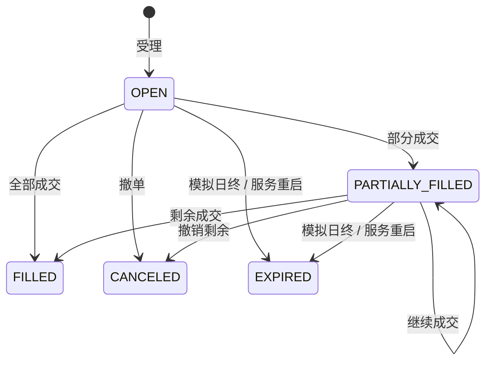

# 海港股票 App 产品方案

本方案尚待学习者评估。港股、全部 mock 与股票业务闭环是当前方向，页面、交互细节、模拟参数和接口可继续调整；已有原型不表示产品方案已确认，原生 App 暂不创建。

海港（Harbor）是用于原生客户端学习的港股模拟交易应用。Swift + SwiftUI 与 Kotlin + Jetpack Compose 分别实现独立 App，使用相同的共享 mock 服务。产品以已有股票客户端经验为起点，通过需求调整和真实运行逐步完善；正式语言与平台知识在具备应用上下文后提炼。本文件维护产品行为，接口见[共享接口方案](../shared/services/docs/api.md)，可操作入口见[原型说明](../prototype/README.md)。

## 第一版定位与边界

第一版完成“登录 → 添加自选 → 看行情 → 买入 → 跟踪委托与成交 → 查看资金和持仓 → 卖出”的闭环。当前交付为 HTML 原型和共享 mock，尚未建立两个原生股票工程。

市场由用户选择为港股，币种为 HKD，展示时区为 Asia/Hong_Kong。股票名称与代码取自熟悉的港股，所有报价、指数、资金流向和交易结果均由 mock 产生，不对应真实行情。应用持续显示“模拟交易”。

采用现金账户、只做多、限价委托、同日买卖。以下参数是本应用的模拟规则：全部证券每手 100 股、最小价位 0.01 HKD、价格范围 1.00–10,000.00 HKD，每笔最多 100,000 股。它们不代表港交所每只证券的实际每手数量、价位表或券商限制。

第一版不展开保证金、做空、衍生品、多市场、多币种、真实开户入金、完整交易所撮合、企业行动和结算交收。WebView、额外系统权限、后台执行、Flutter/RN 混合接入等后续按需求增加。前台断线恢复属于当前行情和交易可用性的基本行为。

## 用户与账户

### 登录、注册与会话

邮箱作为模拟登录标识，密码为 8–128 位。注册时可填写称呼，成功后自动登录。重复邮箱、格式错误和凭据错误在表单附近反馈。没有真实邮箱验证码、找回密码或真实身份资料流程。

用户未登录时可以浏览市场、搜索股票、查看行情。示例自选用于展示界面；修改自选、交易和账户查询需要登录。登录后读取用户自己的自选、资产和交易记录。退出登录后清除当前客户端会话与账户内容，公开行情继续可用。

访问凭据有效期 8 小时，刷新凭据有效期 7 天。刷新采用凭据轮换，过期或注销的凭据不能继续读取账户数据。原型在浏览器 localStorage 保存模拟会话；原生端凭据保存策略在工程实现时确定。

### 初始状态

| 账户 | 现金 | 持仓 | 自选 |
| --- | --- | --- | --- |
| 演示账户 | 182,680.50 HKD | 腾讯 200 股、阿里 300 股、小米 1,000 股 | 前六只示例股票 |
| 新注册账户 | 182,680.50 HKD | 无 | 前六只示例股票 |

演示入口使用固定模拟账户，凭据及完整初始数据位于[固定数据](../shared/services/fixtures/market.json)。同一账户在不同客户端共享自选、委托、资金和持仓；页面选择、图表视口和输入中的委托草稿由各客户端独立管理。

## 页面与导航

| 一级入口 | 核心内容 | 主要去向 |
| --- | --- | --- |
| 自选行情 | 自选列表、指数概览、选中股票行情、资金流向、快捷交易 | 搜索、行情详情、交易确认 |
| 市场发现 | 全部股票、行业筛选、搜索 | 行情详情、加入自选 |
| 交易委托 | 当前委托、全部委托、成交明细 | 委托详情、撤单 |
| 我的资产 | 总资产、可用/冻结资金、持仓及浮盈亏 | 行情详情、卖出 |

HTML 在宽屏组合呈现列表、详情和交易面板，在手机上先展示列表，选中股票后进入详情，交易面板位于详情下方。手机底部保留四个一级入口，行情详情提供返回自选。原生版沿用业务关系，具体导航、返回和输入体验遵循各平台习惯。

## 自选与搜索

支持按中文名称、代码、英文名称、行业搜索当前证券集合。搜索结果展示名称、代码和最新价；选择结果打开行情，星标添加或移除自选。

自选最多 50 只，证券 ID 不重复。列表实时更新报价，选中的证券保持稳定。原型通过“上移”调整顺序，通过移除按钮删除；手机持续显示操作入口，宽屏在行悬停或键盘焦点时显示。排序结果保存于服务端。

没有自选时显示搜索入口。多个客户端同时修改时使用版本检查，冲突后重新读取列表并提示，不静默覆盖另一端的新顺序。

## 行情与图表

### 报价

展示最新价、绝对涨跌、涨跌幅、今开、最高、最低、昨收、成交量、成交额及更新时间。红色表示上涨，绿色表示下跌，同时保留正负号和数值。证券代码旁明确 HK，交易输入明确 HKD。

共享服务每 1.5 秒推进一次确定性报价变化。模拟市场从 2026-11-10 10:36 香港时间开始，按实际经过时间前进，16:00 结束；不依赖开发机当前是否处于真实交易时段。该连续模拟时段省略午间休市和交易日历。

指数卡片是 mock 对股票变化率的合成展示，不是实际恒生指数计算。成交量和成交额是模拟市场汇总，用户自己的成交记录是独立账本，不要求两者完全对应。

### 分时与 K 线

提供分时、日 K、周 K、月 K；图表具有成交量、日/周/月周期的 MA5 与 MA20、十字线读数、拖动历史、滚轮和按钮缩放、“更早行情”加载。分时入口显示分钟收盘价连线。

历史序列采用可重复的合成数据。当前日 K 的开高低收与成交量与报价一致；历史周/月序列用于交互设计，其日期区间和 OHLC 不代表完整交易日历与从分钟数据严格聚合的交易所行情。当前周/月使用固定 7/30 天模拟桶，原生正式图表需求若要求自然周/月，应先升级共享契约与生成器。

切换证券或周期后保留明确的选中状态，丢弃旧请求对当前证券的更新资格。加载更早数据与实时当前柱合并，避免推送覆盖已载入历史。原型最多保留 540 根，单次最多 180 根；长期历史和无限分页不在第一版。

### 资金流向

提供今日、5 日、20 日范围，展示流入、流出、净流入及大/中/小单分类。这里的“资金”指行情统计，不是账户余额。mock 基于模拟成交额和涨跌幅产生说明性的估算，不代表交易所或第三方机构真实的主力资金口径；分类净额按显示精度取整。

## 交易规则

### 填写与预览

从行情页发起买入或卖出；从持仓进入卖出时带入证券与方向。输入限价和股数，支持使用对手价与常用数量。编辑期间价格保持用户输入值，行情变化不自动覆盖草稿。

客户端显示预估费用和支出/收入，服务端预检查是提交依据。服务端核对市场状态、价格精度、数量单位、可用资金或可卖持仓，返回不可修改的确认信息。

确认有效期为服务端时间基准的 15 秒，界面倒计时。过期后重新预览。报价更新时间、确认有效期、委托有效期分别表达；确认有效不保证最终成交或成交价等于预览时行情。

### 委托与成交

每笔提交绑定一个确认 ID 和客户端订单标识。连续点击、网络重试与结果恢复沿用原标识。一份确认不能创建两笔委托，提交时再次核对资金或持仓。接口返回受理后进入待成交。

预检查或受理校验失败以业务错误返回，当前实现不为拒绝请求建立一条委托记录。网络结果不明是客户端提交状态，不增加服务端委托状态。通过客户端订单标识查询，必要时重试同一份提交；明确确认已过期且未受理后，才重新预览。

买入在卖一价不高于限价时成交，卖出在买一价不低于限价时成交。模拟买一/卖一为最新价减/加 0.01。每个撮合周期每笔最多成交 100 股，因此大额委托可以逐步成交。不存在真实订单簿、价格时间优先队列、市场冲击或多账户对手方撮合。

DAY 委托在当前模拟交易日 16:00 失效。演示设置中的“休市”只暂停新委托和撮合，原有委托仍可撤单；恢复交易后继续。服务重启会使未完成委托到期，保留已成交部分并释放剩余冻结，避免将重启的行情基线用于继续撮合旧单。

### 费用、冻结与账户

佣金为累计成交额的 0.03%，每笔委托最低 1 HKD，向上取整到分。部分成交按累计费用增量扣款，不对每次成交重复收取最低费用。第一版没有额外印花税、交易征费等费用项。

买入受理时冻结“限价 × 数量 + 预估佣金”。部分成交扣减现金和对应冻结，剩余冻结采用保守保留策略，价格改善产生的余额在整单结束后释放。撤单只撤销未成交数量，已发生成交保留。

卖出受理时锁定未成交数量，避免重复卖出；成交后减少持仓、增加扣费后的现金。允许卖出当日新买入股数。持仓成本包含买入费用，卖出按比例减少账面成本。

| 指标 | 含义 |
| --- | --- |
| 现金 | 尚在账户内的现金，包含已冻结部分 |
| 可用资金 | 现金减去活动买单冻结 |
| 冻结资金 | 未结束买单保留的资金 |
| 可卖数量 | 持仓数量减去活动卖单未成交数量 |
| 总资产 | 现金加当前持仓市值 |
| 持仓浮盈亏 | 当前持仓市值减去该持仓剩余账面成本 |
| 持仓今日浮动 | 当前价相对昨收的差乘以当前股数，不是完整账户日收益 |

## 连接、恢复与反馈

行情断线时显示连接恢复中，暂停演示推送时显示已暂停。重连采用退避，并重新取得订阅快照；自选、账户与委托由服务端恢复。最后报价可以继续展示，但不以断线期间的静止画面表示最新行情。

HTTP 请求失败显示可读错误。资金不足、持仓不足、市场休市、确认过期和版本冲突使用各自的业务码，不能统一显示“下单失败”。提交超时保留待确认信息，刷新后仍能在交易页面查询或重试原提交。

## 原型验收

| 流程 | 可观察结果 |
| --- | --- |
| 注册 → 退出 → 登录 | 能恢复同一账户，新用户无演示持仓 |
| 搜索 → 添加 → 上移 → 删除 | 自选数量与顺序正确，刷新后保留 |
| 选股 → 换周期 → 查看历史 | 标题、报价、图表、资金流向对应当前证券 |
| 买入 100 股 → 成交 | 委托和成交可查询，现金扣减、持仓增加、冻结释放 |
| 买入多手 → 部分成交 → 撤余单 | 已成交部分保留，剩余冻结释放 |
| 低于卖一的买单 → 撤单 | 保持待成交，撤销后资金恢复可用 |
| 持仓 → 卖出 → 成交 | 可卖数量、持仓和现金一致更新 |
| 等待确认过期 | 确认按钮禁用，重新预览后可继续 |
| 暂停推送 → 恢复 | 明确显示连接状态，恢复后同步快照 |
| 手机 / 宽屏 | 导航、表单、图表与横向表格可以操作 |

实际执行结果与运行方式维护在[原型说明](../prototype/README.md)，接口和服务检查见[服务说明](../shared/services/README.md)。产品设计、代码存在、测试通过、浏览器观察和原生设备行为分别记录。
