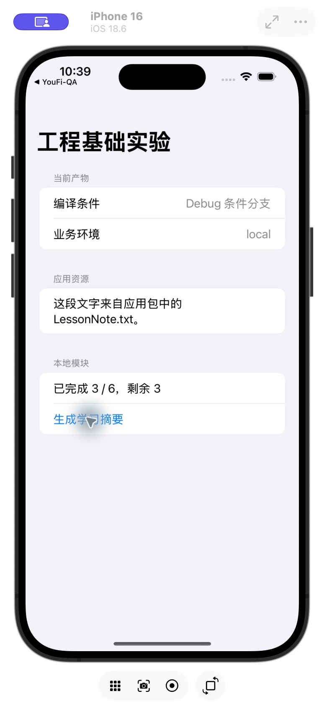
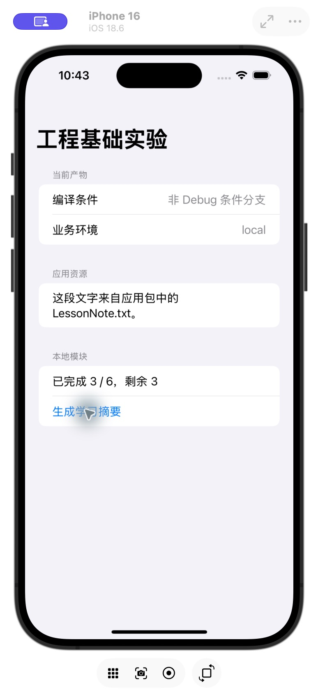
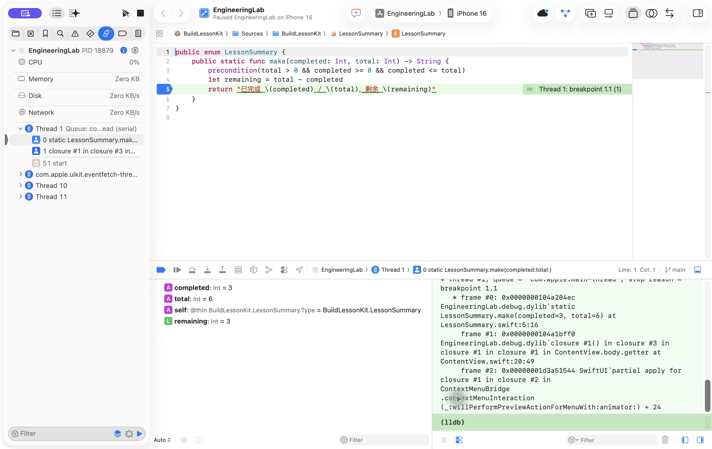

# EngineeringLab｜工程基础实验

本实验为 [iOS 01 核心正文](../../docs/ios/01-engineering-foundations.md)提供可以打开、修改、构建和调试的具体工程。它回答当前应用如何接入一个本地模块、怎样读取配置与资源，以及如何用构建日志和断点核对执行过程。

场景刻意保持简单：应用显示编译分支、业务环境和包内文本。点击“生成学习摘要”后，应用把 `completed = 3`、`total = 6` 交给本地库，预期显示“已完成 3 / 6，剩余 3”。这里没有网络请求、持久化或后台任务；这些机制尚不属于本实验。

## 从哪里开始

建议依次完成六个单元，每个单元先预测、再操作、最后解释观察。操作依赖已有工程，学习者可以逐项重复，无需一次阅读全部构建输出。

| 单元 | 阅读与操作 | 需要解释的结果 |
| --- | --- | --- |
| 1. 环境 | 核对下面的版本与运行目标 | 编译器、language mode、SDK、runtime 与 deployment target 分别约束什么 |
| 2. 工程组成 | 打开 project，检查 target、scheme、configuration 与文件归属 | 目录、产品和动作为什么需要分别描述 |
| 3. 构建运行 | 在 Simulator 运行，检查生成的应用包 | Build 成功后，安装和启动还做了什么 |
| 4. 模块 | 打开 Package.swift，追踪按钮到库函数 | product、target、module 与 public API 如何衔接 |
| 5. 配置与增量 | 对比 Debug／Release；改变一个构建输入 | 编译条件和业务环境怎样分别进入产物，哪些任务重做 |
| 6. 调试与失败 | 设断点检查参数，复现并恢复小故障 | 从哪个阶段、哪条证据开始定位 |

## 环境与前提

2026-10-29 的实际核对结果如下，后续换机或升级后需要重新检查。

| 项目 | 当前值与证据 |
| --- | --- |
| Developer 目录 | `/Applications/Xcode.app/Contents/Developer`，由 `xcode-select -p` 检查 |
| Xcode | 27.1，build 27A9275，由 `xcodebuild -version` 检查 |
| Swift compiler | Apple Swift 6.4，swiftlang-6.4.0.34.1 |
| 应用 language mode | Swift 6，通过 Xcode target Build Settings 核对 |
| 包 manifest | swift-tools-version 6.0；使用本机 6.4 工具链处理 |
| Simulator SDK | iOS 27.1，由 `xcodebuild -showsdks` 检查 |
| 最低部署版本 | iOS 18.0；应用支持 iPhone 与 iPad |
| 原有 runtime | iOS 18.6（22G86） |
| 新 runtime | 用户已授权下载 iOS 27.1（24A94232）arm64；安装和运行状态见文末验证记录 |
| 签名 | 未配置开发团队；当前验证面向 Simulator |

核对命令：

```bash
xcode-select -p
xcodebuild -version
swift --version
xcodebuild -showsdks
xcrun simctl list runtimes
xcrun simctl list devices available
xcrun mcp-server status
```

缺少 Xcode 或 runtime 时，按 [开发环境说明](codex-setup.md)准备。通常由学习者执行安装和本机配置；本次 iOS 27.1 下载是在用户明确授权后执行：

```bash
xcodebuild -downloadPlatform iOS -buildVersion 27.1 -architectureVariant arm64
```

命令按本机 `xcodebuild -help` 核对。此处选择 arm64 对应当前 Apple silicon Mac；不假定其他平台、其他 Xcode 版本支持完全相同选项。下载完成不等于已创建和启动模拟器，应重新检查 runtime 与设备列表。

## 工程结构与输入归属

```text
ios/
├── EngineeringLab/
│   ├── EngineeringLab.xcodeproj/
│   └── EngineeringLab/
│       ├── EngineeringLabApp.swift
│       ├── ContentView.swift
│       ├── BuildIdentity.swift
│       ├── Info.plist
│       ├── LessonNote.txt
│       └── Assets.xcassets/
├── Packages/
│   └── BuildLessonKit/
│       ├── Package.swift
│       └── Sources/BuildLessonKit/LessonSummary.swift
└── docs/
```

工程最初由本机 Xcode 的 SwiftUI App 模板生成，再限定为 iOS 平台。模板默认的 iOS 27.0 部署要求已调整为 18.0，应用 language mode 明确设为 Swift 6。保留模板的 MainActor 默认隔离等设置；其并发含义在 02 展开，本轮没有引入并发任务。

`EngineeringLab` 应用 target 使用文件系统同步 group 管理源码目录，源码与普通资源按规则纳入，源 Info.plist 的处理由 Xcode 配置。不要把学习笔记、故障日志或脚本放入该目录。`docs/` 和 `Packages/` 位于应用输入目录之外。

| 文件 | 当前职责与调用关系 |
| --- | --- |
| [EngineeringLabApp.swift](../EngineeringLab/EngineeringLab/EngineeringLabApp.swift) | 声明入口和 WindowGroup，将根内容交给 SwiftUI |
| [ContentView.swift](../EngineeringLab/EngineeringLab/ContentView.swift) | 显示构建信息和资源；拥有本页的 `summary` 状态，按钮写入新摘要 |
| [BuildIdentity.swift](../EngineeringLab/EngineeringLab/BuildIdentity.swift) | 用编译条件选择说明，从应用 bundle 读取配置与文本；失败返回可见文字 |
| [Info.plist](../EngineeringLab/EngineeringLab/Info.plist) | 提供自定义演示字段 `LabEnvironment = local`；最终元数据还包含构建生成内容 |
| [LessonNote.txt](../EngineeringLab/EngineeringLab/LessonNote.txt) | 作为普通文本资源进入应用包 |
| [Package.swift](../Packages/BuildLessonKit/Package.swift) | 声明 library product 和源码 target，没有远程依赖 |
| [LessonSummary.swift](../Packages/BuildLessonKit/Sources/BuildLessonKit/LessonSummary.swift) | 接受有效计数并生成摘要；不持有 UI、任务或资源 |

`summary` 在视图的状态存储中保留，本例没有把它放进 Package 全局变量。库函数只消费参数并返回 String；它要求 `total > 0` 且 `0 <= completed <= total`，用 precondition 表达示例的程序约束。用户输入校验与可恢复业务错误不应直接照搬为崩溃，本例没有开放任意用户输入。

## 打开、构建与运行

在 Xcode 使用 File → Open，选择 `ios/EngineeringLab/EngineeringLab.xcodeproj`。确认顶部 Active Scheme 为 EngineeringLab，目的地选择一台具体 iPhone Simulator。菜单名称以 Xcode 27.1 实际界面为准。

首次通过 MCP 打开工程时，需要区分全局服务启用与当前 agent 的项目授权。当前会话已成功创建、打开并查询工程；后续新会话仍应以实际调用结果为准。界面窗口与后台打开可能同时产生两个 workspace identifier，应使用当前窗口对应的 identifier，不能把它们写死进长期脚本。

点击 Run 或使用 Product → Run。正常预期是显示“工程基础实验”，编译条件为 Debug，业务环境为 local，资源段显示来自 LessonNote.txt 的文字。此时摘要为“尚未生成”；点击按钮后才出现计算结果。

从仓库根目录也可以构建，构建产物放入已忽略的 `ios/DerivedData`：

```bash
xcodebuild \
  -project ios/EngineeringLab/EngineeringLab.xcodeproj \
  -scheme EngineeringLab \
  -configuration Debug \
  -sdk iphonesimulator \
  -destination 'generic/platform=iOS Simulator' \
  -derivedDataPath ios/DerivedData \
  build
```

这条命令只构建，成功时不会自动把应用安装到一台具体设备。运行交互仍需选择 Simulator 并 Run。真机签名和分发条件不由这条命令验证。

实际 iPhone 16／iOS 18.6 的运行界面如下，已点击按钮生成摘要。截图来自本次 Device Hub 窗口；不能据此推断新系统或真机行为。



当前示例使用中英混合的工程标识，用户可见教学文字为中文。完整多语言、无障碍和自适应验证不在本单元范围。

## 检查最终产物

Debug Simulator 产物位于 `ios/DerivedData/Build/Products/Debug-iphonesimulator/EngineeringLab.app`。先检查内容，再把结果与界面联系起来：

```bash
plutil -p ios/DerivedData/Build/Products/Debug-iphonesimulator/EngineeringLab.app/Info.plist
file ios/DerivedData/Build/Products/Debug-iphonesimulator/EngineeringLab.app/EngineeringLab
xcrun vtool -show-build ios/DerivedData/Build/Products/Debug-iphonesimulator/EngineeringLab.app/EngineeringLab
cat ios/DerivedData/Build/Products/Debug-iphonesimulator/EngineeringLab.app/LessonNote.txt
```

预期 Info.plist 包含应用身份、最低系统要求和 `LabEnvironment`，可执行文件具有 iOS Simulator 平台信息，文本资源可在包内读取。Asset Catalog 由编译工具处理，查看处理后资源，不期待整个源码目录原样出现。

构建日志可在 Report navigator 中查看，展开具体任务和完整命令。可搜索 `SwiftCompile`、`SwiftEmitModule`、`Ld`、`CpResource`、`ProcessInfoPlistFile`、`CompileAssetCatalog` 与 `CodeSign`；具体名称与拆分随 Xcode 和配置变化。

## 本地依赖的接入与边界

当前已通过 File → Add Package Dependencies… → Add Local… 选择 `ios/Packages/BuildLessonKit`，再把 BuildLessonKit library product 关联到 EngineeringLab target。重新打开工程无需再添加一次；Package Dependencies 应标记它为 local。

应用中的 `import BuildLessonKit` 对应源码模块。点击按钮执行 `LessonSummary.make(completed: 3, total: 6)`；枚举与函数均公开，应用才可以跨模块调用。包采用相对路径关联，应连同 `ios/Packages` 一起保留。

这里没有远程 package，不下载第三方业务库，也没有需要展示的远程解析锁定结果。后续引入远程依赖时，再记录约束、Package.resolved 与实际提交；不要为演示锁文件伪造一个解析记录。

## 配置和增量实验

先保持正常基线，只改变一项输入。每次观察后恢复，避免多个变更混在一起。

### Debug 与 Release

在 scheme 的 Run → Info 中检查 Build Configuration。也可把构建命令中的 `-configuration Debug` 改为 `Release`，生成独立目录中的 Release 产物；CLI 构建配置不会自动修改 Xcode 的 Run 动作。

`BuildIdentity.compilation` 由 `#if DEBUG` 选择，业务环境来自 Info.plist。预期 Release 不保留 Debug 分支，而 `LabEnvironment` 仍为 local。若想在界面观察 Release，需要明确让 Run 使用 Release 或安装对应产物，不能仅凭 Release 构建成功就声称已看到画面。

实际安装已构建的 Release 包后，页面确实显示“非 Debug 条件分支”，业务环境仍为 local；按钮摘要正常。检查后已终止 Release 进程并重新安装 Debug 包。



本轮未接入 `.xcconfig`。需要多套配置时，可按核心正文和官方资料增加文件，再在 project 的 Info → Configurations 中关联 Base Configuration，并核对 target 层覆盖关系。

### 不改输入，再构建一次

在同一 configuration、SDK、destination 与 DerivedData 下再次执行构建，预期复用大部分已有产物。记录是否还出现实际 Swift 编译或链接任务，而不是只比较“成功”提示。准备、校验或元数据任务仍可能执行。

### 修改普通资源

只改 `LessonNote.txt` 中的文字，再用相同条件构建。预期新文字进入应用包，Swift 源码无需因这一处普通文本变化而重编译。检查实际日志与包内容，再重新安装观察界面。恢复文本后也应构建恢复后的产物。

### 修改源码与配置

把包函数中的“剩余”改成其他文字，预期需要重编译受影响代码并形成新的链接产物。改变编译条件或其他构建设置则可能扩大失效范围；是否重做由具体输入依赖决定。练习后恢复源码，并重复正常构建。本轮不据此宣称构建速度改善。

## 用断点追踪按钮调用

在 `LessonSummary.make` 内设置断点，推荐先停在 precondition 或 `let remaining` 所在行。以附加调试器的 Run 启动，点击按钮；断点命中后检查参数，再单步执行计算，检查 remaining。不同 Xcode／优化设置下，具体可停位置可能不同。

LLDB 控制台可使用：

```text
process status
frame variable completed total
thread step-over
frame variable remaining
bt 8
continue
```

先确认进程处于暂停状态，再求值或查看当前栈帧变量。`bt` 检查库函数和应用调用闭包的关系。单步可能停在运行库或改变当前 frame，不能在其他栈帧直接假定局部变量存在。结束后移除本次实验断点，恢复执行或停止应用。

下图是本次实际命中的 Xcode 断点，停止在返回语句前：计算已完成，变量区显示 completed、total 和 remaining；右侧控制台显示调用栈。



如果 DeviceInteraction 工具拒绝旧 Simulator，不应把这一错误当成应用代码不兼容。当前 Xcode 27.1 的该工具要求 iOS Simulator 27.0+；CLI 构建、普通 Run、调试和设备交互服务需要分别记录结果。

## 可恢复的故障练习

| 输入变化 | 预期现象 | 恢复与完成依据 |
| --- | --- | --- |
| 临时移除库函数的 public | 应用编译报告不可访问 | 恢复 public，再构建成功；确认不是链接错误 |
| 查询不存在的资源名 | 应用构建可能成功，界面显示资源缺失 | 恢复正确资源名，重新安装并核对文字 |
| 将 completed 设为 7、total 保持 6 | Debug 下触发 precondition，调试器停止 | 恢复 3、6；重新运行得到正确摘要；不要在普通基线保留崩溃入口 |
| 创建一个只有外部声明、没有实现的独立 C 小程序 | 编译为目标文件成功，链接报告未定义符号 | 只在临时目录执行，检查阶段区别，不向应用增加 C 接口 |

独立链接故障可在 macOS 终端复现，临时路径不参与应用构建：

```bash
lesson_tmp=$(mktemp -d)
cat > "$lesson_tmp/missing.c" <<'C'
extern int lesson_value(void);
int main(void) { return lesson_value(); }
C
xcrun clang -c "$lesson_tmp/missing.c" -o "$lesson_tmp/missing.o"
xcrun clang "$lesson_tmp/missing.o" -o "$lesson_tmp/missing"
```

第一条 clang 命令只生成目标文件，预期成功；第二条命令需要找到 lesson_value 的定义，预期失败。本例没有给出实现，所以两步结果不同。它只演示本机 macOS 工具链的阶段区别，没有对 iOS 包的链接方式作额外结论。

这些是实验设计；实际执行覆盖见下一节。安装失败、签名失败和动态库加载失败没有为了凑齐分类而破坏本机环境，核心正文解释定位方法，后续有合适场景再验证。

## 实际验证与限制

此节只记录实际执行及其条件，随着实验修正当前结果。构建成功、模拟器行为和学习者掌握分别判断。

2026-10-29 已执行以下检查，应用源码和资源均已恢复正常基线：

| 检查 | 真实观察 | 证据范围 |
| --- | --- | --- |
| 环境与 MCP | 版本、runtime、服务状态已核对；成功创建、打开、查询工程 | 证明本次所用入口可访问，未逐个调用全部 MCP 工具 |
| Debug／Release 构建 | 两种 configuration 的通用 Simulator 构建均成功 | SDK 27.1，产物同时含 arm64、x86_64；不包含真机构建 |
| 应用元数据与资源 | 两个包均含 local、MinimumOSVersion 18.0、原始资源文字；vtool 显示 IOSSIMULATOR／SDK 27.1 | 核对最终产物，未以源配置替代检查 |
| 无输入变化 | 后续构建未出现 SwiftCompile、Ld 或 CpResource 任务 | 在同一 DerivedData 下观察，未进行耗时收益对照 |
| 仅改普通文本 | 出现 CpResource，未出现 SwiftCompile／Ld；包内内容已变化 | 恢复文本后再构建，恢复原始包内文字；变更文本未另行安装观察 |
| 修改 Package 函数文字 | 出现 SwiftCompile、SwiftEmitModule 与 Ld | 恢复源码并构建成功；任务数量受双架构及调试产物影响，不等于源码文件数 |
| 移除函数 public | 应用编译失败，报告 make 因 internal protection level 不可访问；xcodebuild 返回 65 | 已恢复 public 并重新构建成功 |
| 独立 C 链接故障 | clang -c 返回 0，目标文件存在；链接返回 1，报告 _lesson_value 未定义 | 使用本机 macOS arm64 的临时文件，只证明编译／链接阶段差异，未冒充 iOS 应用链接实验 |
| iOS 18.6 Debug 运行 | RunProject 构建、安装、启动成功；实际点击按钮得到预期文字，未见当前画面截断重叠 | Device Hub 的 CUA 界面与截图观察，没有取得应用内部 UI hierarchy |
| iOS 18.6 Release 运行 | simctl 安装启动成功；CUA 确认非 Debug 分支、local、资源及按钮结果正确 | 运行后已终止 Release 进程，重新安装正常 Debug 包，未再次启动 |
| 断点 | LessonSummary.swift:5 命中；参数 3、6，remaining 为 3；栈中包含 ContentView.swift:20 的调用闭包 | 已删除新增断点，继续执行后停止本次调试进程 |

构建日志还出现 App Intents 元数据提取跳过的提示：当前应用没有 AppIntents.framework 依赖，未实现 App Intents，本轮构建仍成功。未把这一提示计作编译错误或已验证 App Intents。

尚未执行资源缺失和 precondition 失败的应用运行实验，也未验证远程依赖、二进制依赖、真机签名、归档、性能、自动化测试或 Preview。故障练习表中这些项目是待学习者按需开展的设计，不列为通过。

用户授权的 iOS 27.1 runtime 仍在下载，尚未把下载开始当作安装完成；新系统运行与 MCP 设备交互检查待安装后补充。已完成的 iOS 18.6 观察不能替代该项。

任务产物已具备核心正文、可运行工程、操作说明和实际截图。工程验证按上表限定。学习掌握仍需学习者解释版本和工程关系、预测修改影响并独立操作，不能由生成文件代为确认。

## 参考与后续入口

- [iOS 01：平台机制与工程判断](../../docs/ios/01-engineering-foundations.md)
- [开发环境与工具配置](codex-setup.md)
- [Apple：Adding package dependencies to your app](https://developer.apple.com/documentation/xcode/adding-package-dependencies-to-your-app)
- [Apple：Stepping through code and inspecting variables to isolate bugs](https://developer.apple.com/documentation/xcode/stepping-through-code-and-inspecting-variables-to-isolate-bugs)
