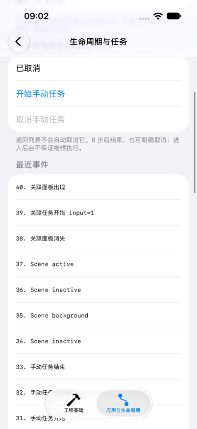

# EngineeringLab｜生命周期与任务

本实验进入“应用与生命周期”标签中的“生命周期与任务”，观察页面出现、任务关联与 Scene 阶段这三层关系。运行方式沿用[页面声明实验](swiftui-pages-and-state.md#运行环境与入口)。

## 观察对象与运行条件

本组使用 Xcode 27.1、Swift 6 language mode，最低 iOS 18.0。不需要网络、后台权限或服务端。任务每秒挂起一次，共八步，使开始、取消和结束有时间被观察；这不是 CPU 计算、网络请求或后台执行配额实验。

关键实现位于：

| 文件 | 作用 |
| --- | --- |
| [LabRootView.swift](../EngineeringLab/EngineeringLab/ApplicationLab/LabRootView.swift) | 窗口内持有模型和 journal，观察所属 Scene 的阶段 |
| [LifecycleTasksView.swift](../EngineeringLab/EngineeringLab/ApplicationLab/LifecycleTasksView.swift) | 页面、条件面板、任务输入与操作按钮 |
| [TaskExperiment.swift](../EngineeringLab/EngineeringLab/ApplicationLab/TaskExperiment.swift) | 关联任务的状态与轮次控制，手动任务句柄及取消 |
| [LifecycleJournal.swift](../EngineeringLab/EngineeringLab/ApplicationLab/LifecycleJournal.swift) | 记录当前进程的有限事件列表，并输出控制台 |

journal 由窗口内容持有，返回列表后仍在；最多保留 60 条，序号递增。页面显示倒序方便查看最新内容，控制台按发生顺序输出。筛选 `[AppLab]` 可以减少系统日志干扰。序号表示一次实际执行中的记录顺序，不能当作跨线程精确时钟或完整系统事件流。

## 页面事件与 Scene 事件

ApplicationLabView 读取并记录所属 Scene 的阶段：

```swift
@Environment(\.scenePhase) private var scenePhase

.onChange(of: scenePhase, initial: true) { _, phase in
    journal.record("Scene \(String(describing: phase))")
}
```

这里展示的是成员声明与修饰器两部分，完整组合见源码。initial 为 true，让首次进入观察时也记录当前阶段；后续由系统阶段变化触发。读取位置在窗口内容中，所以观察的是所属 Scene。

任务页与面板分别在自己的根内容上记录：

```swift
.onAppear { journal.record("任务页出现") }
.onDisappear { journal.record("任务页消失") }
```

打开任务页改变页面出现关系，未必产生新的 Scene 阶段；切到桌面改变 Scene 的运行条件，导航路径仍可保留。journal 记录事件字符串，不保存页面对象。模型释放的直接观察由对象寿命实验承担。

先进入任务页，观察出现日志，然后返回列表再进入。新的一次任务页有自己的输入和显示开关初值，journal 仍保留本进程已有事件。记录放在事件入口，使界面计算保持为内容描述。

## 可移除面板与关联任务

页面使用普通条件控制面板是否存在：

```swift
Toggle("显示关联任务面板", isOn: $showPanel)
Stepper("任务输入：\(input)", value: $input, in: 1...9)
if showPanel {
    AttachedTaskPanel(input: input, tasks: tasks, journal: journal)
}
```

面板在自己的文本上关联任务：

```swift
Text(tasks.attachedStatus)
    .task(id: input) {
        await tasks.runAttached(input: input, journal: journal)
    }
```

面板从不存在变为存在时开始一轮；input 改变时，框架取消旧任务并启动新输入；移除面板时框架取消关联任务。相比依赖某个导航容器对“可见”的具体处理，直接移除条件分支更容易观察任务与视图身份的关系。

面板同时是 Form 中的一行。滚动使这行离开可见区时，容器也可能触发消失和关联任务取消，即使显示开关仍为 on。本次模拟器已经观察到这种行为。因此前四步保持面板可见，在 Xcode 控制台查看事件；需要看页内日志时再滚动，并将新增的取消与滚动操作对应。开关表示声明条件，不保证容器始终让该行处于出现状态。

runAttached 的关键部分是：

```swift
let run = UUID()
currentAttachedRun = run
defer { journal.record("关联任务结束 input=\(input)") }
do {
    for step in 1...8 {
        try await Task.sleep(for: .seconds(1))
        try Task.checkCancellation()
        guard currentAttachedRun == run else { return }
        attachedStatus = "输入 \(input)：\(step) / 8"
    }
    attachedStatus = "输入 \(input)：完成"
} catch is CancellationError {
    if currentAttachedRun == run {
        attachedStatus = "输入 \(input)：已取消"
    }
    journal.record("关联任务收到取消 input=\(input)")
}
```

这是函数关键路径，完整源码还包含初始状态、完成日志及其它错误处理。Task.sleep 是可取消的挂起点；`checkCancellation` 明确检查更新前的资格；run 标识避免旧轮次在退出时把新轮次状态覆盖成“已取消”。MainActor 隔离保护同步状态访问，但在 await 处允许交错，所以轮次判断仍有意义。

`defer` 记录函数真的离开了，而不是只记录框架已经提出取消。日志包含“收到取消”和“结束”，有助于区分取消请求与清理完成。

按下面步骤分别观察：

1. 进入页面后等待进度从 0 变化，预期看到输入 1 的开始与进度。
2. 在八步完成前递增输入，预期旧输入收到取消并结束，新输入开始。
3. 在新任务完成前关闭“显示关联任务面板”，预期当前关联任务收到取消并结束。
4. 再打开面板，预期按当前输入重新开始；输入没变也会开始，因为这是重新进入的一份面板身份。

前后两轮的日志可能交错，不要求“旧任务全部收尾之后新任务才开始”。应检查旧任务结束、新任务使用正确输入、旧取消不会覆盖新显示，而不是比对一条固定总顺序。

## 手动任务为何能离开页面继续

TaskExperiment 由窗口内容持有，任务页只接收同一实例。开始按钮调用 startManual，模型保留一份句柄：

```swift
guard manualTask == nil else { return }
manualIsRunning = true
manualTask = Task {
    defer {
        self.manualTask = nil
        self.manualIsRunning = false
        journal.record("手动任务结束")
    }
    // 八步可取消工作和错误处理见完整源码。
}
```

模型用句柄防止同时重复开始；结束时先清除句柄并更新运行状态，再记录结束。取消按钮只调用 `manualTask?.cancel()`，真正结束仍依赖工作响应取消。

这里闭包在执行期间持有模型，模型持有句柄。任务最多八步，正常结束或取消处理都会清除句柄，解除这段持有关系。不能将同一结构直接用于永不结束、没有退出规则的订阅。

做两组对照：

- **返回后完成**：开始手动任务后立即返回列表，保持应用在前台，八步后重新进入，预期状态为完成，日志包含手动任务完成与结束。页面离开没有对模型句柄发出取消。
- **明确取消**：再次开始，进度尚未完成时点击取消，预期出现收到取消与结束，按钮恢复可开始状态。

移除关联面板不会影响这份手动任务，它们的拥有者不同。返回时发生的关联任务取消与手动任务继续，正是本组要比较的行为。

## 前后台变化与执行限制

先在任务完成后执行一次 Home 操作，再从图标回到 EngineeringLab。保持原来的导航路径，检查 journal 的 Scene 记录。然后在工作尚未完成时重复操作，对比页面事件和 Scene 事件。

预期可观察失活、后台和重新活跃。后台之后的挂起没有单独的 ScenePhase 值，应用也无法依靠自身正在执行的日志记录“此刻已停止执行”。进程终止和重新启动的对照由下一组实验承担。

当前 onChange 只记录阶段，不自动取消手动任务或保存文件。因此，如果希望改为“仅 active 时工作”，需要在阶段变化入口明确发出取消，并决定再次 active 时如何重新开始。页面关联任务本身也没有申请后台执行资格；回到 App 已显示完成，只能证明这次产生了结果，无法推导持续后台运行。

需要判断更接近普通运行的挂起行为时，应停止 Xcode 调试，再从模拟器图标打开已经安装的应用。调试器附加可能影响挂起与终止，因此带调试器时的日志观察不承担后台调度结论。当前没有接入 BGTaskScheduler 或后台模式，也不以模拟器观察代替真机调度验证。

## 关键行为的自动检查

本仓库的 [ApplicationLabChecks.swift](../Tests/ApplicationLabChecks.swift) 对存储恢复、错误保留和任务取消交错做独立检查。它把不依赖 UI 的三个模型编译为 macOS 检查程序；视图身份触发的自动取消仍必须由上面的 iOS 交互验证。

从仓库根目录执行，要求当前 Swift 工具链和 macOS 支持 Observation：

```bash
mkdir -p ios/DerivedData/ApplicationLabChecks
swiftc -swift-version 6 -parse-as-library \
  ios/EngineeringLab/EngineeringLab/ApplicationLab/LessonStore.swift \
  ios/EngineeringLab/EngineeringLab/ApplicationLab/LifecycleJournal.swift \
  ios/EngineeringLab/EngineeringLab/ApplicationLab/TaskExperiment.swift \
  ios/Tests/ApplicationLabChecks.swift \
  -o ios/DerivedData/ApplicationLabChecks/checks
ios/DerivedData/ApplicationLabChecks/checks
```

测试创建临时目录，不使用 App 沙盒；通过时最后输出 `ApplicationLab checks passed`。失败时检查描述指出未满足的行为。它不建立 Xcode 测试 target，不证明 iOS 生命周期或系统后台行为。

## 实际验证

2026-10-31，Xcode 27.1 / Swift 6.4 Debug 构建通过；在 iPhone 17 / iOS 27.0 上实际交互，未附加 Xcode 调试器。

| 检查 | 真实观察 |
| --- | --- |
| 输入变化 | input 从 3 变为 4，日志中 input=4 开始后，input=3 收到取消并结束；允许新旧轮次交错 |
| 关闭面板 | input=4 尚未完成时关闭开关，观察到面板消失、收到取消和结束 |
| 手动任务返回 | 开始后返回列表再进入，仍在执行，随后完成并结束 |
| 手动任务取消 | 再次开始后明确取消，显示已取消，记录结束，开始按钮恢复可用 |
| Scene 阶段 | Home 再回到 App，实际记录 inactive → background → inactive → active |
| Form 滚动 | 面板滚出可见区域也触发消失、取消和结束；显示开关当时仍为 on |

这张截图是在任务页向下滚动后的事件区，能看到本次 Scene 阶段序列与手动任务结束记录。部分上方内容已滚出，不表示面板开关被关闭。



独立模型检查五组全部通过：保存与未保存版本的重建对照、无效快照保留、保存失败保留修改、关联任务取消交错、手动任务取消后释放句柄并可重新开始。检查程序在 macOS 上执行，不把模型检查当作 iOS 自动取消的证据。

没有验证真机、系统后台调度、后台长时间运行或资源压力终止。事件表只记录本次可观察关系，不把该次总顺序和执行时间提升为系统保证。

接下来使用[对象内存与进程恢复实验](state-restoration.md)，把出现、任务结束、对象释放和进程重建的证据分别核对。
