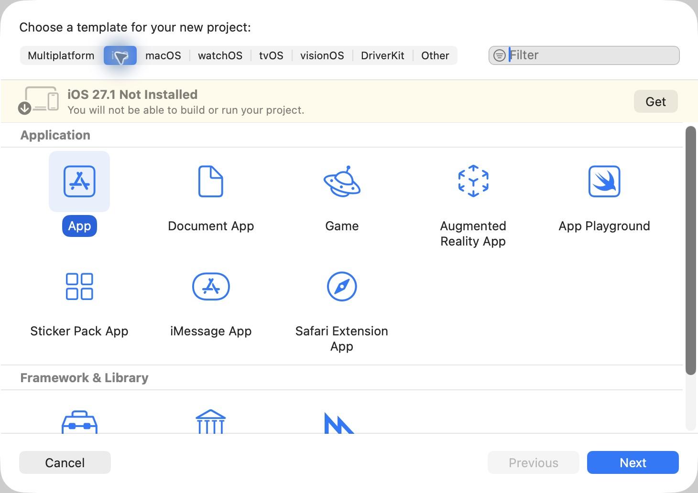
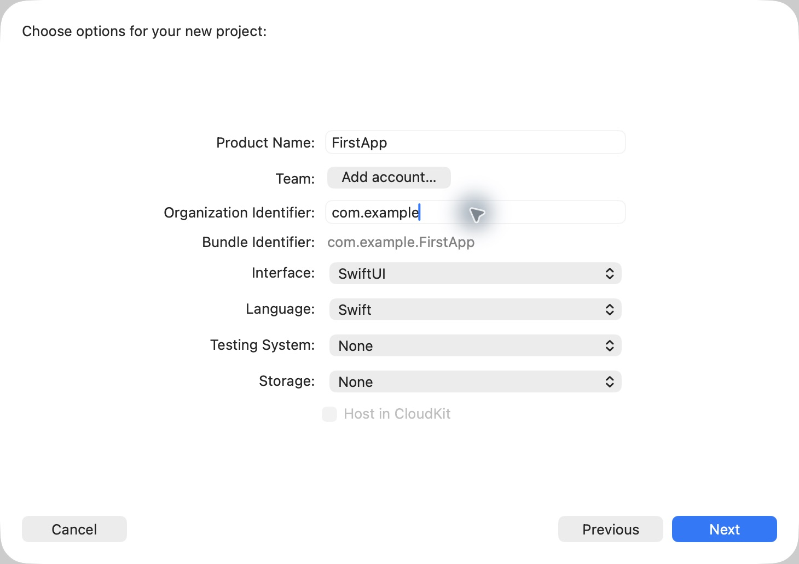
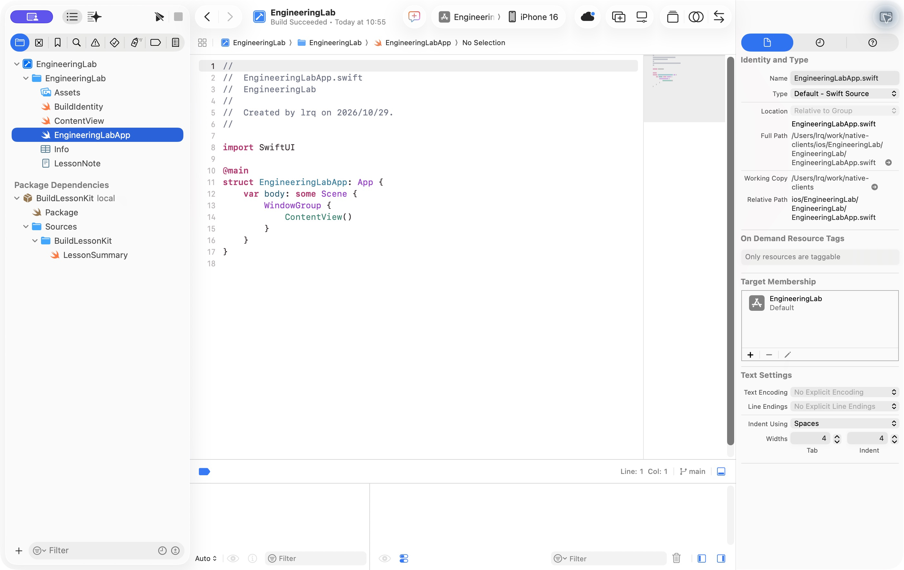
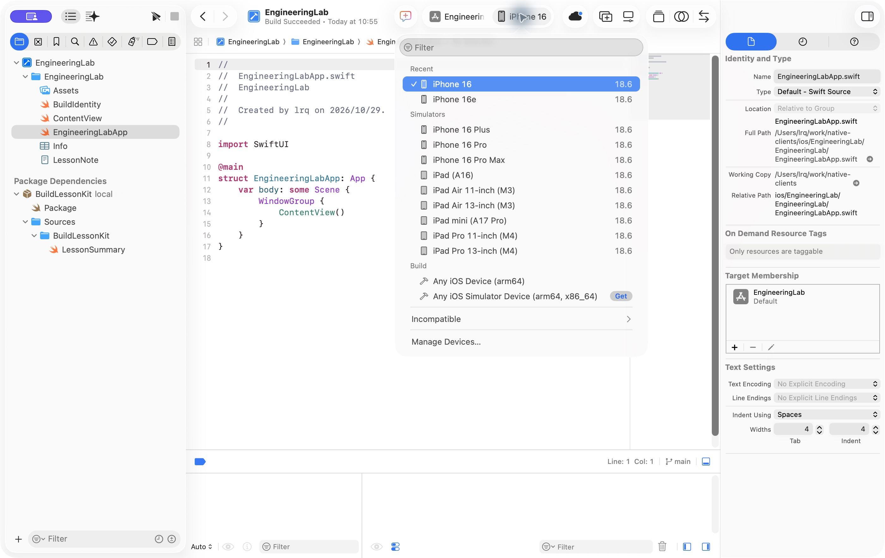
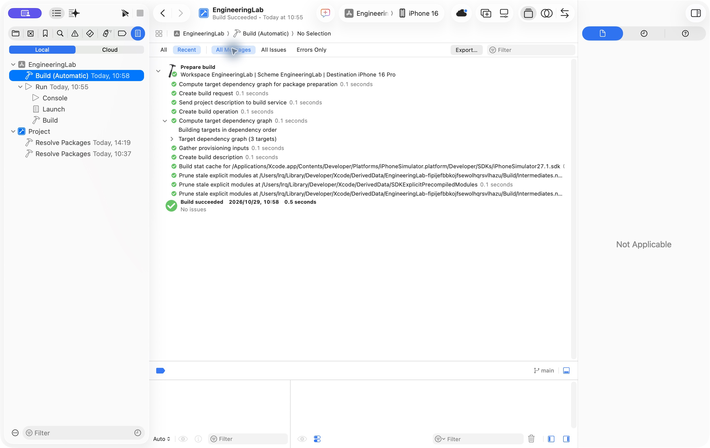

# iOS 工程入门：创建、阅读与运行第一个 SwiftUI App

本文是第一次进入 iOS 工程时的操作入口。目标是先创建一个最小 SwiftUI 应用，认识 Xcode 中最重要的区域和文件，再把这些认识连接到仓库中的 EngineeringLab。本文只建立能继续学习所需的最小 Swift 语法；工程对象和构建机制的完整解释见 [iOS 01｜工程基础与工具链](../../docs/ios/01-engineering-foundations.md)。

## 开始前

本机需要已经安装可运行的 Xcode；安装和版本切换见[开发环境与 Codex 工具配置](codex-setup.md)。本文使用 Swift 和 SwiftUI 创建 iOS App，菜单文字会随 Xcode 版本略有变化。

本文有两条路径：第一次接触 iOS 时从“创建项目”开始；已经有可运行 Xcode 工程时，可以直接阅读“打开仓库工程”。

下文配图来自本机 Xcode 27.1 的真实界面，截取于 2026-10-29。创建向导使用 `FirstApp` 作为示例名称，工程窗口使用仓库中的 EngineeringLab；断点图复用该工程已有的实际调试截图。

## 创建一个最小 iOS 项目

1. 打开 Xcode，点击欢迎窗口中的 **New Project**，或使用 **File → New → Project**。
2. Xcode 27.1 可能先显示快捷选择面板，选择 **Choose Template…**，再在模板窗口选择 **iOS → App**，点击 **Next**。
3. 填写项目选项：

   | 选项 | 本次选择 | 作用 |
   | --- | --- | --- |
   | Product Name | `FirstApp` | 项目和默认 target 的名称 |
   | Team | 按本机状态选择 | 真机签名需要；只运行 Simulator 时可以暂时留空 |
   | Organization Identifier | 例如 `com.example` | 与名称组合形成 bundle identifier |
   | Interface | `SwiftUI` | 使用 SwiftUI 描述界面 |
   | Language | `Swift` | 使用 Swift 源文件 |
   | Storage | `None` | 本次不添加持久化模型 |
   | Testing System | `None` | 本次先运行最小 App，后续按需要添加测试 target |

4. 选择保存位置，确认 **Create**。
5. 在左侧 Project Navigator 中选中项目最上方的蓝色项目图标，确认出现一个应用 target 和 Debug、Release 两套基本配置。

下图顶部选中 iOS，Application 中选中 App。黄色横幅是截取时本机对 iOS 27.1 组件的提示，说明模板选择与运行环境准备是两件事；出现提示时先检查所需组件与运行目标，不能把选中模板当作已经能够运行。



项目选项按下图填写。这里的 `com.example` 是演示标识；Team 尚未登录，先不为 Simulator 练习添加账户。



先保留模板的 Bundle Identifier、Signing 和 Build Phases。若模板默认的最低系统高于现有 Simulator，先核对版本条件，再选择兼容的运行系统或有依据地调整 Deployment Target，具体关系见 [iOS 01](../../docs/ios/01-engineering-foundations.md#版本如何限制能否运行)。

## 认识 Xcode 窗口

| 区域 | 看到什么 | 现在用它做什么 |
| --- | --- | --- |
| Project Navigator | 文件、工程、Package 和测试 target | 找到源码和资源 |
| Editor | 当前选中的源码、配置或 plist | 阅读和修改内容 |
| Inspector | 当前文件或工程对象的属性 | 查看 target membership、路径和设置 |
| Scheme | 当前要构建和运行的产品 | 选择 App、Test 或其他 target |
| Destination | 运行到哪台 Simulator 或真机 | 选择具体设备和系统 |
| Debug area | 变量、控制台和 LLDB | 查看运行时行为 |
| Report navigator | 构建、测试和运行报告 | 查看失败阶段和具体任务 |

如果某个区域没有显示，可以使用 Xcode 窗口右上角的导航、检查器和调试区按钮重新打开。学习时先记住“文件在左边找，内容在中间看，属性在右边查，运行目标在顶部选”。

下图选中了 `EngineeringLabApp.swift`：左侧是 Project Navigator，中间可见入口源码，右侧是 File Inspector，顶部可见 Scheme 和 iPhone 16 Destination，底部打开了 Debug area。右侧的 Target Membership 显示该文件参与 EngineeringLab target。Xcode 文件树可能省略 `.swift` 等扩展名，选中文件后可在 Inspector 的 Name 中确认完整名称。



## 找到应用入口和第一个页面

模板通常会生成一个名为 `FirstAppApp.swift` 的文件和一个 `ContentView.swift` 文件。它们的职责不同：

```swift
import SwiftUI

@main
struct FirstAppApp: App {
    var body: some Scene {
        WindowGroup {
            ContentView()
        }
    }
}
```

- `@main` 标记应用启动入口。
- `App` 表示应用级对象遵循的协议。
- `body` 描述应用提供的 Scene。
- `WindowGroup` 提供一组窗口的根内容。
- `ContentView()` 是第一个页面。

页面文件可以先保持最小形式：

```swift
import SwiftUI

struct ContentView: View {
    var body: some View {
        Text("Hello, iOS")
    }
}

#Preview {
    ContentView()
}
```

这里的 `struct` 定义一个值类型，`View` 表示 SwiftUI 页面描述，`body` 返回页面内容，`#Preview` 为 Xcode 预览提供输入。`@State`、按钮和页面更新会在后续 UI 主题中展开；当前只需要能读懂这些符号在文件中的位置。

## 选择 Simulator 并运行

1. 在 Xcode 顶部 Scheme 旁边打开 Destination 菜单。
2. 选择一台已经安装对应 runtime 的 iPhone Simulator。
3. 点击 Run，或使用 **Product → Run**。
4. 等待 Xcode 构建、安装并启动应用。
5. 看到 `Hello, iOS` 后点击 Stop，再次 Run，观察应用如何重新启动。

这里有三个不同阶段：Build 产生应用包，Install 把包登记到 Simulator，Launch 创建应用进程并显示窗口。Build 成功不能单独证明安装、启动和页面行为都成功。

下图是 EngineeringLab 的实际 Destination 菜单。选择 Simulators 中的具体设备，例如 `iPhone 16 / 18.6`；Build 分组中的 `Any iOS Simulator Device` 用于构建，不能直接接收点击或显示运行中的 App。



如果没有可用设备，Xcode 27.1 可以从菜单底部的 **Manage Devices…** 进入设备管理；其他版本可能显示 **Add Additional Simulators…**。先确认所需 runtime 可用，再创建设备。下载 runtime 的操作见环境说明。

构建后打开左侧的 Report navigator，选择一条 Build 记录，再选择 **All Messages** 查看任务。下图展示工程已有的成功构建报告；报告中的 Destination 属于那次构建，顶部工具栏则是当前选择，两者可能不同。它可以帮助判断运行用了什么输入，但不能单独证明 App 页面正确。



## 修改页面并设置断点

把 `Text("Hello, iOS")` 改成另一段文字，重新 Run。修改 Swift 源码通常会触发受影响模块重新编译；重新点击已经运行的按钮不会重新编译。

在可执行语句左侧的行号区域点击一次可以设置断点；在按钮闭包或普通函数中观察参数，比在声明式 `body` 上设置断点更容易辨认执行时机。附加调试器运行并命中后，Xcode 会暂停进程；此时可以在 Debug area 查看变量和调用栈，使用 Continue 恢复运行。右键点击断点标记，通过菜单停用或删除本次练习的断点。断点暂停会改变时间条件，不能用它证明并发行为已经正确。

下图来自 EngineeringLab 已有的按钮调用实验：绿色行是暂停位置，左侧 Debug navigator 展示当前调用栈，底部左侧显示 `completed`、`total`、`remaining`，右侧为 LLDB 控制台。先辨认这些区域，再按[实验文档的断点步骤](engineering-foundations.md#用断点追踪按钮调用)重复操作。


## 打开仓库中的 EngineeringLab

完成最小项目后，使用 **File → Open** 打开仓库中的 [EngineeringLab.xcodeproj](../EngineeringLab/EngineeringLab.xcodeproj)。顶部选择 `EngineeringLab` Scheme 和一台具体 Simulator，点击 Run。

EngineeringLab 中最重要的文件是：

| 文件 | 从哪里找到 | 先看什么 |
| --- | --- | --- |
| `EngineeringLabApp.swift` | Project Navigator → `EngineeringLab` | `@main` 和 `WindowGroup` |
| `ContentView.swift` | 同一目录 | 页面、`@State` 和按钮 |
| `BuildIdentity.swift` | 同一目录 | Debug 条件、Bundle 配置和资源读取 |
| `Info.plist` | 同一目录 | `LabEnvironment` 配置 |
| `LessonNote.txt` | 同一目录 | 普通文本资源 |
| `Package.swift` | `Packages/BuildLessonKit` | 本地 Swift Package 的声明 |
| `LessonSummary.swift` | `Packages/BuildLessonKit/Sources/BuildLessonKit` | 跨模块调用的 `public` API |

首次运行的完整实验步骤、预期画面、构建日志和真实验证结果见 [EngineeringLab｜工程基础实验](engineering-foundations.md)。

## 继续学习前的检查

完成本文后，应该能够回答：

- 哪个文件声明应用入口？
- 哪个文件描述第一个页面？
- Scheme 和 Destination 分别决定什么？
- Build、Install、Launch 的证据分别在哪里？
- 修改源码后为什么需要重新构建？
- 如何从 Xcode 找到 EngineeringLab 的 Package 和资源？

如果这些问题还不能回答，先重复一次创建、运行、修改和断点流程，再阅读 [iOS 01｜工程基础与工具链](../../docs/ios/01-engineering-foundations.md)。

