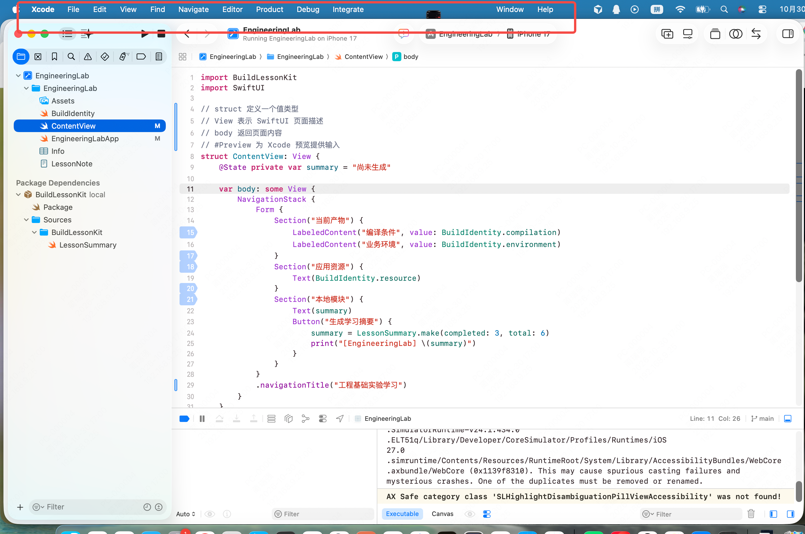
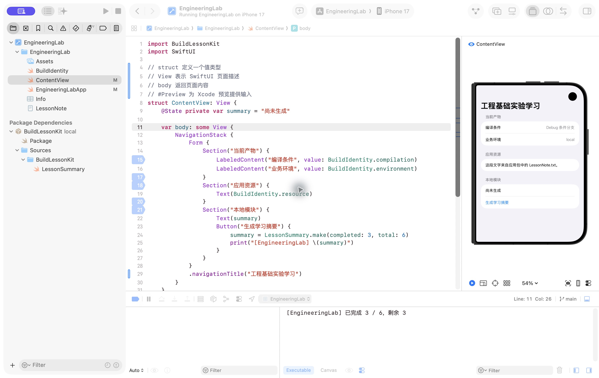
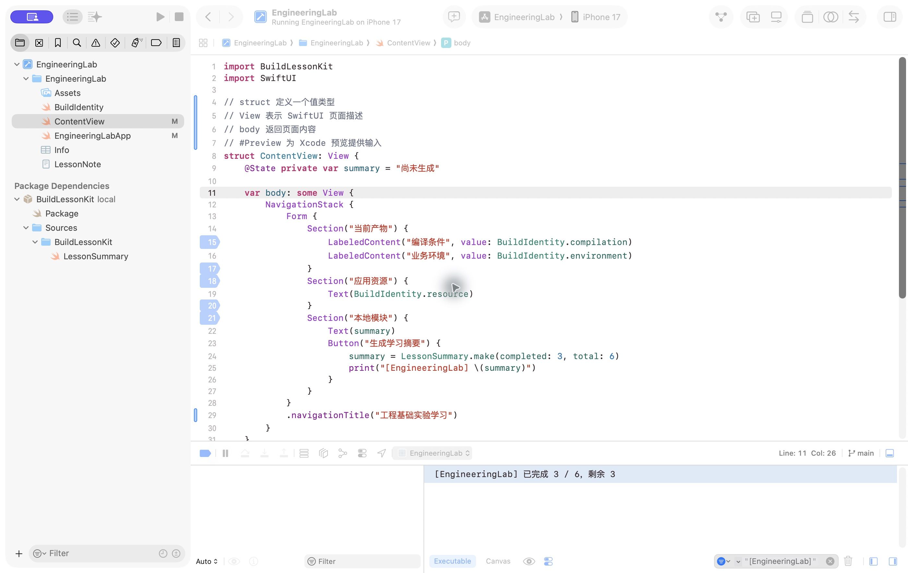
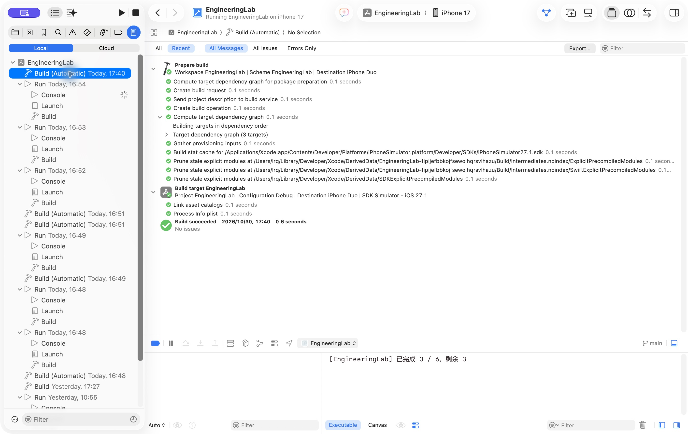
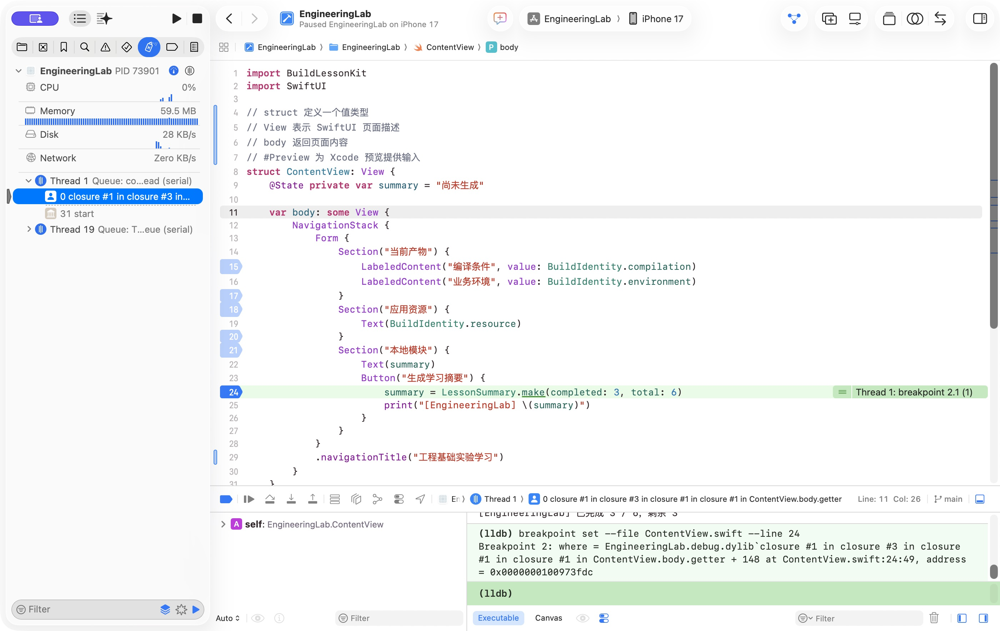
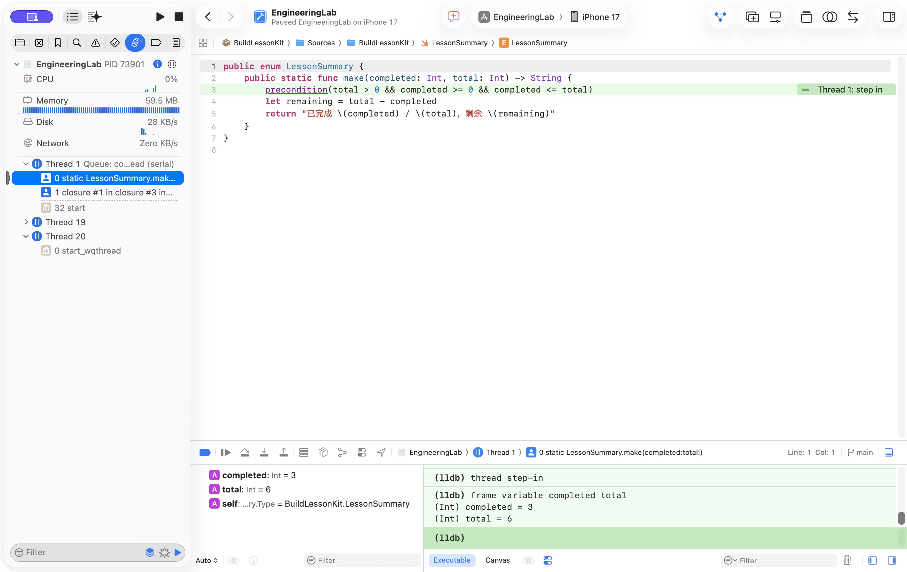
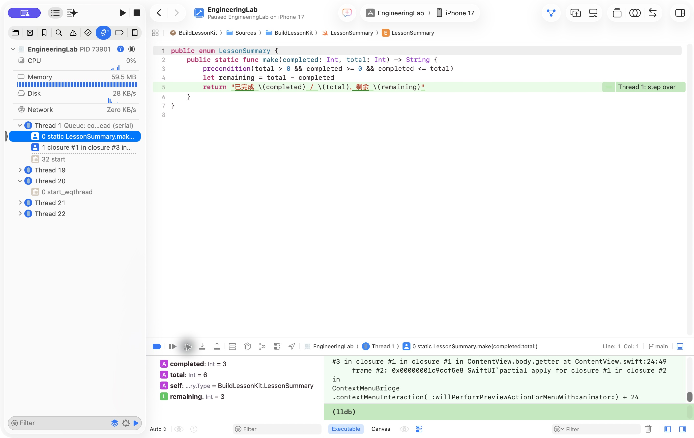
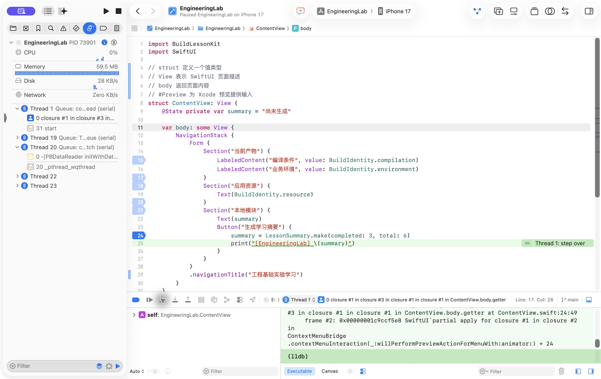
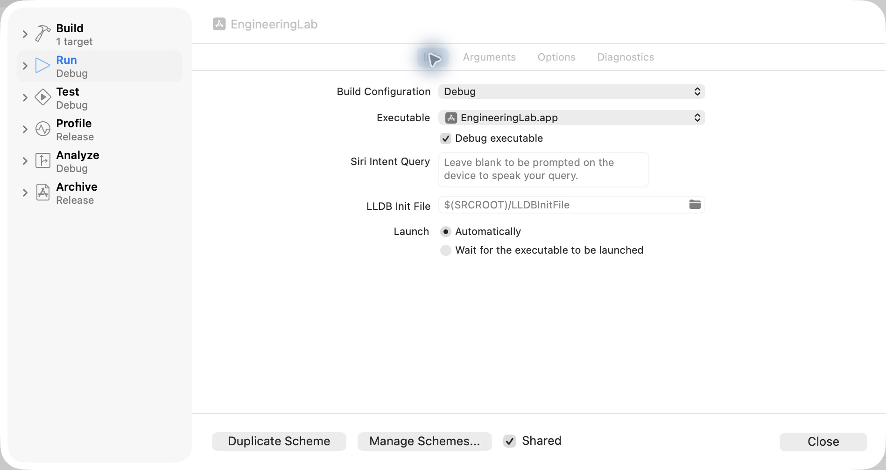

# Xcode 使用与调试：EngineeringLab

你已经能运行 EngineeringLab，现在要学会让 Xcode 回答三个具体问题：我改的代码怎样生效，按钮到底执行到哪里，结果与预期不同时从哪里看证据。本文全程使用仓库中的同一个工程，不要求另建 App；系统语言基础见 [Swift 基础单元](../../swift-core/docs/02-basics-and-functions.md)，完整构建机制见 [iOS 07](../../docs/ios/07-engineering-foundations.md)。

先按顺序做一次“打开工程 → 运行 → 找到按钮日志 → 命中断点 → 进入函数 → 返回并继续”。后面的 Preview、配置切换和归档入口按需要查阅，不必先掌握所有菜单。

本文界面基准是用户于 2026-10-30 提供的 EngineeringLab 截图，新增调试截图来自同日 Xcode 27.1 的实际操作。代码行号会随编辑变化，定位时以文件名和语句为准。历史工程截图与当前截图的设备和布局可能不同，每张图的说明分别标明用途。

## 打开现有工程并认清窗口

在屏幕顶部的 **File → Open…** 中打开 [EngineeringLab.xcodeproj](../EngineeringLab/EngineeringLab.xcodeproj)。如果窗口已经打开，无需再创建或添加 Package。

下面是用户提供的真实界面。红框中的 **Xcode、File、View、Product、Debug** 属于 macOS 屏幕顶部菜单栏；下面一排 Run、Stop、工程名、Scheme 与设备属于 Xcode 窗口工具栏。本文写“View → …”时从红框所在的菜单栏找，写“底部按钮”时从编辑器下方找。



| 区域 | 在这张图中的位置 | 现在怎样使用 |
| --- | --- | --- |
| Project navigator | 左侧，选中蓝色文件夹形导航图标后的树 | 打开文件和 Package；`⌘1` 回到这里 |
| Source editor | 中间，当前显示 ContentView | 修改代码，点击行号附近设置断点 |
| Debug area | 编辑器下面，包括调试工具条、变量区和控制台 | 运行时输出与暂停后的变量；不等于构建报告 |
| Variables view | 底部左半边，图中为空 | 暂停并选择正确栈帧后观察变量 |
| Console | 底部右半边，当前有系统输出 | 找 `print` 输出，暂停时也可输入 LLDB 命令 |
| Debug navigator | 左侧导航的一种模式，`⌘7` | 暂停时看线程与调用栈 |
| Breakpoint navigator | 左侧另一种模式，`⌘8` | 查看、启停和删除断点 |
| Report navigator | 左侧另一种模式，`⌘9` | 查看 Build 等操作报告与编译命令 |
| Inspector | 窗口右侧，当前截图未展开 | 查看所选文件、路径及属性，当前调试练习不依赖它 |

导航图标容易混淆时，使用 **View → Navigators → Project / Debug / Breakpoints / Reports**，比根据图标形状猜测可靠。文件后的 `M` 是版本控制的修改标记，不是编译失败。

### 在当前树中找到文件

左侧最上面的 EngineeringLab 是工程节点，展开后的同名目录保存应用输入。Package Dependencies 下的 BuildLessonKit 则是已关联的本地 Swift Package。两处名字并非同一种对象，先按下面路径找实际文件即可。

| 左侧路径 | 实际文件 | 本次用途 |
| --- | --- | --- |
| EngineeringLab → EngineeringLab → EngineeringLabApp | [EngineeringLabApp.swift](../EngineeringLab/EngineeringLab/EngineeringLabApp.swift) | `@main` 应用入口、WindowGroup 与根页面 |
| 同目录 → ContentView | [ContentView.swift](../EngineeringLab/EngineeringLab/ContentView.swift) | 摘要状态、按钮和日志 |
| 同目录 → BuildIdentity | [BuildIdentity.swift](../EngineeringLab/EngineeringLab/BuildIdentity.swift) | 编译条件、业务环境和资源读取 |
| 同目录 → Info / LessonNote | [Info.plist](../EngineeringLab/EngineeringLab/Info.plist)、[LessonNote.txt](../EngineeringLab/EngineeringLab/LessonNote.txt) | 配置和普通资源 |
| Package Dependencies → BuildLessonKit local → Sources → BuildLessonKit → LessonSummary | [LessonSummary.swift](../Packages/BuildLessonKit/Sources/BuildLessonKit/LessonSummary.swift) | 本次要进入的计算函数 |

Xcode 可能隐藏 `.swift`、`.plist` 等扩展名，文件树显示 `Info` 并不意味着缺少 Info.plist。选中文件后可以在 Inspector 查看完整路径；也可以 `⇧⌘O` 输入 `LessonSummary` 快速定位，出现多个结果时核对所属工程和路径。

## 运行、停止与确认当前状态

先确认顶部选择 **EngineeringLab Scheme** 和一台具体 iPhone Simulator，点击 Run 三角按钮，或选择 **Product → Run（⌘R）**。已有兼容设备即可，不要求复制某个固定机型；当前新截图使用 iPhone 17 / iOS 27.0。不要选择仅供构建的通用设备条目来期待出现可交互窗口。

应用启动后，找到“生成学习摘要”按钮。当前源码标题为“工程基础实验学习”，初始摘要通常为“尚未生成”；已点过按钮的当前进程可以显示上一次计算结果。按一次按钮，预期变为“已完成 3 / 6，剩余 3”。

Stop 方形按钮或 **Product → Stop（⌘.）** 结束本次运行。调试器的 Pause 则把进程暂时停住以供检查；Continue 会继续同一个进程。Stop 后再次 Run 与 Pause 后 Continue 不是同一件事。

| 当前状态 | 可以看到什么 | 下一步 |
| --- | --- | --- |
| 正在运行 | 工具栏显示 Running，调试工具条提供 Pause | 可以点击应用按钮 |
| 断点暂停 | 源码出现绿色执行位置，通常有 `breakpoint` 停止原因，调试条提供 Continue | 先看变量或单步，再继续 |
| 已停止 | 本次进程已结束，没有当前调用栈可检查 | 需要运行时重新 Run |

如果页面点击没有响应，先看是否已被断点暂停；不要立刻认定按钮逻辑失效。行号处的蓝色断点图形只表示设置了断点，**绿色执行位置与停止原因**才是当前命中的依据。

## 修改后怎样看到效果

### 用 Run 检查完整应用

修改已有页面文字，保存后 `⌘R`，Xcode 会构建受影响的部分，再安装和启动应用。源文件变化不会自动替换普通运行进程中的实现；只在设备里重新打开已安装应用，得到的仍是已安装产物。

这通常是完整流程的反馈方式：重新启动会重新建立内存状态，持久化到磁盘的数据则可能保留。Xcode 会利用增量构建，不表示每次都从零编译。它与 Flutter 保留运行状态的 hot reload、重启 Dart 执行环境的 hot restart 都有不同边界。

### 用 Preview 调整局部页面

当前 `ContentView.swift` 底部已经有：

```swift
#Preview {
    ContentView()
}
```

打开 ContentView，点击窗口工具栏中提示为 **Show Canvas** 的按钮显示预览画布（也可从 Editor → Canvas 查找）；画布暂停时按其 Resume，或按当前版本提示启动预览。先只改一处现有 Text 或标题，观察画布更新，再恢复。进入可交互的预览后可以点击按钮，但要确认当前查看的是预览内容，而非另一个普通运行窗口。

Preview 根据代码变化构建并更新预览内容，适合局部 UI 迭代；更改范围可能导致预览重新启动，不能依赖它保留任意应用状态。入口、权限、前后台、安装和完整数据流程仍需普通运行或对应环境验证。画布没有刷新时，检查是否暂停、是否有编译错误及预览诊断，不要把多按 Run 当作唯一修复方法。

下面是本次实际渲染的现有 ContentView。预览选择了 iPhone Duo / iOS 27.1，与普通 Run 的 iPhone 17 / iOS 27.0 分别记录；窗口顶部的 Run 设备不代表画布设备。此次只验证已有预览可以渲染，没有改写用户源码测试自动刷新或预览状态保留。



## 在哪里看日志

### 先找到自己的运行输出

当前按钮代码已经有日志，不必再添加另一套打印：

```swift
summary = LessonSummary.make(completed: 3, total: 6)
print("[EngineeringLab] \(summary)")
```

1. 用附加调试器的 Run 启动应用，先确保当前没有断点暂停。
2. 使用 **View → Debug Area → Show Debug Area** 显示底部区域（已显示时菜单变为 Hide Debug Area）；`⇧⌘Y` 切换显示。
3. 使用 **View → Debug Area → Activate Console** 定位控制台。若只看到变量区，使用调试区的面板显示按钮恢复控制台，悬停核对提示文字。
4. 在截图所示的底部标签中选择 **Executable**，确认观察应用输出；**Canvas** 关联预览上下文，不应混用来判断普通 Run 的日志。
5. 找到控制台底部 Filter。初次检查先清空过滤条件；也可用旁边垃圾桶清空可见输出，便于观察这次操作。清空不等于重新启动或清除应用数据。
6. 在运行的 App 中点“生成学习摘要”，找到下面这一行；输出较多时，在 Filter 输入 `[EngineeringLab]`。

```text
[EngineeringLab] 已完成 3 / 6，剩余 3
```



如果没有日志，依次检查：应用是否暂停；按钮是否实际点击；当前跑的是否是含 print 的最新代码；控制台是否属于本次进程；过滤条件是否隐藏输出。若断点停在 print 前，这次日志尚未产生，需要执行该行或 Continue。

`print` 适合这里的局部学习观察。它不能替代正式应用中的结构化日志、隐私控制和性能诊断，这些由第 08 篇与具体工程主题继续展开。

### 系统警告不等于业务日志，也不自动证明崩溃

用户原始截图中可见 `WebCore`、`AccessibilityBundles` 和 `AX Safe category...` 等输出。它们提供上下文，但仅凭文字中出现 “crashes” 或黄色背景，不能断言本 App 已崩溃，也不能直接确定根因。

先确认进程是否退出、按钮能否响应、有没有调试器停止原因，再结合复现步骤与调用栈分析。需要判断异常时清除过滤条件，读取上下文；只筛选自己的前缀可能把有用的系统证据一起隐藏。

### 构建失败去 Report navigator

控制台回答“运行时输出了什么”；构建报告回答“这次怎样编译、链接和处理输入”。构建还没成功时，按钮 print 根本没有执行机会。

使用 **View → Navigators → Reports（⌘9）**，选择最近一次 Build 记录，显示 **All Messages** 并展开失败项或具体任务。先读第一个相关诊断，再判断是源码、依赖还是其他输入问题；更完整的构建实验见 [工程基础实验](engineering-foundations.md#检查最终产物)。

下面是 2026-10-30 的实际报告：左侧选中 Preview 触发的 Build (Automatic)，右侧 All Messages 显示 Debug、iPhone Duo 和构建成功。顶部工具栏仍是普通 Run 的 iPhone 17；报告对应已发生的动作，不能用顶部当前选择改写它的目标。



## 第一次断点：确认按钮执行

先只放一个断点，避免每次 SwiftUI 计算布局时都停住。用户原始截图的布局行上已有若干断点；练习前在 **View → Navigators → Breakpoints（⌘8）** 查看它们，记录启停状态，暂时停用不相关断点。不要为了练习删除自己原有的断点。

1. 打开 `ContentView.swift`，找到按钮里的 `summary = LessonSummary.make(completed: 3, total: 6)`。当前示例是第 24 行。
2. 点击该行左侧的行号或旁边 gutter 区域，看到断点标记。不要点击中间源码文字，也不要把断点放在注释、空行或闭合括号上。
3. 确认断点已启用，同时调试工具条中的全局断点开关处于开启状态。单个断点与全局开关是两层控制。
4. 确认 Run 使用 Debug 且 **Debug executable** 勾选，入口见[配置章节](#切换-debugrelease-与认识归档)。已附加调试器运行时，添加断点后可以直接触发，不必为了设置断点反复构建。
5. 切到运行中的 App，点击“生成学习摘要”。
6. 回到 Xcode，确认停在调用处，出现绿色执行位置及断点停止原因。此时先不要继续点 App。



停在调用语句时，本次 `make` 和赋值通常还没有完成。`summary` 可能仍是“尚未生成”，也可能是上次点击留下的字符串；不能用它提前证明本次计算结果。

先认识底部调试条四个按钮，悬停读取实际名称；也可从 **Debug** 菜单寻找对应命令：

| 控制 | 作用 | 当前怎样使用 |
| --- | --- | --- |
| Step Over | 在当前层执行下一步，通常不进入被调用函数内部；遇到其他断点仍可能暂停 | 完成调用后检查 summary |
| Step Into | 尝试进入下一步调用的实现 | 进入 LessonSummary.make |
| Step Out | 执行完当前函数，返回调用方，其他断点仍可能中断 | 从库函数返回按钮动作 |
| Continue | 恢复执行，直到下一个停止条件 | 让 print 执行并恢复交互 |

第一次先选 **Step Over**。预期执行调用并推进到 print 附近。当前变量区可能只显示 `self`，不会自动平铺 `summary`；选中按钮闭包栈帧，在 Console 的 `(lldb)` 提示符输入 `po summary`，回车查看赋值后的字符串，也可以展开 self 检查状态存储。此处 `po` 会求值，当前表达式只读取自己的简单状态，不随意调用有副作用的业务方法。由于生成的状态访问器等代码，单步可能停在辅助实现，先核对文件和栈帧，再回到自己的代码。最后 Continue，在控制台找到日志并确认页面结果。

完成后可暂时保留这个断点，第二次点击会再次命中，接着做下一节。

## 第二次断点：进入函数并看变量

本次要回答的是：传入的数值是什么，减法何时完成，返回值怎样交回调用方。

1. 再次在按钮调用处停住，选择 **Step Into**。实际验证进入了本地 Package 的 `LessonSummary.make`，先停在前置条件附近。
2. 如果单步进入了 SwiftUI 或编译器生成的辅助函数，不要把其中变量当成业务参数；可以改在 `LessonSummary.swift` 的 `let remaining = total - completed` 行设置第二个断点，然后 Continue。
3. 查看底部变量区，确认 `completed = 3`、`total = 6`。若变量区未显示，使用调试区的变量面板按钮，并核对当前选择的是 `LessonSummary.make` 栈帧。
4. 逐步 Step Over，核对绿色行到达哪里。停在 `let remaining` 前不能把该局部量当作已初始化；推进到 return 行，再确认 `remaining = 3`。





绿色执行位置表达源码映射，不保证每按一次按钮都恰好走过一行。实际 Debug 观察中，从函数前置条件处经过两次 Step Over 到达返回行；具体次数不是验收条件，文件、停止位置和变量是否有效才是依据。

### 调用栈为什么要选择正确的帧

按 `⌘7` 打开 Debug navigator，展开暂停线程的调用栈。选择 `LessonSummary.make`，底部显示该函数的参数与局部变量；选择调用它的 ContentView 闭包，编辑器与变量区会切换到调用方。

栈帧是当前线程一次调用的上下文，不是整个程序的所有变量。切到按钮闭包后找不到 remaining，首先考虑作用域和当前帧，而不是马上认为编译失败。系统框架和运行库栈帧也属于真实调用链，当前先找到自己的两个文件。

### 返回后确认赋值、日志与画面

选择 **Step Out** 返回按钮动作。实际验证返回后仍停在调用行附近，此时需要继续 Step Over，直到推进到 print 语句前，再在当前按钮闭包帧执行 `po summary` 确认赋值完成。暂停位置不等于该行一定已经执行完。



最后 Continue。预期 print 输出摘要，页面显示相同结果，App 恢复交互。不要把“看到函数返回值”直接当成“屏幕已经绘制完成”。

### LLDB 作为可选补充

先学会图形界面，再在 Console 中练习下列命令。它们共享当前调试状态，输入命令前先确认选中的进程与帧：

```text
process status
frame variable completed total
thread step-over
frame variable remaining
bt 8
continue
```

`process status` 确认暂停或运行；`frame variable` 看当前帧变量；`bt` 看调用栈。示例里的 remaining 只能在其计算完成且处于相应帧时读取，不能机械地连续粘贴所有命令。如果停在调用方，应先选择库函数帧或重新触发断点。

### 结束练习与断点不命中的排查

练习完成后，在 Breakpoint navigator 选中本次新建断点按 Delete 删除，或停用以供以后使用；恢复练习前记录的原有断点状态。也可以把标记拖出 gutter 删除。不要把“全局关闭所有断点”误当成删除或修复断点。

| 现象 | 按顺序检查 |
| --- | --- |
| 放了断点却不暂停 | 是否点击了实际按钮；单个断点是否启用；全局开关是否启用；调试器是否附加 |
| 停在不相关布局行 | 是否还有 body 中的断点；停用不相关断点后重新触发 |
| 标记空心或未解析 | 当前代码是否在实际加载的模块中；源码是否匹配新产物；是否有可执行位置；是否被优化 |
| 变量为空或不可用 | 是否真正暂停；当前栈帧是否正确；是否已执行初始化；是否为优化构建 |
| 没有日志、App 也不响应 | 是否仍暂停在断点或 print 之前，先检查停止原因再 Continue |
| 单步进了系统或生成代码 | 查看文件与调用栈；在自己的目标语句再放断点，Continue 到明确位置 |

## 切换 Debug／Release 与认识归档

### 查看或改变 Run 使用的配置

1. 屏幕菜单选择 **Product → Scheme → Edit Scheme…**。
2. 左侧选择 **Run**，右侧选择 **Info**。
3. 找到 **Build Configuration**，当前 EngineeringLab 为 Debug。
4. 日常断点练习保持 Debug，勾选 **Debug executable**。后者决定启动时是否附加调试器，不是由 Debug 这个配置名自动代替的。
5. 若要观察优化构建，可把 Build Configuration 改为 Release，再 Close 并 Run。先记住原值，观察完改回，避免后续变量检查受优化影响。



当前 `BuildIdentity.compilation` 使用 `#if DEBUG`，Release 预期显示“非 Debug 条件分支”；业务环境来自 Info.plist，仍可显示 local。Release 不自动切生产服务，也不保证关闭调试器。构建条件和配置的完整实验见 [工程基础实验](engineering-foundations.md#debug-与-release)。

本次截图与配置检查只查看设置，没有为了截图切换用户 Scheme；历史 Release 的安装运行证据单独保留在工程实验中。

### “打包”对应哪个动作

| 目的 | 入口 | 结果 |
| --- | --- | --- |
| 检查当前代码是否能构建 | Product → Build（⌘B） | 构建产物，不自动等于已安装运行 |
| 构建并运行当前应用 | Product → Run（⌘R） | 按 Run 配置在所选设备启动 |
| 准备分发候选归档 | Product → Archive | 按 Archive 配置生成归档，之后在 Organizer 处理分发 |

Run 和 Archive 分别选择配置；当前共享 Scheme 的 Run 是 Debug，Archive 是 Release。所以平时跑 Debug，不表示归档也会用 Debug。

准备设备分发时需选择适用的 iOS 设备构建目的地，再 Archive；归档后在 **Window → Organizer** 的 Archives 中选择记录，按分发方式继续。`.xcarchive` 是归档，不是已经导出的 `.ipa`。证书、团队、provisioning、权限与具体分发方式还需满足各自条件，完整交付机制由第 09 篇承接。本次没有执行归档、导出或发布。

## 实际验证与限制

本节分别记录操作已执行、截图已取得与仍待验证的部分；教程给出的操作步骤不自动算作通过。2026-10-30 的验证使用 Xcode 27.1（27A9275）、Apple Swift 6.4，以及 iPhone 17 / iOS 27.0 Simulator；应用仍使用用户当前源码。

| 检查 | 实际观察 | 证据边界 |
| --- | --- | --- |
| 菜单与窗口 | CUA 读取实际 View 菜单，核对 Debug Area 的显示/隐藏、Activate Console，以及四种 navigator 入口 | 单步名称由底部按钮提示核对；未单独确认 Debug 菜单每一项文字 |
| 按钮与日志 | 在 Device Hub 真实点击按钮，摘要从“尚未生成”变为预期文本；GetConsoleOutput 取得 `[EngineeringLab]` 输出 | 不是用调试器执行表达式代替点击；未取得设备工具的 hierarchy |
| 调用处断点 | ContentView 调用语句命中；另一次 Step Over 推进到 print 前，`po summary` 为预期摘要 | 初始变量区只显示 self，不能承诺 summary 自动平铺 |
| 进入、计算与返回 | Step Into 进入库函数，参数 3、6；Step Over 到 return 前看到 remaining 为 3；Step Out 后再单步完成赋值 | 停止位置与有效变量分别确认，不保证固定单步次数 |
| Preview | RenderPreview 成功，Canvas 显示当前页面；使用 iPhone Duo / iOS 27.1 | 未修改源码验证自动刷新、状态保留或预览内按钮交互 |
| 构建报告 | 选中预览触发的 Build (Automatic)，All Messages 显示 Debug、iPhone Duo、SDK 27.1 和成功 | 与 iPhone 17 普通运行分开；未执行 Release 重构建或 Archive |
| 配置 | Run → Info 为 Debug，Debug executable 勾选，配置列表有 Release；Archive 显示 Release | 本次只查看，未更改配置或分发 |

用户提供的概览图证明其当时可见界面；其他八张新增截图对应本次窗口观察。本次新建的两个教学断点均已删除，用户原有断点与全局开关保持原状态；应用已恢复正常运行。两个 Swift 文件及共享 Scheme 的 SHA256 与工作开始时一致，未改写用户内容。

设备交互服务本次出现状态不一致：启动返回成功后，合成事件提示 Session not found，重新启动又提示设备被占用，结束接口也报告会话不存在。实际按钮操作改用 CUA 的 Device Hub 完成，不把设备交互服务当作通过。未安装工具或重配环境。

模拟器观察不能替代真机、签名、归档或完整平台能力验证。菜单、Preview 渲染与断点执行也各有边界；学习掌握仍需学习者独立完成预测和操作。

## 继续学习与官方参考

语言学习按 [iOS 01：Swift 语言与运行机制](../../docs/ios/01-language-runtime-concurrency.md)选择主题，具体写法进入 [swift-core](../../swift-core/docs/README.md)。本教程只承担应用操作，按钮例子不代表第一章的知识结构。需要解释构建任务与产物时再进入 [第 07 篇](../../docs/ios/07-engineering-foundations.md)和 [工程实验](engineering-foundations.md)。

- [Apple：Running your app on simulated or physical devices](https://developer.apple.com/documentation/xcode/running-your-app-on-simulated-or-physical-devices)
- [Apple：Setting breakpoints to pause your running app](https://developer.apple.com/documentation/xcode/setting-breakpoints-to-pause-your-running-app)
- [Apple：Stepping through code and inspecting variables to isolate bugs](https://developer.apple.com/documentation/xcode/stepping-through-code-and-inspecting-variables-to-isolate-bugs)
- [Apple：Previews in Xcode](https://developer.apple.com/documentation/swiftui/previews-in-xcode)
- [Apple：Customizing the build schemes for a project](https://developer.apple.com/documentation/xcode/customizing-the-build-schemes-for-a-project)
- [Apple：Testing a release build](https://developer.apple.com/documentation/xcode/testing-a-release-build)
