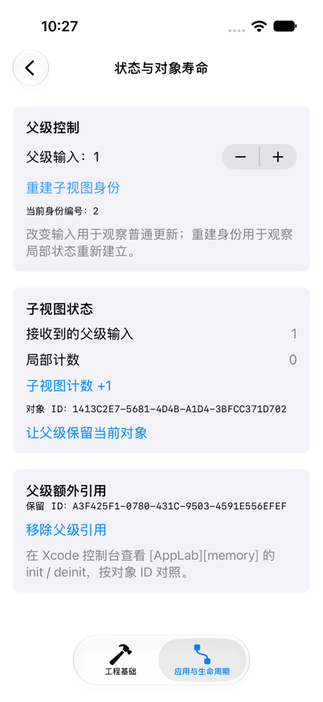
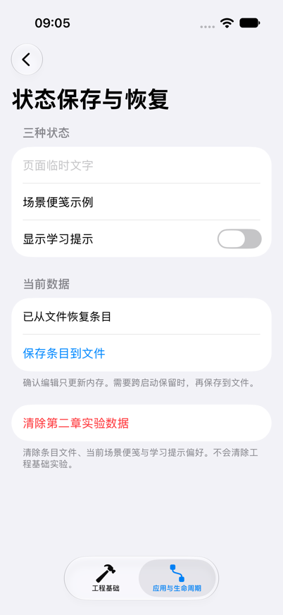

# EngineeringLab｜对象内存与进程恢复

本组先观察对象由谁持有、何时释放，再比较进程重启前后的数据。它承接页面声明与生命周期：状态身份结束、对象执行 deinit 和操作系统终止进程，是三个不同层次。

## 从状态存储观察对象释放

运行条件沿用[页面实验](swiftui-pages-and-state.md#运行环境与入口)。在“应用与生命周期”标签进入“状态与对象寿命”，打开 Xcode 控制台，筛选 `[AppLab]`。实现集中在 [StateLifetimeView.swift](../EngineeringLab/EngineeringLab/ApplicationLab/StateLifetimeView.swift)。

用于观察的对象只有不可变 ID，并记录创建和释放：

```swift
nonisolated final class LifetimeProbe: Sendable {
    let id = UUID().uuidString

    init() {
        print("[AppLab][memory] init \(id)")
    }

    deinit {
        print("[AppLab][memory] deinit \(id)")
    }
}
```

它没有任务、回调或日志器引用，方便分析强引用来源。nonisolated 明确让这个普通不可变观察对象不采用应用的默认 MainActor 隔离；Sendable 的成立条件是不可变且可安全传递的存储，不是为了绕过可变 UI 模型的隔离检查。

子内容用 State 保存 probe，在任务入口按需建立。父级另有一个可选引用 retainedProbe，点击“让父级保留当前对象”时将同一引用交给父级：

```swift
@State private var retainedProbe: LifetimeProbe?

LifetimeContent(input: input) { retainedProbe = $0 }
    .id(generation)

RetainedObjectPanel(probe: retainedProbe) { retainedProbe = nil }
```

这是父级的相关片段。显示区也读取同一对象，因此实际释放要等旧界面清理完相关引用。观察时允许框架清理延迟，用对象 ID 对应事件，不要求 disappear 与 deinit 紧邻。

分别做三组对照：

| 操作 | 预期与解释 |
| --- | --- |
| 子计数增加后改变父级输入 | 子计数和对象 ID 保留；这是同一身份下更新 |
| 没有额外保留时重建子身份 | 子计数归零，新对象出现；旧状态清理后旧 ID 出现 deinit |
| 先保留对象，再重建子身份 | 子内容使用新对象，父级仍显示旧对象 ID；旧对象继续存活 |

最后点击“移除父级引用”，核对旧对象的 deinit；返回列表，核对本页对象最终释放。重新进入会建立新的状态与对象。当前父级保留只持续到这张实验页退出，没有新增全局缓存。

若一开始未保留对象，重建身份后已经能看到旧对象 deinit，就能确认普通 View 更新和身份重建的不同。若已经保留对象，页面局部存储结束只移除了部分强引用；明确解除额外引用后，ARC 才可能释放旧对象。这是实际持有关系，不需要制造永久泄漏作为默认实验。

## 任务怎样延长模型寿命

[TaskExperiment.swift](../EngineeringLab/EngineeringLab/ApplicationLab/TaskExperiment.swift) 中，窗口内容保留 TaskExperiment，模型保留手动 Task 句柄，任务闭包在执行期间使用 self。返回任务页的上一级，并没有结束窗口模型，所以任务可以继续。

```swift
manualTask = Task {
    defer {
        self.manualTask = nil
        self.manualIsRunning = false
        journal.record("手动任务结束")
    }
    // 有限的八步工作，响应取消；完整实现见源码。
}
```

取消入口调用句柄的 cancel；循环中的可取消 sleep 与检查促使任务退出。defer 清除模型中的句柄，并记录结束。完成和取消的真实交互见[生命周期与任务](lifecycle-and-tasks.md#手动任务为何能离开页面继续)。

这个有限工作在执行期间有意持有模型。若改成无限流，就必须重新明确结束规则；weak 捕获后又将对象提升为强引用，并跨越长时间等待，同样会延长寿命。对象何时释放需看整条持有链，资源何时停止则由明确取消或关闭控制。

本组用 deinit 证明具体对象的释放，不把一个对象的释放日志当作整个进程内存立即下降的测量。没有分配大量内存、模拟真实 jetsam 或加入系统后台能力。

## 从页面存续到进程重建

同一 App 的“状态保存与恢复”入口继续提供进程内外对照：

| 内容 | 存储与作用域 |
| --- | --- |
| 页面临时文字 | 当前恢复页的 State |
| 场景便笺 | 当前 Scene 的 SceneStorage |
| 显示学习提示 | AppStorage 连接 UserDefaults |
| 条目与完成状态 | 窗口内模型；明确保存后写入应用沙盒文件 |

[RestorationView.swift](../EngineeringLab/EngineeringLab/ApplicationLab/RestorationView.swift) 的声明如下：

```swift
@State private var temporaryText = ""
@SceneStorage("app-lab.scene-scratch") private var sceneScratch = ""
@AppStorage("app-lab.show-hints") private var showHints = true
```

输入临时文字 `temporary`、场景便笺 `scene-note`，关闭提示，再返回列表重新进入。预期临时文字重新为空，同一 Scene 中的便笺仍可读，偏好仍关闭。随后切到桌面再返回，只要还是原进程，就可能继续沿用内存；这一步与新进程读取文件分别观察。

SceneStorage 由系统决定持久化时机，适合轻量场景恢复。它在页面重入时保留，不代表每次赋值都已落盘。AppStorage 适合简单偏好；正式条目则采用下一节明确的保存入口。

## 配套文件保存与恢复实现

[LessonStore.swift](../EngineeringLab/EngineeringLab/ApplicationLab/LessonStore.swift) 在 Application Support 下使用 `ApplicationLab/learning-items.json`。这是 App 沙盒中的可写数据，区别于工程随包安装的资源。快照包含版本和三个固定条目：

```swift
private struct Snapshot: Codable {
    let version: Int
    let items: [LearningItem]
}
```

update 修改内存并设置未保存标记。save 的核心路径如下：

```swift
let data = try JSONEncoder().encode(Snapshot(version: 1, items: items))
try FileManager.default.createDirectory(
    at: fileURL.deletingLastPathComponent(), withIntermediateDirectories: true)
try data.write(to: fileURL, options: .atomic)
hasUnsavedChanges = false
storageMessage = "保存成功：重新启动后可读取"
```

源码包含 do/catch，只有成功写入才清除标记。写入失败保留内存修改并显示原因。原子替换降低读取半份新文件的风险，不提供多文件事务。此处固定三个条目、每条最多 2000 字符，同步编码和 I/O 会占用主执行时间，数据扩大后需要另行安排执行与保存顺序。

模型初始化不读文件；页面的任务调用 loadIfNeeded，由模型保证当前实例只加载一次，避免返回页面时用旧快照覆盖内存修改。加载校验版本、固定 ID、顺序、标题和长度。文件不存在使用内置数据；格式或契约错误时暂用内置内容、显示失败，并保留原文件。这是固定实验的数据约定，没有实现完整迁移。

按顺序验证跨进程恢复：

1. 编辑一条笔记为 `saved-note`，确认后回列表，点击“保存条目到文件”，核对成功提示。
2. 再将笔记改为 `memory-only`，确认但不保存。
3. Xcode Stop 后重新 Run，进入第二章并检查详情。
4. 预期读取 `saved-note`，临时状态和未保存修改不恢复。偏好单独检查；SceneStorage 的强制终止恢复单独记录。

也可以对已安装 App 执行：

```bash
xcrun simctl list devices booted
xcrun simctl terminate booted com.example.nativeclients.EngineeringLab
xcrun simctl launch booted com.example.nativeclients.EngineeringLab
```

只有一台目标模拟器启动时才用 booted，多台时改用明确 UUID。terminate/launch 检查新进程重建，不模拟系统内存压力。新进程默认回到工程基础标签，本例不恢复导航路径和未确认草稿。

查看已经保存的文件：

```bash
lab_data=$(xcrun simctl get_app_container booted com.example.nativeclients.EngineeringLab data)
cat "$lab_data/Library/Application Support/ApplicationLab/learning-items.json"
```

从未保存时文件可以不存在。损坏 JSON、未知版本和写入失败由[独立模型检查](lifecycle-and-tasks.md#关键行为的自动检查)在临时目录验证，不破坏当前 App 数据。

## 实验清理

寿命实验中先移除父级引用再返回；恢复页点击“清除第二章实验数据”并确认，删除条目文件、恢复内置数据、清空当前场景便笺并把提示偏好设回 true。文件删除失败时保留当前数据并显示错误。journal 保留本进程记录，原工程基础实验不受影响。

清除只恢复当前单窗口实验基线，不代表删除其它 Scene 的状态。重装 App、重置模拟器或改变 bundle identifier 会改变数据容器条件，需要与普通重启区分。

## 实际验证与边界

2026-10-31，在 iPhone 17 模拟器 / iOS 27.0 上使用 Xcode 27.1 / Swift 6.4 Debug 产物验证，未附加调试器。对象释放以实际进程 stdout 为依据，未用界面消失推断。

### 状态与对象释放

下表 A、B、C、D 表示本次运行中四个不同 UUID 的对象。

| 操作 | 真实观察 |
| --- | --- |
| 子计数加一，再改变父级输入 | 输入变为 1，局部计数仍为 1，对象仍为 A；没有额外 init/deinit |
| 不额外持有，重建身份 | 局部计数归零，创建 B，随后观察到 A deinit |
| 父级保留 B 后再重建身份 | 子内容创建 C，父级仍显示 B，此阶段没有 B deinit |
| 移除父级引用 | 父级显示“未保留对象”，观察到 B deinit，C 继续存在 |
| 返回列表 | 观察到 C deinit |
| 重新进入，再返回 | 输入、身份编号与计数归零，创建 D；返回后观察到 D deinit |

下面是保留 B、创建 C，到分别释放两者的实际日志摘录；操作之间的页面事件省略：

```text
[AppLab][memory] init A3F425F1-0780-431C-9503-4591E556EFEF
[AppLab][memory] init 1413C2E7-5681-4D4B-A1D4-3BFCC371D702
[AppLab][memory] deinit A3F425F1-0780-431C-9503-4591E556EFEF
[AppLab][memory] deinit 1413C2E7-5681-4D4B-A1D4-3BFCC371D702
```

截图停在创建 C、父级仍持有 B 的时刻。完整交互中还观察到新身份的 appear 先于旧身份的 disappear，说明应按身份和对象 ID 分析关系，而不把回调总顺序当作固定保证。



### 进程重建与数据恢复

| 检查 | 真实观察 |
| --- | --- |
| 页面重入 | TEMP02 临时文字清空，SCENE02 便笺与关闭的提示保留 |
| 未保存改动重启 | 确认后的笔记和完成状态未保存，terminate/launch 后回到内置条目 |
| 偏好重启 | off 状态跨两次重启保留 |
| SceneStorage 重启 | 本次强制重启没有恢复 SCENE02 |
| 文件保存与重启 | JSON version 为 1、首条完成为 true；新进程读取后列表和详情一致 |
| 清除 | 文件不存在，条目、便笺和偏好回到实验基线 |

下面的截图来自文件恢复之后。便笺“场景便笺示例”是在那次启动中重新输入并经页面重入保留的，没有在强制终止后恢复。



独立模型检查五组通过，其中保存相关检查确认：已保存快照优先于后来未保存修改；无效版本、空条目与损坏 JSON 被拒绝且原文件保留；写入失败保留内存修改。错误条件在 macOS 临时目录执行，未验证 iOS 错误 UI。

没有真机、系统内存压力、后台调度、多窗口或 Instruments 泄漏分析验证；对象 deinit、进程重启和内存压力终止分别判断。上述结果证明这些明确持有关系下的释放行为，不承担精确释放时刻或整个应用无泄漏的结论。
