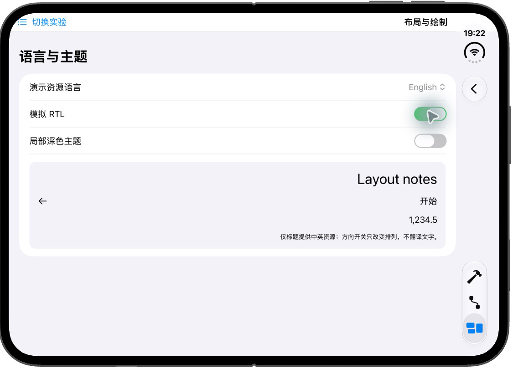

# EngineeringLab｜布局协商、绘制与命中

本组先用普通文字和容器观察尺寸，再实现自定义 Layout，最后用 Shape 与 Canvas 绘制。机制见[第三章更新与布局](../../docs/ios/03-ui-rendering-interaction.md#状态怎样经过布局成为画面)，运行与日志入口见[第三章运行说明](swiftui-ui-lab.md)。源码在 [UILayoutLabView.swift](../EngineeringLab/EngineeringLab/UILab/UILayoutLabView.swift)。

## 从宽度提议到文字换行

进入“布局与绘制 → 1. 尺寸、换行与 modifier 顺序”。Slider 改变外层 frame 宽度，范围为 160～300 pt。内容仍是相同文字，因此可以把画面变化归因于提议条件。

```swift
Text("SwiftUI 中会随可用宽度换行的长标题")
    .fixedSize(horizontal: false, vertical: fixedHeight)
    .layoutPriority(priority ? 1 : 0)
    .border(.blue)
```

它与另一段文字放在 HStack 中，外层 frame 使用 Slider 的宽度。父级先给 HStack 有限宽度，HStack 根据两个子项的响应与间距分配空间，Text 再根据所得宽度换行并报告高度。蓝绿框显示两项自己的范围，橙框显示外层范围。

先把宽度从 300 减到 160，再给长标题提高 layoutPriority。预期文字分配和换行随空间竞争改变；优先级没有增加总宽度，另一段也会受影响。`fixedSize(horizontal: false, vertical: true)` 表示横向继续响应提议，纵向采用理想尺寸。本页位于垂直 ScrollView，若原先已得到足够高度，开关可能不产生额外变化；它不是强制让文字变大的命令。

### 顺序怎样变成不同的布局层

同页的背景开关对照两条完整组合：

```swift
Text("Layout notes", tableName: "UILayout")
    .padding(20)
    .background(.blue.opacity(0.2))

Text("Layout notes", tableName: "UILayout")
    .background(.blue.opacity(0.2))
    .padding(20)
```

第一条由外部背景接收 padding 的报告范围，蓝底包含两侧和上下间距；第二条的背景只接收内部文字范围，padding 在蓝底外。再改变外层宽度，观察文字响应与背景范围，按“提议向内、响应向外”追踪各层。

开关使用条件分支创建对照，内容没有编辑状态。这里检验修饰顺序，不把分支替换推荐成通用的保状态封装。

## 占位、裁剪与命中要分别观察

选择“2. 占位、绘制与命中”。offset 示例把 border 放在 offset 外：

```swift
HStack {
    Text("原布局空间")
        .padding()
        .offset(x: moved ? 45 : 0)
        .border(.orange)
    Text("相邻内容").padding().border(.blue)
}
```

移动后文字画面改变，橙框和相邻蓝框仍按原布局关系排列。若改成会改变布局响应的尺寸或间距，相邻内容可能重新安排，这是另一种机制。

圆形实验先以 140×140 绘制，再把外层高度可选限制为 80，并裁剪。`contentShape` 在圆形与矩形间选择，点击动作只修改 taps：

```swift
.contentShape(rectangularHit ? AnyShape(Rectangle()) : AnyShape(Circle()))
.onTapGesture { taps += 1 }
```

先不裁剪，在外框角落与圆内分别点击，比较两种命中形状；再裁剪，比较可见像素、外框和可点击位置。不要仅根据裁剪后的图片推断输入范围。本例同时提供可访问性标签和 action，但真实读屏操作仍需另验。

覆盖层对照在 Button 前方放一块半透明 Rectangle。关闭“装饰层拦截点击”时，该层退出命中，底层按钮仍能加次数；打开后比较按钮是否继续接收。这个实验用于确认层级关系，半透明颜色只帮助看见覆盖范围。

## 自定义 Layout 怎样完成测量与放置

选择“3. 自定义 Layout 的提议与放置”。UIEqualWidthLayout 不保存测量状态；SwiftUI 在布局阶段调用它的两个方法。

```swift
func sizeThatFits(
    proposal: ProposedViewSize, subviews: Subviews, cache: inout ()
) -> CGSize {
    let width = finiteWidth(proposal.width)
    let childWidth = widthPerChild(width, count: subviews.count)
    let sizes = subviews.map {
        $0.sizeThatFits(.init(width: childWidth, height: nil))
    }
    return CGSize(width: width, height: sizes.map(\.height).max() ?? 0)
}
```

finiteWidth 为未指定和无限宽提议提供本例的 280 pt 理想宽度，有限宽度则取非负值。widthPerChild 扣除项间间距后平分宽度。每个子项收到同样宽度和未指定高度，返回适合自己内容的高度；容器采用最大高度，让两项都容纳进去。

```swift
func placeSubviews(
    in bounds: CGRect, proposal: ProposedViewSize,
    subviews: Subviews, cache: inout ()
) {
    let childWidth = widthPerChild(bounds.width, count: subviews.count)
    for (index, view) in subviews.enumerated() {
        view.place(
            at: CGPoint(
                x: bounds.minX + CGFloat(index) * (childWidth + spacing),
                y: bounds.minY
            ),
            anchor: .topLeading,
            proposal: .init(width: childWidth, height: nil)
        )
    }
}
```

放置阶段使用最终 bounds，位置包含 bounds 的原点，不假定从零开始。高度提议与测量阶段保持相同含义。框架可以多次调用测量，因此日志次数不是固定布局轮数，也不能把测量方法中的副作用当作业务时序。

改变宽度、开启大字、开启 RTL，观察返回高度与顺序。在 Debug 控制台过滤 `[UI03 layout]`，对照 proposal、children、result 和 bounds。SwiftUI 自定义 Layout 有水平镜像处理，本例不再按 RTL 手动倒序，避免二次翻转。

这份等宽规则没有实现多行流式布局和虚拟化；它展示如何直接共同测量，而不把测量结果写回 State。想根据内容改变横纵排列，继续阅读[适配实验](swiftui-adaptive-layout.md)。

## Shape怎样生成 Path，Canvas怎样绘制采样点

选择“4. Shape、Path 与 Canvas”。UITriangleShape 从传入矩形生成三角形路径：

```swift
nonisolated private struct UITriangleShape: Shape {
    func path(in rect: CGRect) -> Path {
        Path { path in
            path.move(to: CGPoint(x: rect.midX, y: rect.minY))
            path.addLine(to: CGPoint(x: rect.maxX, y: rect.maxY))
            path.addLine(to: CGPoint(x: rect.minX, y: rect.maxY))
            path.closeSubpath()
        }
    }
}
```

Shape 描述几何，外层 stroke 负责样式。路径跟随局部 rect，因而无需读取全局屏幕。nonisolated 用于这份不访问共享状态的几何类型，避免工程默认 MainActor 隔离与 Shape 协议要求冲突。

UITrendDrawing 则在 Canvas 中取得 context 与 size，将五个相对采样值映射为点，再连接描边：

```swift
let point = CGPoint(
    x: size.width * CGFloat(index) / 4,
    y: size.height * value
)
context.stroke(path, with: .color(.blue), lineWidth: 3)
```

开关只改变中间采样值，预期折线中间部分改变。绘制坐标向下增大，所以较小 y 值在画面中更高。整块 Canvas 提供趋势摘要和随输入改变的 accessibilityValue，图元没有独立操作。真实图表若需要逐点朗读与探索，还要设计各点的语义和交互。

## 资源语言、方向与主题分别改变什么

选择“5. 语言、方向与主题”。[UILayout.xcstrings](../EngineeringLab/EngineeringLab/UILab/UILayout.xcstrings)提供 `Layout notes` 的 en 与 zh-Hans 资源，中文值为“布局笔记”。Text 保留资源键和表名，到显示时按环境解析。

“演示资源语言”可选择跟随系统、简体中文或 English，只改变演示区域的 locale。先明确选简体中文，确认标题为“布局笔记”，再选 English，确认变成“Layout notes”；选择跟随系统则恢复继承环境。也可以在 scheme 中设置 App Language 后重启比较。RTL 开关只改变 layoutDirection，不翻译文字。数字使用 format style，主题区域使用语义背景和前景。

分别切换语言选项、RTL 和深色开关，避免一次改变全部条件。预期语言影响标题与格式，方向影响排列，主题影响语义颜色；关闭模拟开关恢复继承环境。只有该标题有双语资源，本章没有声称完成全应用翻译。

## 实际验证

2026-11-01 在 iPhone Duo / iOS 27.1 Simulator 打开重写后的“语言、方向与主题”：继承系统语言时标题显示“布局笔记”；将演示资源语言切为 English 后显示“Layout notes”；再启用 RTL，标题与数字移到右侧、箭头移到左侧并反向，英文标题保持不变。这支持资源解析与布局方向分别起作用的解释。本次没有单独选择简体中文、切换 scheme 语言或复测深色主题。



旧实现于同日观察过 padding 顺序、大字与 RTL，属于改写前记录。新入口中的宽度与优先级对照、offset 与命中、Layout 测量日志、Shape / Canvas 开关未逐项复测；源码已通过统一入口所述的 Debug / Release 构建，但编译不能代替这些运行观察。VoiceOver 未执行。
