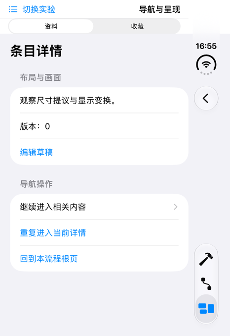
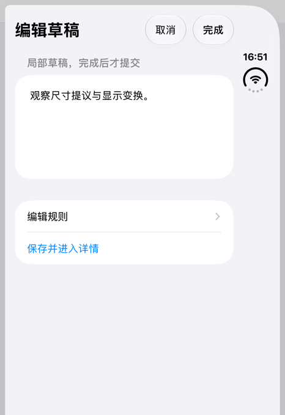
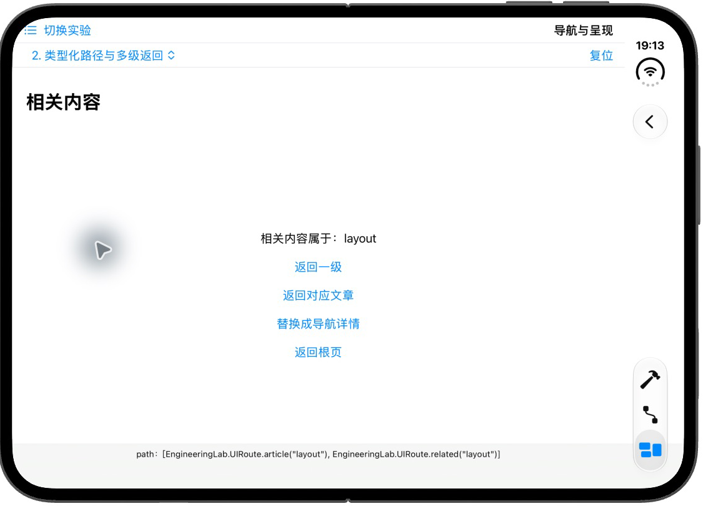
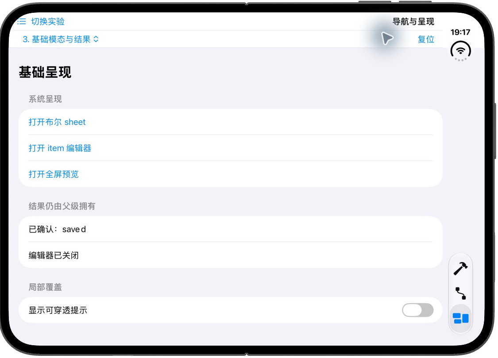

# EngineeringLab｜从系统导航到路由与呈现协调

本组先直接使用 SwiftUI 系统能力，再增加类型化路径、独立草稿与流程协调。核心机制见[第三章导航](../../docs/ios/03-ui-rendering-interaction.md#导航栈与路由怎样组织页面)与[模态部分](../../docs/ios/03-ui-rendering-interaction.md#模态与覆盖层怎样形成可协调的流程)，构建与模型检查统一见[第三章运行入口](swiftui-ui-lab.md)。

进入“UI 与交互 → 导航与呈现”，顶部“导航子实验”选择四个递进示例；“复位”重新建立当前实验身份。基础实现在 [UINavigationBasicsView.swift](../EngineeringLab/EngineeringLab/UILab/UINavigationBasicsView.swift)，组合视图在 [UINavigationLabView.swift](../EngineeringLab/EngineeringLab/UILab/UINavigationLabView.swift)，组合模型在 [UINavigationModel.swift](../EngineeringLab/EngineeringLab/UILab/UINavigationModel.swift)。

## 先用系统链接建立最小导航

选择“1. 简单链接与返回”。一个栈、一条链接和一个详情就能完成导航：

```swift
struct UIDirectNavigationView: View {
    var body: some View {
        NavigationStack {
            List {
                NavigationLink("进入文章详情") { UIDirectDetailView() }
                Text("本例由系统管理路径，下一组再把路径交给应用状态。")
                    .font(.caption)
            }
            .navigationTitle("简单链接")
        }
    }
}

private struct UIDirectDetailView: View {
    @Environment(\.dismiss) private var dismiss
    var body: some View {
        VStack(spacing: 24) {
            Text("详情仍在同一个导航栈内")
            Button("程序请求返回") { dismiss() }
        }
        .navigationTitle("文章详情")
    }
}
```

点击链接，由 NavigationStack 显示目标并建立返回关系。详情的 dismiss 从目标环境读取，因此请求结束这一层导航；也可以用系统返回按钮。这里没有 Router，没有字符串路由表，也不需要开发者持有 UIViewController。

先用系统按钮返回，再重新进入用“程序请求返回”。两者都应回到根列表。这一示例没有向应用暴露完整路径，适合局部导航；要做多级返回或从程序建立目标序列，再进入下一组。

## 类型化路径怎样与目标注册连接

选择“2. 类型化路径与多级返回”。UIRoute 是工程已有的 Hashable 枚举：

```swift
enum UIRoute: Hashable, Codable {
    case article(String)
    case related(String)
}
```

UITypedPathView 拥有 `[UIRoute]`，NavigationStack 绑定数组，链接传递路由值，navigationDestination 根据分支建立页面。以下是该实验的主要连接：

```swift
@State private var path: [UIRoute] = []

NavigationStack(path: $path) {
    List {
        NavigationLink("链接进入布局详情", value: UIRoute.article("layout"))
        Button("程序进入导航详情") {
            path.append(.article("navigation"))
        }
        Button("一次建立两级路径") {
            path = [.article("layout"), .related("layout")]
        }
    }
    .navigationTitle("类型化路径")
    .navigationDestination(for: UIRoute.self) { route in
        switch route {
        case .article(let id):
            VStack(spacing: 20) {
                Text("当前文章 ID：\(id)")
                NavigationLink("进入相关内容", value: UIRoute.related(id))
                Button("返回根页") { path.removeAll() }
            }
            .navigationTitle("详情 \(id)")
        case .related(let id):
            VStack(spacing: 20) {
                Text("相关内容属于：\(id)")
                Button("返回一级") {
                    if !path.isEmpty { path.removeLast() }
                }
                Button("替换成导航详情") {
                    path = [.article("navigation")]
                }
                Button("返回根页") { path.removeAll() }
            }
            .navigationTitle("相关内容")
        }
    }
}
```

这段保留了根入口、路径、注册和返回的完整关系；源码还增加“返回对应文章”及底部 path 观察区。没有把 NavigationStack 藏到项目 Router 后面，所以可以先看清系统契约。

根列表不在 path 中。点击布局详情后，数组是一个 article；进入相关内容后有两个元素。系统返回也会回写绑定，所以数组能反映已完成的导航。目标注册挂在 List 外层，避免依赖懒行是否已经准备。

### 多级返回与整体替换

返回对应文章先查找路径中匹配的 article，再删除它之后的元素：

```swift
if let index = path.firstIndex(of: .article(id)) {
    path.removeSubrange(path.index(after: index)..<path.endIndex)
}
```

这里的 firstIndex 明确选择首次出现的匹配祖先；复杂流程允许重复目标时，要定义想回哪一次出现，不能仅靠业务 ID 猜测。数组的静态元素类型让查找、裁剪和替换直接可表达。

按顺序操作，并同时看标题与底部路径：

1. 链接进入布局详情，再进入相关内容；预期路径从一项变两项。
2. 返回对应文章，再深入并返回一级；预期每次只结束相关页。
3. 回根后“一次建立两级路径”，再替换成导航详情；预期新路径只有 navigation 详情。
4. 使用系统返回；预期数组清空并回根。

路径变化说明导航状态，系统边缘手势中途取消还需实际操作，不能从数组按钮检查推断已验证。NavigationPath 可承载异构目标，但本例的共同枚举已经满足需求，无需为了“统一路由”先擦除类型。

## 布尔 sheet、item 编辑器与结果交付

选择“3. 基础模态与结果”。UIBasicPresentationView 保存固定帮助布尔值、可选编辑目标、已确认文字和关闭结果。呈现入口对应不同状态：

```swift
.sheet(isPresented: $showsHelp) { UIBasicHelpView() }
.sheet(item: $target, onDismiss: { result = "编辑器已关闭" }) { target in
    UIBasicEditorView(original: target.original) { saved = $0 }
        .id(target.id)
}
.fullScreenCover(isPresented: $showsPreview) { UIBasicHelpView() }
```

固定帮助由按钮把 showsHelp 设为 true。编辑则创建 UIBasicEditTarget，包含原文和本次 UUID；非空目标本身表达展示条件。每次新会话得到新身份，初始化新的草稿。

编辑器完整的保存与取消关系如下：

```swift
private struct UIBasicEditorView: View {
    @Environment(\.dismiss) private var dismiss
    @State private var draft: String
    let save: (String) -> Void

    init(original: String, save: @escaping (String) -> Void) {
        self.draft = original
        self.save = save
    }

    var body: some View {
        NavigationStack {
            Form { TextField("本次草稿", text: $draft) }
                .navigationTitle("独立草稿")
                .toolbar {
                    ToolbarItem(placement: .cancellationAction) {
                        Button("取消") { dismiss() }
                    }
                    ToolbarItem(placement: .confirmationAction) {
                        Button("完成") { save(draft); dismiss() }
                    }
                }
        }
    }
}
```

draft 没有默认值，init 以 original 初始化。它属于本次编辑器身份，不会随输入直接改变父级 saved。完成先调用父级保存闭包，再请求关闭；取消仅关闭。onDismiss 两条路径都会经过，所以只能更新“已关闭”，不能据此决定保存。

先打开编辑器改文后取消，预期父级仍显示原文；重新打开应从原文开始；再改文并完成，预期父级显示新文。帮助与全屏预览都在呈现内容内部读取 dismiss。底部开关控制普通 overlay，允许点击穿透，和系统模态分别观察。

## 多入口出现后再引入 Router

选择“4. 路由与编辑流程组合”。UICoordinatedNavigationView 拥有 Catalog、Router 和 Presenter 三个可观察对象：

| 对象 | 保存的内容 | 接收的操作 |
| --- | --- | --- |
| UICatalog | 当前文章、文字与版本 | 按 ID 查询、校验并确认编辑 |
| UIRouter | 当前流程、资料路径、收藏路径、错误 | 校验目标、进入流程、回根 |
| UIPresenter | 当前呈现、关闭标记、待处理目标、提示 | 打开互斥呈现、请求关闭、消费关闭结果 |

资料和收藏用 Picker 切换，路径始终保存在外层 Router。UIFlowView 取得对应 Binding，再交给 NavigationStack：

```swift
private var path: Binding<[UIRoute]> {
    flow == .library ? $router.libraryPath : $router.savedPath
}

// UIFlowView 使用该绑定构造 NavigationStack(path: path)。
```

项目外层已有 App Tab，这里用显式流程 Picker，避免嵌套 Tab 栏。切换会替换当前 UIFlowView，保留的是外层路径；不声称保留旧子树全部局部状态与滚动位置。

Router.open 先检查 Catalog 里目标存在，再切换流程并追加路由。无效目标不会先破坏旧路径。它只抑制程序入口对当前栈顶的重复详情；直接 NavigationLink 不经过这个方法，因此去重不是全局框架规则。

分别在资料、收藏进入不同详情并切回；再测试无效目标和重复进入当前详情。预期路径各自保留，无效入口仅反馈错误，限定入口的重复请求不多压一层。

## 独立编辑会话怎样协调关闭与后续导航

UIEditSession 保存目标 ID、原文、版本和会话 UUID。UIEditorView 从会话初始化草稿，完成时调用 Catalog.commit。空白、失效目标或旧版本返回错误，草稿继续保留；取消不调用 commit。未确认修改限制下滑关闭，取消按钮再提供放弃确认。

UIPresentation 用 editor、help、preview 表达平级互斥，sheet 与 fullScreenCover 的绑定投影同一份状态。关闭先清除 active，记下待处理目标与 isClosing；对应 onDismiss 调用 didDismiss，取出并清空目标后再交给 Router。关闭期间的新呈现由示例策略拒绝，不靠固定毫秒延时猜测动画完成。

操作顺序：改文 → 进入编辑规则 → 返回 → 取消 → 继续编辑，预期草稿保留；放弃后重新打开应是原文；完成后文字与版本更新；“保存并进入详情”应先关闭编辑器再进入详情。基础编辑器允许直接取消，组合编辑器增加防丢失和版本规则，两者的复杂度来源应能分清。

模型检查入口见[第三章运行说明](swiftui-ui-lab.md#模型检查与-ui-验证的分工)。检查覆盖数据规则，不证明系统 sheet、动画时机和返回手势。

## 实际验证

原组合实现于 2026-11-01 通过模型检查和 Debug/Release 构建，并在 iPhone Duo / iOS 27.1 Simulator 操作过多级回根、无效目标、草稿放弃、确认写入与关闭后导航。两份路径切换保留；当时发现的嵌套 Tab 入口问题已改为 Picker。

以下图像属于该组合实现的历史运行时刻，不能代表新基础实验已验证：





重写后的基础实验于同日在 iPhone Duo / iOS 27.1 Simulator 实测：简单链接进入详情后，“程序请求返回”回到根页；“一次建立两级路径”显示相关内容，底部路径为 article("layout")、related("layout")；“返回对应文章”留下 article("layout")，再回根得到空数组。



布尔 sheet 能打开，并由内容中的“关闭”结束。item 编辑器中修改文字后取消，父级仍为“原始文字”，关闭结果更新；重新打开仍从原文开始，修改后点完成，父级显示提交文字，关闭结果仍是“编辑器已关闭”。这次输入经过模拟器当前输入法，不作为中文组合输入正确性的专项验证。



“返回一级”、整体替换、系统返回按钮与边缘手势取消、基础全屏与 overlay 未逐项复测。组合模型检查本次重新执行通过；组合系统交互仍以上述历史观察为界。真机触摸、VoiceOver 和多窗口未执行。
