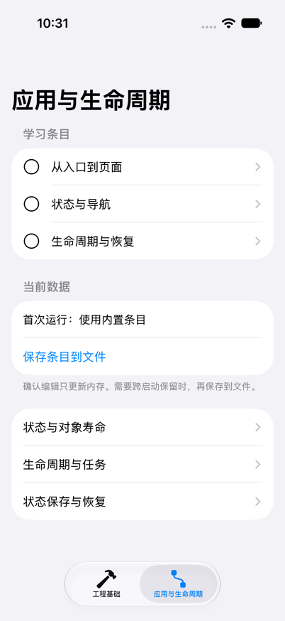

# EngineeringLab｜页面声明与状态身份

本实验观察 SwiftUI 怎样把页面声明连接成持续存在的界面：先阅读 App、Scene 与 View 的声明，再比较输入更新和视图身份改变。列表和详情只是进入、离开内容的场景，重点是状态存储与页面生命周期。

## 运行环境与入口

使用 Xcode 打开 [EngineeringLab.xcodeproj](../EngineeringLab/EngineeringLab.xcodeproj)，选择 EngineeringLab scheme 和具体 iPhone Simulator，Run 后点击“应用与生命周期”标签。Xcode 的窗口、控制台、断点和 Preview 操作沿用已有的[使用教程](project-started.md)。

工程使用 Xcode 27.1、Apple Swift 6.4、Swift 6 language mode、iOS Simulator SDK 27.1，最低 iOS 18.0。应用默认 MainActor 隔离并启用 Approachable Concurrency。无需外部服务；VS Code 可以编辑代码，页面与生命周期需要在 iOS 运行环境观察。

从仓库根目录可用终端构建：

```bash
xcodebuild \
  -project ios/EngineeringLab/EngineeringLab.xcodeproj \
  -scheme EngineeringLab \
  -configuration Debug \
  -sdk iphonesimulator \
  -destination 'generic/platform=iOS Simulator' \
  -derivedDataPath ios/DerivedData \
  build
```

它只构建，不会自动安装、运行和点击应用。

## 从入口到 View 声明

[EngineeringLabApp.swift](../EngineeringLab/EngineeringLab/EngineeringLabApp.swift) 声明应用入口：

```swift
@main
struct EngineeringLabApp: App {
    var body: some Scene {
        WindowGroup {
            LabRootView()
        }
    }
}
```

App 的 body 提供 Scene，WindowGroup 的内容提供根 View。打开 [LabRootView.swift](../EngineeringLab/EngineeringLab/ApplicationLab/LabRootView.swift)，可以看到根内容用 TabView 组织两组实验；“工程基础”继续呈现原 ContentView，“应用与生命周期”呈现 ApplicationLabView。

App 层没有建立条目模型，模型由每份 ApplicationLabView 的 State 保留。这使第二章各页面共享当前窗口的模型，而不是默认共享一个全局对象。

声明页面时，普通属性接收输入，body 组合内容：

```swift
private struct LessonRow: View {
    let title: String
    let isComplete: Bool

    var body: some View {
        Label(title, systemImage: isComplete ? "checkmark.circle.fill" : "circle")
            .foregroundStyle(isComplete ? .green : .primary)
    }
}
```

这个 View 接收两个值，Label 描述内容，modifier 改变前景样式。改变输入后，SwiftUI 可以创建新的 LessonRow 描述值并更新内容。此类型没有局部交互状态；需要状态时，再将其交给 State 存储。

## 输入更新为什么不重置局部状态

从列表进入“状态与对象寿命”，实现见 [StateLifetimeView.swift](../EngineeringLab/EngineeringLab/ApplicationLab/StateLifetimeView.swift)。父级提供输入和身份编号：

```swift
@State private var input = 0
@State private var generation = 0

LifetimeContent(input: input) { retainedProbe = $0 }
    .id(generation)
```

这里省略父级其它成员和布局。input 是子内容收到的数据，generation 显式控制子内容身份。它们可以分别变化，避免把数据更新和状态重建混在一起。

子内容保存计数和对象引用：

```swift
let input: Int
let onRetain: (LifetimeProbe) -> Void
@State private var count = 0
@State private var probe: LifetimeProbe?
```

框架把 count、probe 的存储关联到子内容身份。对象在关联任务中按需建立：

```swift
.task {
    if probe == nil { probe = LifetimeProbe() }
}
```

这项任务没有长时间工作，建立引用后即返回。后续重新出现时，如果同一状态存储中的 probe 已存在，就继续使用。普通 View 值创建不会额外建立用来记录寿命的候选对象。

按顺序观察：

1. 进入后，记下子视图对象 ID A，计数初始为 0。
2. 点击“子视图计数 +1”。
3. 改变“父级输入”。预期子内容接收新输入，计数和对象 ID A 保留。
4. 点击“重建子视图身份”。预期身份编号增加，局部计数为 0，对象变为新的 ID B。

第三步改变输入，第四步改变身份。结果说明 State 依附的是一段身份生命周期，普通内容更新可以沿用它。对象的释放与额外引用继续在[内存实验](state-restoration.md#从状态存储观察对象释放)核对。

## 页面声明中的状态与访问关系

条目模型使用 Observation：

```swift
@MainActor
@Observable
final class LessonStore {
    private(set) var items = LearningItem.samples
    // 修改、加载与保存入口见源码。
}
```

[LessonStore.swift](../EngineeringLab/EngineeringLab/ApplicationLab/LessonStore.swift) 允许页面读取，通过 update 方法修改。ApplicationLabView 中的 `@State private var store = LessonStore()` 保留对象引用；Observable 让依赖属性变化可以推动界面更新；MainActor 约束访问隔离。

详情通过输入接收同一模型，同时声明自己的计数：

```swift
let itemID: String
let store: LessonStore
@State private var visits = 0
```

条目由上层模型持有，visits 由本次详情身份管理。进入“从入口到页面”，增加局部计数并切换完成状态，再返回列表重新进入：预期计数重新为 0，条目完成状态仍在。这与身份实验共同展示局部状态和较长作用域的数据。

编辑场景用来观察父子读写连接。编辑器从条目建立自己的草稿，子控件只接收 Binding：

```swift
@State private var draft: LessonDraft

init(item: LearningItem, onConfirm: @escaping (LessonDraft) -> Void) {
    self.item = item
    self.onConfirm = onConfirm
    self.draft = LessonDraft(note: item.note, isComplete: item.isComplete)
}
```

```swift
DraftFields(note: $draft.note, isComplete: $draft.isComplete)
```

```swift
@Binding var note: String
@Binding var isComplete: Bool
```

这些分别是编辑器的相关声明、子内容调用与子内容成员，完整实现见 [LessonDetailView.swift](../EngineeringLab/EngineeringLab/ApplicationLab/LessonDetailView.swift)。当前 SDK 的 State 使用宏，声明处没有默认值，初始化器提供本次草稿初值。Binding 连接到这份草稿；确认时调用父级操作，取消时结束本次呈现。文件保存由共享模型单独承担。

旧项目若使用 ObservableObject，应对应阅读 StateObject 与 ObservedObject 的拥有和观察职责；当前工程不混用两套模型。需要为 Observable 属性生成 Binding 时可以使用 Bindable，本例编辑器使用的是独立值草稿。

## 生命周期入口附着在哪里

详情把事件放在页面根 Form 上：

```swift
.onAppear { journal.record("详情出现 \(itemID)") }
.onDisappear { journal.record("详情消失 \(itemID)") }
```

它记录的是这份内容出现与消失。共享模型的 update 记录数据变化，LifetimeProbe 的 deinit 记录对象释放；按各自前缀与 ID 区分证据。不要把 body 变成追加事件的入口，否则日志修改状态会干扰界面更新。

任务面板将 `.task(id:)` 放在 Form 的一行上，该行滚出可见区域也可能消失。修饰器附着层次的对照，以及 Scene 事件的接入，集中在[生命周期与任务实验](lifecycle-and-tasks.md)。

## 实际验证

2026-10-31，Xcode 27.1 / Swift 6.4 Debug 构建通过。在 iPhone 17 / iOS 27.0 完成以下实际交互，使用 UI hierarchy 的 hitPoint 点击并检查截图：

| 场景 | 真实观察 |
| --- | --- |
| 原工程基础按钮 | 摘要、local 与资源正常 |
| 详情退出再进入 | 局部计数归 0，共享条目完成状态保留 |
| 草稿取消与确认 | 取消未改正式模型；确认后的笔记进入共享内存 |

下图是当前实验列表，“状态与对象寿命”用于观察本篇的输入更新与身份重建。



身份与对象实验已观察到普通更新保留状态、身份重建重置状态，对应对象 ID 与释放日志见[内存实验记录](state-restoration.md#实际验证与边界)。未验证 Preview、真机、多窗口、其它字号或横屏。页面与对象关系可由本实验观察，系统后台调度与内存压力回收不能由这些操作代替。
