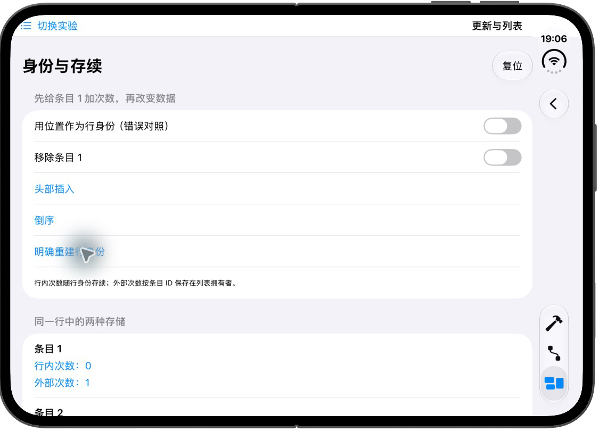

# EngineeringLab｜状态读取、列表身份与滚动

本组从一份 State 开始，再比较读取位置、行身份与滚动目标。它回答“声明和数据接好以后，具体是谁接收变化”。机制见 [第三章更新部分](../../docs/ios/03-ui-rendering-interaction.md#状态怎样经过布局成为画面)和[列表部分](../../docs/ios/03-ui-rendering-interaction.md#列表怎样连接数据行与滚动位置)，运行条件见[第三章入口](swiftui-ui-lab.md)。

源码集中在 [UIUpdatesLabView.swift](../EngineeringLab/EngineeringLab/UILab/UIUpdatesLabView.swift)。进入“更新与列表”后按编号阅读，每个子实验拥有独立状态。

## 从局部状态到绑定

选择“1. 局部状态与绑定”。完整的状态连接只有父级、子级与控件三层：

```swift
struct UIStateBindingView: View {
    @State private var count = 0

    var body: some View {
        Form {
            Section("父级拥有 count") {
                Text("父级读到：\(count)")
                UICountEditor(count: $count)
                Button("复位") { count = 0 }
            }
        }
        .navigationTitle("局部状态与绑定")
    }
}

private struct UICountEditor: View {
    @Binding var count: Int
    var body: some View {
        Stepper("子控件读到：\(count)", value: $count)
    }
}
```

State 声明在父级，`$count` 取得访问该存储的 Binding，子级继续把绑定交给 Stepper。点击加号时，Stepper 写回父级数据源，父级文字和子控件都读取到新值。父级的复位按钮也写同一份源，因此两处一起归零。

先连续加两次，再复位。预期两处从 0 一起变为 2，再一起回到 0。若把子级 Binding 改为一份独立 State，便建立了另一份存储；这时需要明确同步，不能继续预期天然共享。

## 父级传值与子级读取为什么不同

选择“2. 父级传值与子级读取”。UIReadExperimentView 用 State 保留同一 UIReadModel，操作区域只提供修改入口：

```swift
@MainActor @Observable
final class UIReadModel {
    var score = 0
    var message = "尚未改变说明"
}
```

“子级各自读取”中，父区域传模型引用，UIScoreView 和 UIMessageView 在自己的 body 内分别读取 score 和 message。“父级先读取”则由 UIParentReadsView 读取 score，再把整数传给 UIValueScoreView：

```swift
// UIParentReadsView.body 中：
UIValueScoreView(score: model.score)

private struct UIValueScoreView: View {
    let score: Int
    var body: some View { Text("值输入：\(score)") }
}
```

两种方式都能显示分数，但第一种由子级建立可观察属性依赖，第二种由父级建立依赖，再通过普通输入更新子级。按钮 action 中修改属性不等于按钮内容计算订阅全部属性；读取发生的执行位置才是分析依据。

各区域在 Debug 的 body 中调用 `Self._printChanges()`，在控制台按类型名过滤。复位后等待内容稳定，先增加分数，再改变说明。预期分数读取者因 score 改变更新，说明读取者因 message 改变更新；父级传值区域因自己读 score 而参与分数更新。其他输入和环境仍可能触发求值，所以记录原因，不断言绝对次数。

### 条件读取会改变依赖

底部 UIConditionalReadView 同时保存 showsScore，并按它选择当前读取：

```swift
if showsScore {
    Text("当前读取 score：\(model.score)")
} else {
    Text("当前只读取 message：\(model.message)")
}
```

先打开开关、改变说明，再增加分数；随后关闭开关重复操作。预期当前分支实际读取的属性成为依赖。界面显示不变本身不能证明没有 body 求值，需要结合更新原因日志。本例没有在 body 中修改计数器来统计调用，避免观察代码反过来触发更新。

## 行身份为什么会影响局部状态

选择“3. 行身份与移除”。UICounterRow 有行内 count，另有 savedCount Binding，后者连接列表拥有者按条目 ID 保存的字典。正常模式展开业务标识稳定的元素：

```swift
ForEach(visibleItems) { item in
    UICounterRow(title: item.title, savedCount: countBinding(item.id))
}
```

countBinding 用 get/set 访问 `savedCounts[id]`；这与可直接投影的属性不同，所以采用显式 Binding。行内点击写局部 State，外部点击回写字典，二者刻意分开。

操作分四轮，每轮先复位：

1. 稳定身份模式给条目 1 的两种次数各加两次，再头插、倒序。预期两种次数都继续对应条目 1。
2. 打开“用位置作为行身份”，这会结束原行身份；重新给条目 1 加次数，再头插。预期旧位置的行内次数可能出现在新条目 13 下，而外部次数仍由业务 ID 查询。
3. 回稳定模式并复位，给条目 1 两种次数加值，打开“移除条目 1”后再关闭。记录行内次数是否保留，外部次数仍由列表拥有者保存。List 对短暂移除的内部保留可能使局部次数仍然存在，不能把这一步写成必然立即销毁；需要可靠保留的业务状态仍应由行外拥有者保存。

4. 给同一行两种次数加值，再点击“明确重建行身份”。预期局部次数归零，外部次数仍按业务 ID 保留；这轮通过显式身份变化观察重建，不依赖 List 回收时机。

位置模式使用 `enumerated` 的 offset 作 ID，是隔离的错误对照。切换模式会重建行，不能用切换时的清零证明重排行为。复位和明确重建都更新 generation；每行显式身份由当前业务 ID（位置反例中为 offset）与 generation 组成，确保局部状态重建，外部字典仍由拥有者决定是否清空。

## 普通内容与按需内容怎样观察

选择“4. 普通与按需内容”。同一组 120 个固定索引分别放进 VStack 和 LazyVStack，每行高度 60 pt。此处固定范围的整数就是样本身份，不涉及可重排业务数据。

Debug 下 UILazyRow.body 输出 `[UI03 lazy] build`，onAppear 输出 `appear`。这里的 build 表示该次内容求值，**不表示对象初始化或最终绘制**。先使用 LazyVStack 打开，滚到后面，再改普通 VStack 比较。预期普通容器更早准备全部内容，按需容器在滚动中继续准备；框架预取范围和调用次数不作为测试常量。

“重新建立”改变滚动区域身份，可恢复本次观察起点。该实验没有统计内存、复用次数或帧时间，onAppear/onDisappear 也不证明对象释放。

## 滚动目标怎样与数据改变连接

选择“5. 滚动目标与筛选”。外层拥有可选 target，内容容器标记目标布局，滚动容器绑定目标：

```swift
ScrollView {
    LazyVStack(spacing: 8) {
        ForEach(visibleIDs, id: \.self) { id in
            Text("滚动条目 \(id)")
                .frame(maxWidth: .infinity, minHeight: 56)
                .id(id)
        }
    }
    .scrollTargetLayout()
}
.scrollPosition(id: $target, anchor: .top)
```

程序把 target 设为 20 是定位请求；用户滚动又可能让绑定反映新的目标。头插使用新的负向 ID，已有业务身份保持不变。“只看偶数”先筛选输入集合，不在每行临时决定是否生成内容。

先定位 20，记录目标与视口，再头插；随后复位，定位 21，再开启偶数筛选。第一轮目标仍存在，第二轮目标被移除。比较实际绑定与画面，区分定位身份和保持像素偏移；不要为无效目标预先写死框架一定会返回什么值。本例没有实现聊天列表的跟随最新策略。

## 实际验证

2026-11-01 在 iPhone Duo / iOS 27.1 Simulator 对重写后的入口进行了操作：

- State / Binding：连续增加两次，父子显示均为 2；复位后同时为 0。
- 属性读取：修改 score 后分数与父传值区域显示 1；切换到说明后修改 message，说明同步。Debug 日志中，score 对应 UIScoreView、UIParentReadsView、UIValueScoreView，message 对应 UIMessageView、UIConditionalReadView。这里只记录对应操作中看到的读取者，不承诺固定求值次数。
- 稳定 ID：条目 1 的行内与外部次数各为 1，头插后仍属于条目 1。短暂过滤再加入，两个次数仍为 1，说明这次移除没有提供立即结束局部状态的证据。
- 明确重建行身份：条目 1 两种次数各为 1 后重建身份，行内变为 0，外部仍为 1。
- 位置 ID：在同一位置模式内给条目 1 的行内次数加 1，再头插；新条目 13 显示行内 1、外部 0，复现状态跟随位置的反例。



普通 / Lazy 内容的滚动与日志对照、目标 20 / 21 的筛选反馈未在重写后复测；上文为复现步骤与预期分析，不记为运行通过。没有内存、帧时间或真机滚动测量。
