# Xcode 基本使用与调试

本文保留 Xcode 的日常操作：创建或打开工程、运行应用、使用 Preview、查看日志、设置断点、单步和切换构建配置。理解工具链关系时可回查 [iOS 07](../../docs/ios/07-engineering-foundations.md)，安装和 Codex 接入见[环境配置](codex-setup.md)。

当前仓库仅准备原生文档，还没有可打开的股票 App 工程。以下步骤供后续工程建立后使用，创建工程也是操作说明，不表示本次已经执行。

配图保留自 2026-10-30 的 Xcode 27.1 实际操作，画面中的旧工程名、学习摘要按钮和本地库仅用于辨认界面；对应实验工程已删除。菜单、设备、模板字段和代码行号随版本与工程变化，操作时以实际名称、文件和语句为准。

## 创建或打开工程

### 创建新的 iOS App

在欢迎页选择 **Create New Project…**，或从 **File → New → Project…** 进入模板选择。选择适合 iOS 的 App 模板；不同版本也可能从多平台 App 模板选择支持的平台。

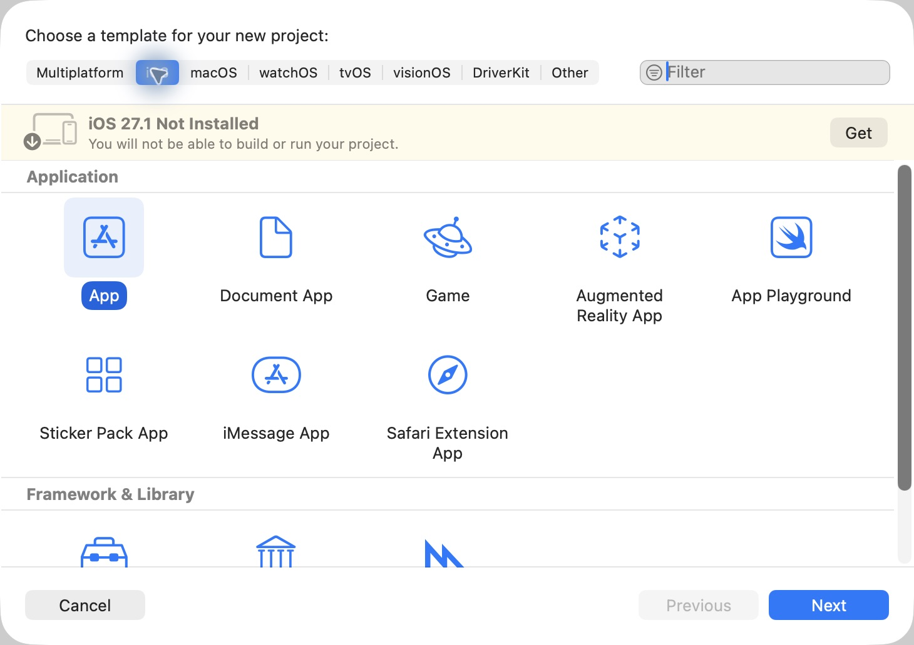

填写 Product Name 和 Organization Identifier，它们参与应用身份与工程命名。若模板提供 Interface、Language 等选项，分别选择 SwiftUI、Swift；Storage 和 Testing System 按实际需要选择，不能从其他教程的截图推断当前模板必有同名选项。不要为认识窗口提前启用无关能力或存储框架。

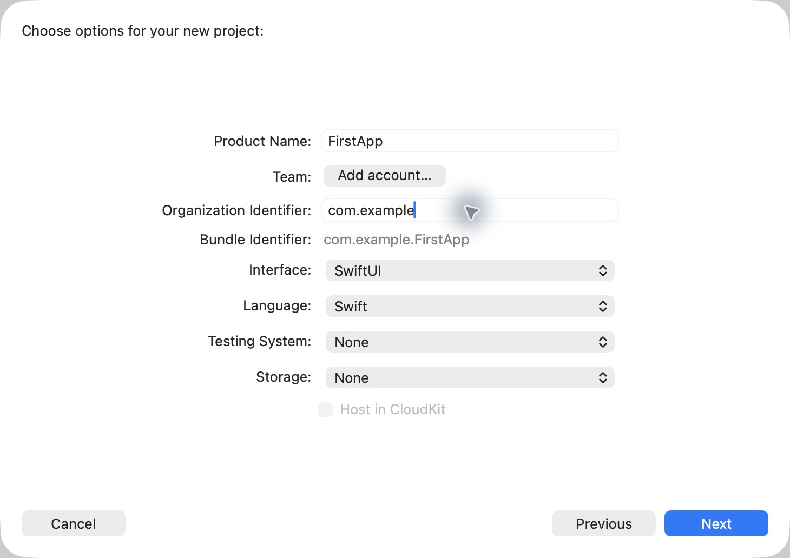

选择保存位置后，检查实际生成的工程目录、应用入口和 target。后续股票工程的名称、最低系统与依赖在建立工程时确定，不由本文示例决定。

### 打开已有工程

从 **File → Open…** 选择实际的 `.xcodeproj`，或按工程说明打开 `.xcworkspace`。工程使用 workspace 组织依赖时遵循其运行入口；不要同时打开同一工程的多个副本来判断修改是否生效。

Swift Package 可以单独打开 `Package.swift`，但能运行什么取决于包声明的产品。应用入口、语言库和命令行程序不是同一种运行目标。

## 认清窗口、菜单与文件

macOS 屏幕顶部的 **Xcode、File、View、Product、Debug** 是菜单栏；窗口中的 Run、Stop、Scheme 和设备是工具栏。教程里的 **View → …** 从屏幕菜单寻找，不在编辑器代码中寻找。

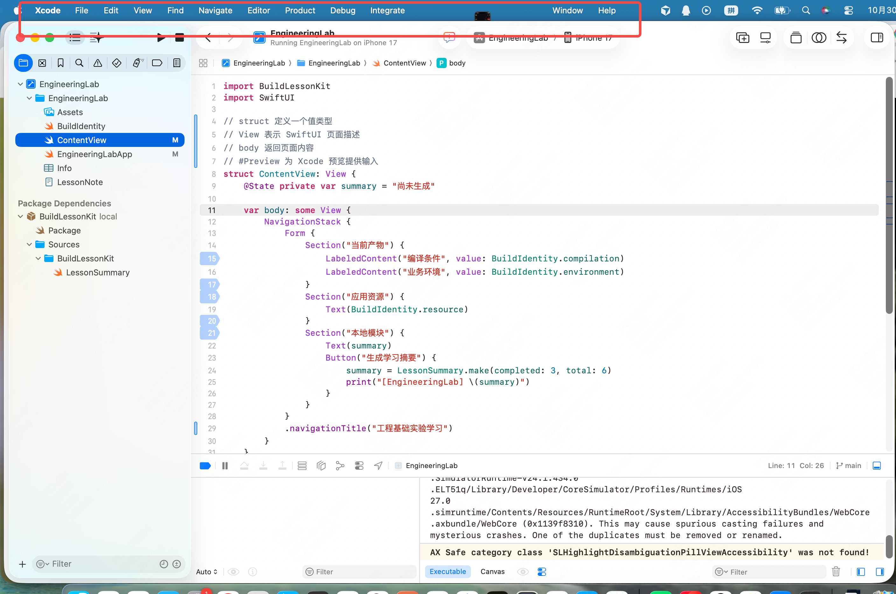

| 区域 | 用途与入口 |
| --- | --- |
| Project navigator | 左侧工程与文件树，`⌘1`；打开源码、资源和依赖 |
| Source editor | 编辑源码；行号附近可设置断点 |
| Debug area | 编辑器下方的调试工具条、变量区与控制台，`⇧⌘Y` 切换 |
| Variables view | 暂停后查看当前栈帧中的参数和变量 |
| Console | 查看进程输出，暂停时也可输入 LLDB 命令 |
| Debug navigator | `⌘7`；观察线程和调用栈 |
| Breakpoint navigator | `⌘8`；查看、启停和删除断点 |
| Report navigator | `⌘9`；查看构建等动作的报告与诊断 |
| Inspector | 右侧所选文件或工程对象的路径、属性和设置 |

图标难以分辨时使用 **View → Navigators → Project / Debug / Breakpoints / Reports**。文件后的 `M` 是版本控制修改标记，不是编译失败。

展开工程节点后，应用源码、资源和 Package Dependencies 可能位于不同位置。目录、target 和 module 的关系见第 07 篇；不要根据文件树中出现某个名字就认定它已经参与当前构建。

Xcode 可能隐藏 `.swift` 等扩展名；选中文件后在 Inspector 查看完整路径。`⇧⌘O` 可以按名称快速打开文件，结果重名时核对所属工程与路径。后续查找入口优先使用实际文件和符号，不依赖截图中的旧行号。

## 选择 Scheme、设备并运行

顶部选择应用的 Scheme，再选择一台具体且兼容的 iPhone Simulator，按 **Product → Run（⌘R）** 或 Run 三角按钮。通用设备条目可能只能构建，不是一台能接收点击的模拟器；设备和 runtime 的准备见环境配置。

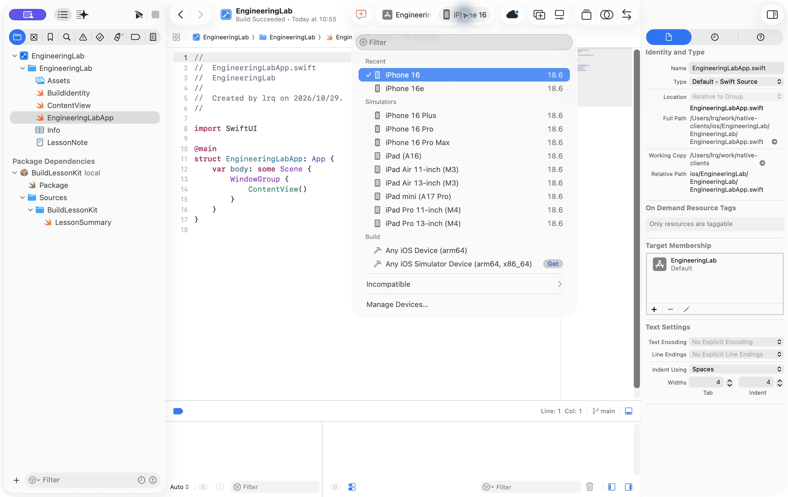

Run 会按当前配置构建、安装并启动应用，检查页面是否出现以及本次操作是否产生预期结果。能够构建、能够启动和功能正确是三个不同观察结果。

| 状态或操作 | 含义 |
| --- | --- |
| Running | 进程运行中，可以交互；调试条通常提供 Pause |
| 断点暂停 | 出现执行位置与停止原因；先检查变量或单步，再 Continue |
| Pause | 暂停同一进程以便观察，并未结束运行 |
| Continue | 恢复当前进程，直到下一次停止条件 |
| Stop，`⌘.` | 结束本次进程；之后需要重新 Run |

应用点击没反应时，先看是否仍停在断点。蓝色断点图形表示设置了断点，执行位置与停止原因才说明当前真正暂停在哪里。

## 修改后怎样看到效果

### 完整运行

保存源码后再次 Run，会构建受影响的部分并启动应用。只在模拟器中重新点开已安装图标，通常仍是原来的安装产物；普通运行进程不会因为磁盘源码修改而自动替换实现。

重新启动会建立新的内存状态，持久化数据可能保留。Xcode 的增量构建与 Flutter 的 hot reload、hot restart 各有边界，不能凭画面相似就认为它们保留同样的状态。

### Preview 与 Canvas

页面有 `#Preview` 声明且依赖能够构建时，打开对应文件，从 **Editor → Canvas** 或提示为 **Show Canvas** 的按钮显示画布；暂停时选择 Resume，按当前版本启动预览。

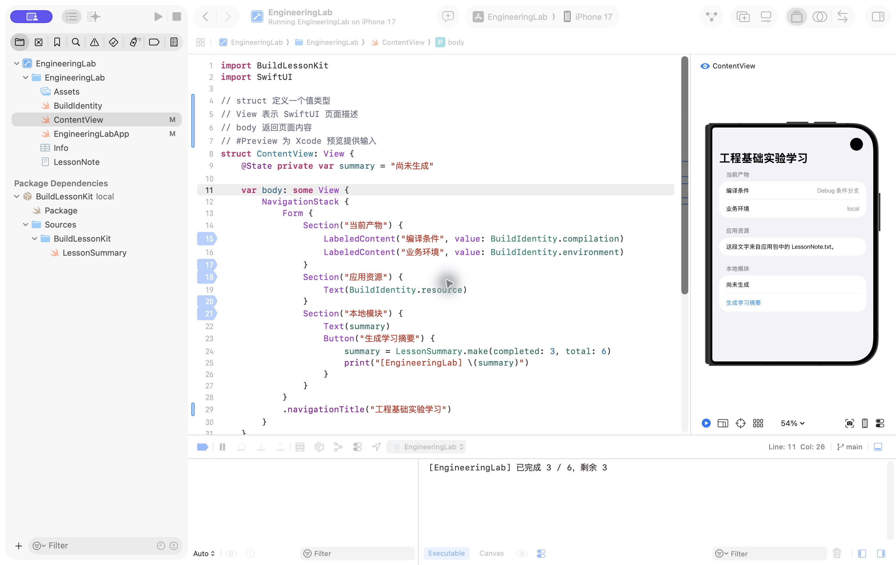

Preview 适合调整局部 UI；代码变化可能重新启动预览，不能依赖任意状态永久保留。检查画布选择的设备与环境，顶部普通 Run 的设备不必与画布相同。

没有更新时先看画布是否暂停、是否有编译错误及预览诊断。安装、登录全流程、前后台和系统能力仍需在对应应用环境验证；预览成功不代表完整应用已验收。

## 查看日志与构建报告

### 找到当前进程的运行输出

从 **View → Debug Area → Show Debug Area** 显示底部区域，再用 **Activate Console** 定位控制台。若界面提供 Executable、Canvas 等上下文，确认正在看本次运行进程，而非另一份预览日志。

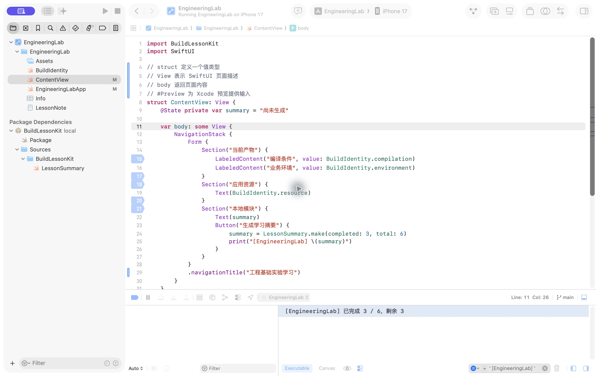

触发实际操作后查找自己的日志前缀。没有输出时依次检查：应用是否暂停、动作是否发生、代码是否进入最新产物、当前控制台是否属于目标进程，以及 Filter 是否隐藏了内容。暂停在日志语句之前时，该条日志尚未产生。

清空控制台只是清空可见输出，不会重新启动进程或重置业务数据。`print` 适合局部观察；正式应用的结构化日志、隐私控制与性能诊断需另行设计。

系统框架警告提供上下文，不能凭黄色背景或某个单词就认定应用崩溃。结合进程是否退出、停止原因、调用栈和复现过程判断；排查系统异常时不要只保留自己的日志过滤条件。

### 构建失败查看 Reports

使用 **View → Navigators → Reports（⌘9）**，选择对应的 Build，显示 **All Messages**，展开失败项。先读第一个相关诊断，再区分源码、依赖、资源和运行条件问题。

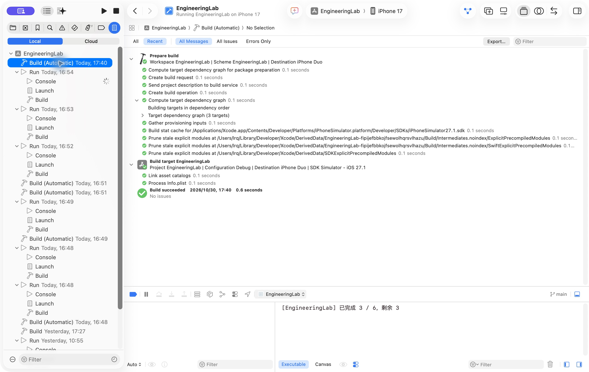

构建报告属于已经发生的动作；当前工具栏选择不能改写历史报告的配置与目的地。运行控制台回答进程输出，构建报告回答编译和处理输入的过程；构建尚未成功时，业务日志可能根本没有执行机会。

## 设置断点并观察执行

先在自己的事件处理或业务调用中选择一条可执行语句，避免一开始把断点放在频繁求值的 `body` 中。记录已有断点状态，只新增本次需要的断点。

1. 点击目标语句左侧行号附近的 gutter，确认出现断点标记。
2. 检查单个断点启用状态和全局断点开关；两者是不同控制。
3. Run 使用适合调试的配置，核对 **Debug executable** 已勾选。
4. 在应用中执行真正会走到这条语句的操作。
5. 回到 Xcode，确认执行位置、文件、栈帧和停止原因。

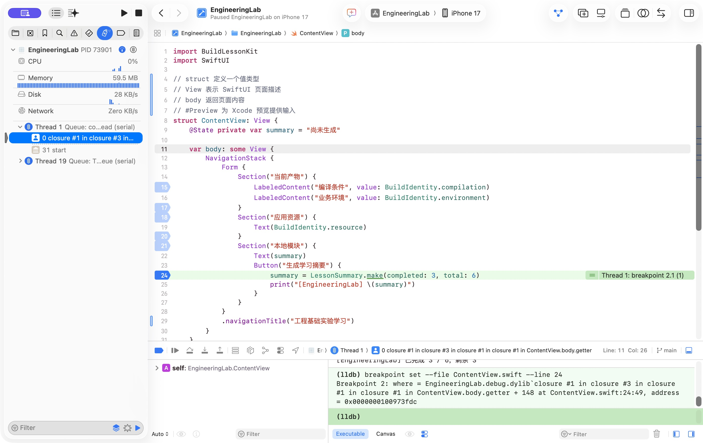

停在调用或赋值语句附近，不代表调用或赋值已经完成。先判断下一步将执行什么，再观察变量；上一次留下的状态不能提前证明本次结果。

| 控制 | 作用 |
| --- | --- |
| Step Over | 在当前层推进，通常不进入被调用函数；其他断点仍可能暂停 |
| Step Into | 尝试进入下一步调用的实现 |
| Step Out | 执行完当前函数并返回调用方；其他停止条件仍可能中断 |
| Continue | 恢复执行，直到下一次停止条件 |

按钮名称可悬停确认，也可从 Debug 菜单查找。单步可能进入编译器生成的访问器或系统实现；此时核对文件与调用栈，也可以在自己的目标语句再放断点，然后 Continue。

### 参数、局部变量与栈帧

`⌘7` 打开 Debug navigator，展开暂停线程并选择目标函数。变量区显示这个栈帧的参数与局部变量；切到调用方后，不应继续期待被调用函数的局部变量仍在当前作用域。

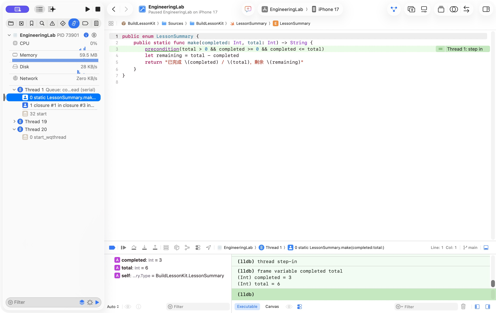

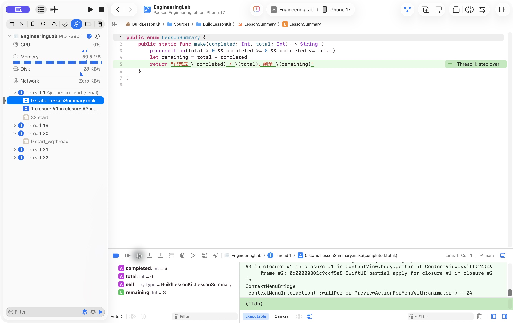

局部量应在完成初始化后读取。单步次数和源码行的对应受生成代码与优化影响，不以“点击固定几次”作为成功条件。

Step Out 返回后也要确认调用方已经接收结果，再 Continue 观察日志与页面。函数返回、状态赋值和屏幕完成绘制是不同阶段。

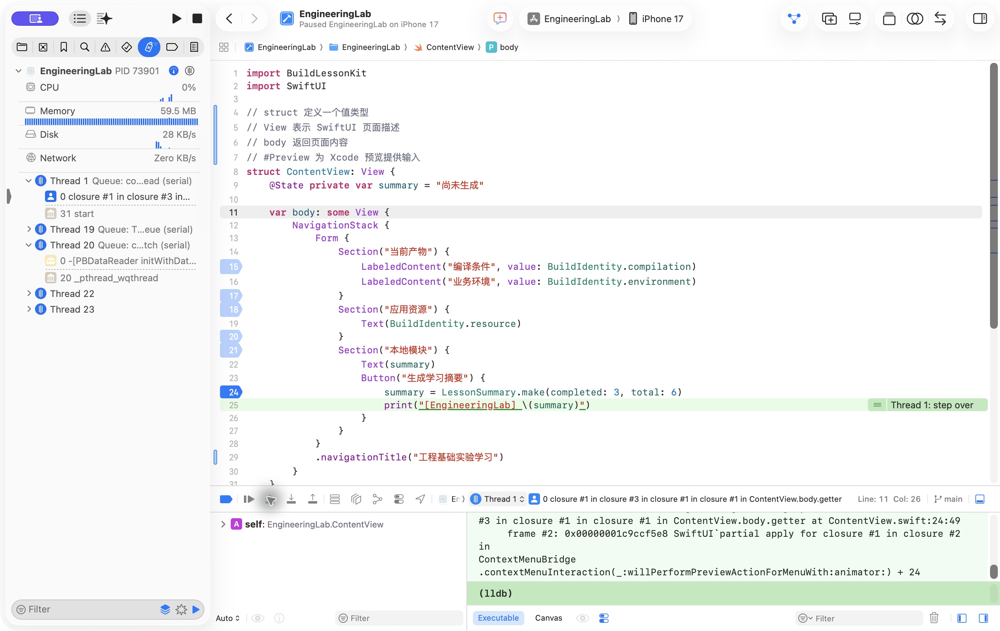

### LLDB 与断点排查

暂停后，控制台的 LLDB 可以补充图形界面观察：

```text
process status
frame variable
bt 8
```

`process status` 查看进程状态，`frame variable` 查看当前帧变量，`bt` 查看调用栈。`po` 会求值表达式，读取简单值前也应确认当前帧；不要随意调用有副作用的业务方法来代替真实交互。

| 现象 | 先检查 |
| --- | --- |
| 断点不命中 | 动作是否触发目标路径、断点与全局开关是否启用、调试器是否附加 |
| 标记未解析 | 代码是否进入加载模块、源码是否匹配产物、位置是否可执行、是否被优化 |
| 变量不可用 | 是否真正暂停、栈帧是否正确、初始化是否完成、是否为优化构建 |
| 点击无响应也没有日志 | 是否停在断点或日志语句前，查看停止原因后 Continue |
| 单步进入系统或生成代码 | 核对文件和栈帧，在自己的目标语句设置断点后继续 |

结束后删除或停用本次断点，恢复之前记录的状态。关闭所有断点不等于删除断点，也不等于修复业务问题。

## Debug、Release 与归档

从 **Product → Scheme → Edit Scheme… → Run → Info** 查看 Build Configuration 和 Debug executable。日常断点观察通常选 Debug；希望观察优化构建时可改为 Release，先记住原值，结束后恢复。

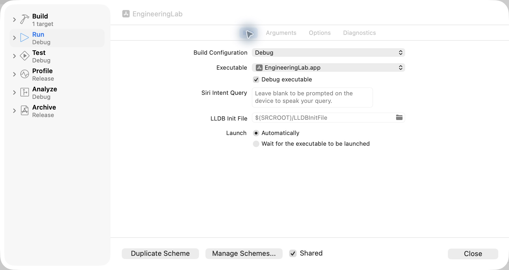

Debug/Release 的名称不自动决定业务环境，也不能替代是否附加调试器的选择。Release 不保证访问生产服务；具体地址和构建条件由应用配置决定。

| 目的 | 入口与结果 |
| --- | --- |
| 构建 | Product → Build，`⌘B`；产生构建结果，不自动代表已安装运行 |
| 运行 | Product → Run，`⌘R`；按 Run 配置在所选目标启动 |
| 归档 | Product → Archive；生成候选归档，随后在 Organizer 处理 |

Run 与 Archive 分别选择配置，查看实际 Scheme，不根据日常 Run 推断归档设置。设备分发还需要适用的目的地、团队、证书、provisioning 和相关能力配置。

归档后在 **Window → Organizer → Archives** 查看记录。`.xcarchive` 不是已导出的 `.ipa`，本教程也不执行归档、导出、签名配置或发布。

## 资料与验证边界

本篇从原有工具教程整理，保留 Xcode 27.1 的历史操作截图和通用步骤，移除了旧实验源码依赖。2026-11-10 本次仅检查文档、配图和链接，未新建应用、重做截图中的操作或验证新工程。

后续使用时核对实际 Xcode 版本、工程入口、配置、设备和依赖；新应用的构建、调试、模拟器与真机结果需分别记录。能够阅读教程与能够独立操作也分别判断。

## 官方参考

- [Apple：Creating an Xcode project for an app](https://developer.apple.com/documentation/xcode/creating-an-xcode-project-for-an-app)
- [Apple：Running your app on simulated or physical devices](https://developer.apple.com/documentation/xcode/running-your-app-on-simulated-or-physical-devices)
- [Apple：Setting breakpoints to pause your running app](https://developer.apple.com/documentation/xcode/setting-breakpoints-to-pause-your-running-app)
- [Apple：Stepping through code and inspecting variables to isolate bugs](https://developer.apple.com/documentation/xcode/stepping-through-code-and-inspecting-variables-to-isolate-bugs)
- [Apple：Previews in Xcode](https://developer.apple.com/documentation/swiftui/previews-in-xcode)
- [Apple：Customizing the build schemes for a project](https://developer.apple.com/documentation/xcode/customizing-the-build-schemes-for-a-project)
- [Apple：Testing a release build](https://developer.apple.com/documentation/xcode/testing-a-release-build)
